# 应用初始化与数据库迁移

<cite>
**本文引用的文件**
- [main.py](file://src/personal_ai_life_os/main.py)
- [config.py](file://src/personal_ai_life_os/config.py)
- [db.py](file://src/personal_ai_life_os/db.py)
- [env.py](file://migrations/env.py)
- [alembic.ini](file://alembic.ini)
- [health.py](file://src/personal_ai_life_os/api/routes/health.py)
- [metrics.py](file://src/personal_ai_life_os/api/routes/metrics.py)
- [jobs.py](file://src/personal_ai_life_os/services/jobs.py)
- [backup-production.sh](file://scripts/backup-production.sh)
- [restore-production.sh](file://scripts/restore-production.sh)
- [verify_database_restore.py](file://scripts/verify_database_restore.py)
- [backup-restore.md](file://docs/operations/backup-restore.md)
</cite>

## 目录
1. [引言](#引言)
2. [项目结构](#项目结构)
3. [核心组件](#核心组件)
4. [架构总览](#架构总览)
5. [详细组件分析](#详细组件分析)
6. [依赖关系分析](#依赖关系分析)
7. [性能与可观测性](#性能与可观测性)
8. [生产环境初始化流程](#生产环境初始化流程)
9. [异常处理、优雅关闭与日志记录](#异常处理优雅关闭与日志记录)
10. [数据库备份与恢复](#数据库备份与恢复)
11. [排错指南](#排错指南)
12. [结论](#结论)

## 引言
本文面向 Personal-AI-Life-OS 的运维人员和后端开发者，系统性说明该应用在启动阶段的初始化行为、数据库连接与迁移流程、健康检查机制、后台工作进程在 worker 模式下的执行方式、数据备份与恢复策略，以及运行期监控指标。文档强调生产环境的硬性约束：自动建表需关闭、使用数据库驱动的后台任务、外部对象存储和独立的删除日志桶，并基于源代码路径提供可追溯的分析。

## 项目结构
该应用采用 FastAPI 作为 Web 框架，使用 SQLAlchemy 管理数据访问，Alembic 负责迁移，同时通过线程调度后台任务（包括 OCR、模型生成任务和定时调度）。配置集中由 Pydantic Settings 加载；运行时将引擎、会话工厂、对象存储等注入到 FastAPI state；健康检查和指标分别暴露独立路由；生产脚本通过 Docker Compose 配合 PostgreSQL、S3 兼容对象存储完成部署。

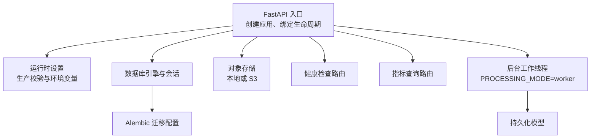

**图示来源**
- [main.py:20-80](file://src/personal_ai_life_os/main.py#L20-L80)
- [main.py:201-315](file://src/personal_ai_life_os/main.py#L201-L315)
- [config.py:1-132](file://src/personal_ai_life_os/config.py#L1-L132)
- [db.py:1-75](file://src/personal_ai_life_os/db.py#L1-L75)

**章节来源**
- [main.py:20-80](file://src/personal_ai_life_os/main.py#L20-L80)
- [config.py:1-132](file://src/personal_ai_life_os/config.py#L1-L132)

## 核心组件
- **应用入口与生命周期**：FastAPI lifespan 中执行依赖启动、Schema 同步、搜索索引初始化、删除墓碑回放、桌面子系统启动以及 worker 调度。
- **配置系统**：Settings 根据环境变量构建配置，并在 production 模式下执行严格安全校验。
- **数据库层**：封装 SQLite/PostgreSQL 引擎创建、外键、WAL 模式、连接探测以及无自动刷新的会话工厂。
- **健康与就绪检查**：`/health` 返回轻量存活信息；`/ready` 验证数据库连通性。
- **后台任务系统**：支持 `inline` 与 `worker` 两种处理模式；worker 模式下启动数据库驱动的任务领取与执行循环。
- **指标与审计**：内存中最近请求采样、导入状态、作业队列状态、外部模型调用统计与估算成本。

**章节来源**
- [main.py:40-120](file://src/personal_ai_life_os/main.py#L40-L120)
- [config.py:10-132](file://src/personal_ai_life_os/config.py#L10-L132)
- [db.py:1-75](file://src/personal_ai_life_os/db.py#L1-L75)
- [health.py:1-27](file://src/personal_ai_life_os/api/routes/health.py#L1-L27)
- [metrics.py:1-129](file://src/personal_ai_life_os/api/routes/metrics.py#L1-L129)

## 架构总览
应用启动时先创建数据库引擎和会话工厂，再按配置决定是否自动建表；随后初始化搜索索引和删除回放逻辑；当运行在 worker 模式时启动两条后台线程：任务执行线程与定时调度线程。所有业务路由挂载在 `/api/v1` 下，并通过中间件实现速率限制、CORS 和安全响应头。

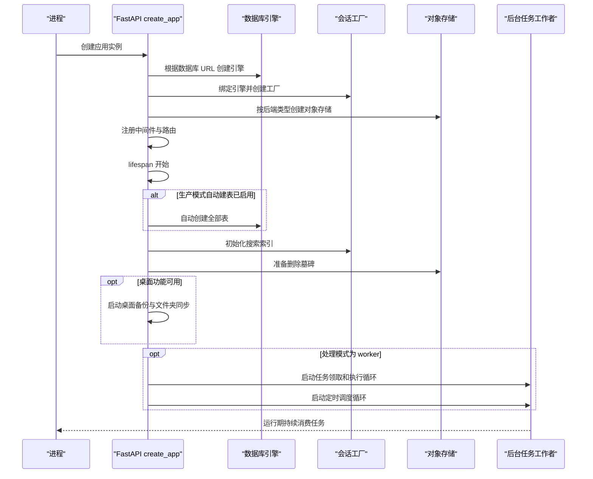

**图示来源**
- [main.py:40-120](file://src/personal_ai_life_os/main.py#L40-L120)
- [main.py:201-315](file://src/personal_ai_life_os/main.py#L201-L315)

**章节来源**
- [main.py:40-120](file://src/personal_ai_life_os/main.py#L40-L120)

## 详细组件分析

### 数据库连接池、会话管理与隔离级别
- **SQLite**：禁止跨线程共享参数被禁用，连接事件打开外键约束；桌面环境额外启用 WAL 提升并发写入能力。非 SQLite 连接默认开启 `pool_pre_ping`，用于连接健康探测。
- **会话工厂**：禁用自动 flush 和提交后过期，避免隐式副作用。请求通过依赖获取会话，并由框架上下文管理生命周期。
- **事务隔离级别**：源码没有显式设置事务隔离级别；若需要强一致语义（如 PostGIS 或多事务并发），应在连接字符串或引擎参数中补充相应设置。当前实现以 SQLAlchemy ORM 默认隔离为准。
- **类型增强**：UTCDateTime 装饰器保证持久化和读取时间带时区；SQLite 缺失时区时自动统一转换为 UTC。

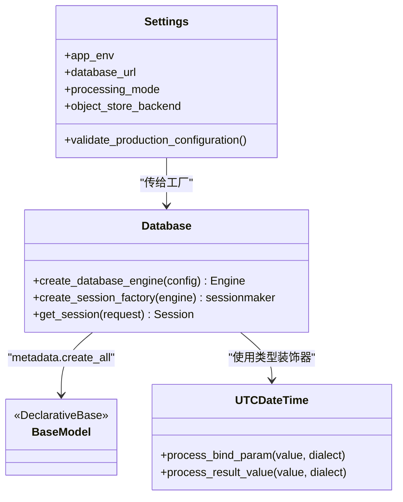

**图示来源**
- [config.py:10-132](file://src/personal_ai_life_os/config.py#L10-L132)
- [db.py:1-75](file://src/personal_ai_life_os/db.py#L1-L75)

**章节来源**
- [db.py:1-75](file://src/personal_ai_life_os/db.py#L1-L75)
- [config.py:10-132](file://src/personal_ai_life_os/config.py#L10-L132)

### Alembic 迁移流程与 Schema 同步
- **迁移脚本位置**：根级 `migrations/env.py` 从应用的 Settings 动态读取 `database_url`，并复用应用的 SQLAlchemy Base 元数据。
- **对象过滤**：排除全表搜索表及其临时副本、后缀为 `_trgm` 的索引，避免迁移工具把只读辅助索引当作用户变更。
- **在线与离线模式**：在线模式创建引擎、连接并进行事务包装迁移；离线模式直接传入 SQL 文本进行迁移。
- **与自动建表的关系**：生产环境要求 `auto_create_schema=false`，必须由 Alembic 显式维护迁移；开发或测试环境中允许应用启动时自动建表。

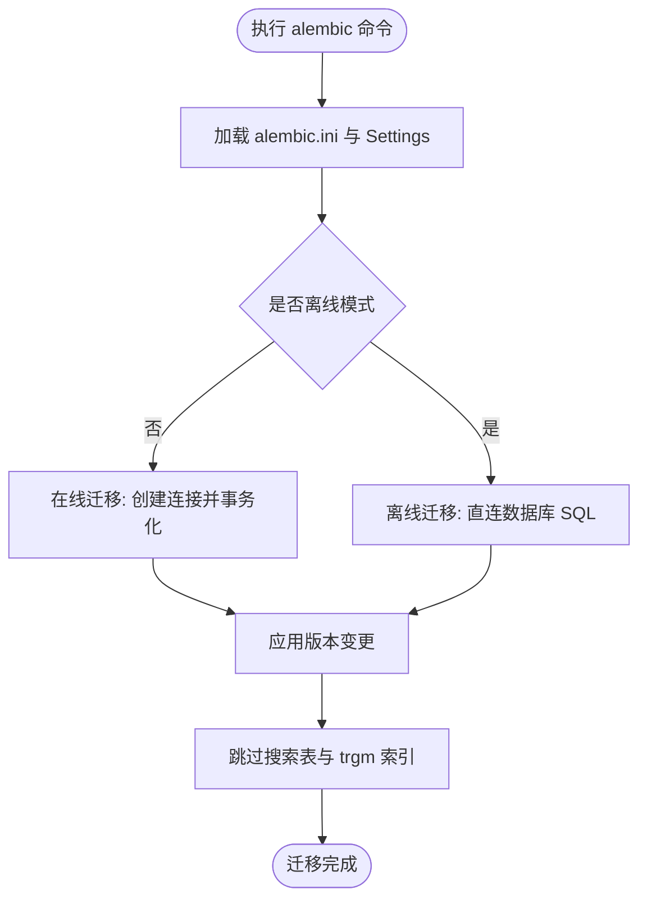

**图示来源**
- [env.py:1-59](file://migrations/env.py#L1-L59)
- [alembic.ini:1-39](file://alembic.ini#L1-L39)
- [config.py:10-132](file://src/personal_ai_life_os/config.py#L10-L132)

**章节来源**
- [env.py:1-59](file://migrations/env.py#L1-L59)
- [alembic.ini:1-39](file://alembic.ini#L1-L39)
- [config.py:80-132](file://src/personal_ai_life_os/config.py#L80-L132)

### 健康检查与服务就绪端点
- **存活检查 `/health`**：不访问数据库，仅返回服务名和健康状态，适合负载均衡器的快速存活探测。
- **就绪检查 `/ready`**：通过 SQLAlchemy 执行 `SELECT 1` 验证数据库可用；异常时返回 503，并隐藏具体数据库细节，只提供错误码和友好消息。
- **局限性**：当前就绪检查未覆盖对象存储连接、磁盘空间或第三方模型 API 可用性；可在扩展中增加对象存储列举或删除权限检查、磁盘配额检查及关键外部依赖 Ping。

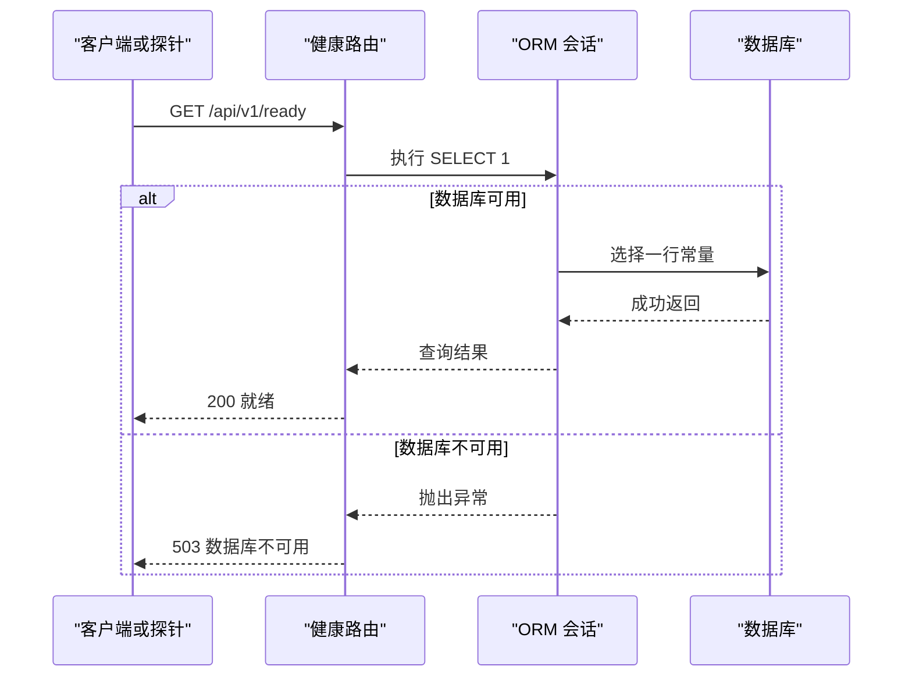

**图示来源**
- [health.py:1-27](file://src/personal_ai_life_os/api/routes/health.py#L1-L27)

**章节来源**
- [health.py:1-27](file://src/personal_ai_life_os/api/routes/health.py#L1-L27)

### 后台任务与 worker 模式
- **处理模式**：`processing_mode` 支持 `inline` 与 `worker`；生产环境强制要求 `worker`，以保证任务具备幂等、可续跑和重试能力。
- **生命周期中的 worker 启动**：`lifespan` 启动名为 `lifeos-background-worker` 和 `lifeos-schedule-worker` 的守护线程；停止时通过事件标志关闭，并按租约时长追加超时等待，最后销毁引擎。
- **任务领取机制**：`_claim` 在会话中选取最早的可执行或租约过期的任务；PostgreSQL 使用 `FOR UPDATE SKIP LOCKED` 避免多 worker 竞争相同任务；任务更新为运行态并设置过期时间。
- **OCR 处理流程**：从对象存储读取图片，调用照片解析模块提取文字，然后更新源项文本内容与 OCR 状态；失败路径写回失败状态、取消同步或降级周度审查草稿。
- **预算与计费**：模型相关失败的作业可能写入 `ModelRun`，记录目的、模型、代价估算与失败原因。

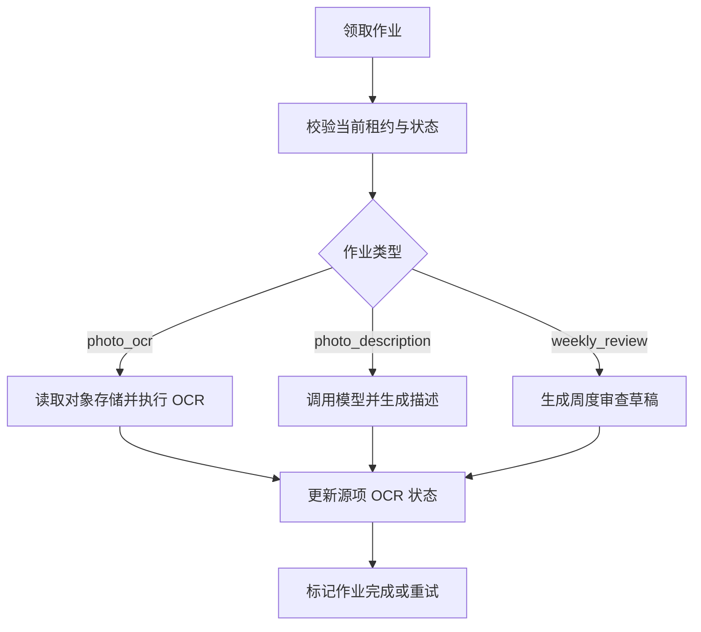

**图示来源**
- [main.py:70-120](file://src/personal_ai_life_os/main.py#L70-L120)
- [jobs.py:200-450](file://src/personal_ai_life_os/services/jobs.py#L200-L450)

**章节来源**
- [main.py:60-120](file://src/personal_ai_life_os/main.py#L60-L120)
- [jobs.py:1-200](file://src/personal_ai_life_os/services/jobs.py#L1-L200)
- [jobs.py:200-450](file://src/personal_ai_life_os/services/jobs.py#L200-L450)
- [config.py:10-80](file://src/personal_ai_life_os/config.py#L10-L80)

### 应用异常处理与安全头
- **HTTP 异常**：统一包装为包含错误码的 JSON；若上层 detail 不是结构化字典，则替换为标准内部错误格式。
- **请求校验异常**：将所有验证问题转换为扁平 issue 列表，便于前端展示。
- **未捕获异常**：记录错误名称并返回 500；不直接透传异常详情，避免敏感信息泄露。
- **安全响应头**：设置禁止类型嗅探、禁止帧嵌套、禁用引用策略，以及严格的 Content-Security-Policy。

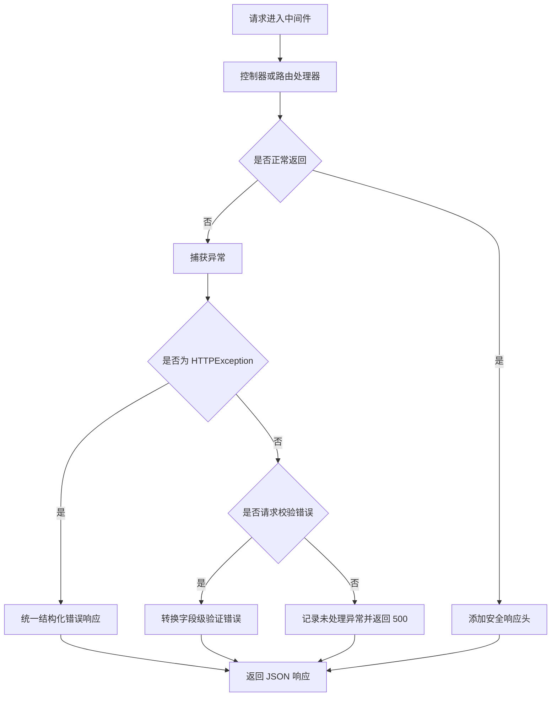

**图示来源**
- [main.py:220-315](file://src/personal_ai_life_os/main.py#L220-L315)

**章节来源**
- [main.py:201-315](file://src/personal_ai_life_os/main.py#L201-L315)

## 依赖关系分析

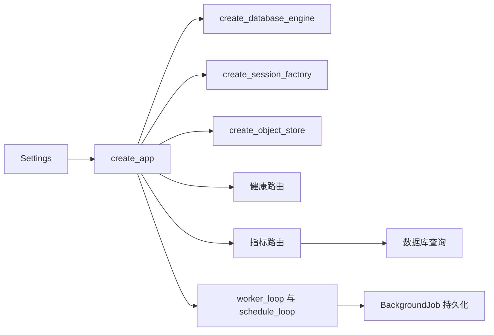

**图示来源**
- [main.py:20-120](file://src/personal_ai_life_os/main.py#L20-L120)
- [db.py:1-75](file://src/personal_ai_life_os/db.py#L1-L75)
- [metrics.py:1-129](file://src/personal_ai_life_os/api/routes/metrics.py#L1-L129)

**章节来源**
- [main.py:20-120](file://src/personal_ai_life_os/main.py#L20-L120)

## 性能与可观测性
- **请求延迟采样**：中间件记录最近最多 1000 条带时间戳、毫秒延迟和状态码的请求样本，用于计算 P95 延迟和 5xx 比例。
- **作业与导入指标**：聚合 queued/running/failed 作业数、最旧队列年龄、24 小时失败数，以及正在处理的导入数量。
- **外部模型观测**：统计模型调用次数、失败次数、预算回归与超出次数，累计输入输出 token 和估算美元成本；区分周度审查与图片描述用途。
- **删除生命周期观测**：统计未完成的删除墓碑数、最旧未完成任务年龄以及删除耗时 P95。
- **认证保护**：`/metrics` 必须携带正确的 `Metrics-Token`；未启用或令牌无效时返回特定错误码。

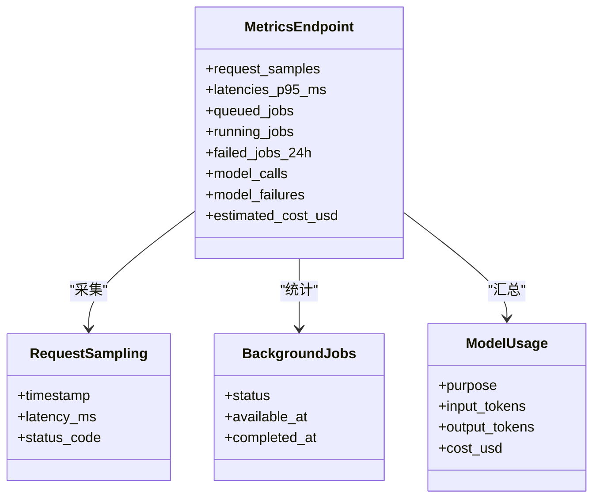

**图示来源**
- [metrics.py:1-129](file://src/personal_ai_life_os/api/routes/metrics.py#L1-L129)
- [main.py:201-315](file://src/personal_ai_life_os/main.py#L201-L315)

**章节来源**
- [metrics.py:1-129](file://src/personal_ai_life_os/api/routes/metrics.py#L1-L129)
- [main.py:201-315](file://src/personal_ai_life_os/main.py#L201-L315)

## 生产环境初始化流程
生产启动前，应通过环境变量正确设置数据库、对象存储、指标令牌、CORS 源和密钥。应用启动顺序如下：

1. 加载 Settings，执行生产环境校验；校验失败直接拒绝启动。
2. 创建数据库引擎和会话工厂。
3. 在 development/test 模式可自动建表；production 必须关闭自动建表。
4. 初始化 SQLite 或 Postgres 全文搜索索引。
5. 重放删除墓碑，使被逻辑删除且对象已删除的数据保持一致。
6. 可选启动桌面备份与文件夹同步线程。
7. 若 `PROCESSING_MODE=worker`，启动后台任务工作者和定时调度器。
8. 返回 FastAPI 实例并持续处理请求。

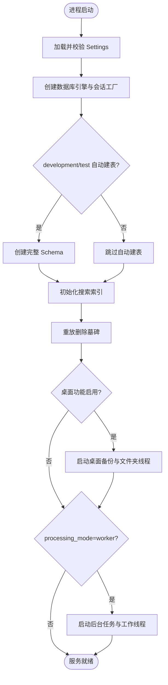

**图示来源**
- [main.py:40-120](file://src/personal_ai_life_os/main.py#L40-L120)
- [config.py:40-132](file://src/personal_ai_life_os/config.py#L40-L132)

**章节来源**
- [main.py:40-120](file://src/personal_ai_life_os/main.py#L40-L120)
- [config.py:40-132](file://src/personal_ai_life_os/config.py#L40-L132)

## 异常处理、优雅关闭与日志记录
- **统一错误格式**：HTTP 异常、请求校验异常和未处理异常都有统一的错误结构体，降低前端处理复杂度。
- **请求采样**：即使发生异常也会记录错误延迟，但不会把敏感异常堆栈放入响应体。
- **优雅关闭**：lifespan 的 finally 块依次触发 worker 和调度器停止事件，随后按 `worker_lease_seconds` 给足退出缓冲时间；最后 join 各线程并调用引擎 dispose。
- **日志目标**：应用日志命名空间为 `personal_ai_life_os`；Alembic 日志等级设置为 WARN/INFO；数据库引擎日志也设为 WARN，以减少大量 SQL 输出对性能的干扰。

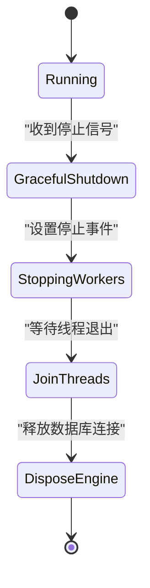

**图示来源**
- [main.py:60-120](file://src/personal_ai_life_os/main.py#L60-L120)
- [alembic.ini:1-39](file://alembic.ini#L1-L39)
- [main.py:220-315](file://src/personal_ai_life_os/main.py#L220-L315)

**章节来源**
- [main.py:60-120](file://src/personal_ai_life_os/main.py#L60-L120)
- [main.py:201-315](file://src/personal_ai_life_os/main.py#L201-L315)
- [alembic.ini:1-39](file://alembic.ini#L1-L39)

## 数据库备份与恢复
- **备份脚本**：从生产 Compose 环境执行 pg_dump，导出自定义格式数据库，并同步主对象桶内容到独立备份桶；生成包含备份 ID、创建时间与关联存储桶的 manifest。
- **恢复脚本**：校验备份 ID 格式和目标桶安全性；确认备份不包含冲突的删除日志后，暂停对外服务，恢复对象存储，清理现有库并重载 dump，最终重启整个服务栈。
- **恢复后验证**：先确认 `/api/v1/ready`；使用合成账号验证时间线和归档；验证已知被删除账号、源和对象前缀不再可读写；检查删除重建日志和迁移日志。
- **交互式演练**：`verify_database_restore.py` 创建临时数据库、执行快照恢复、验证快照之后删除的数据确实消失，而保留的对象仍然可读。
- **联合恢复演练**：参考操作文档中的联合备份恢复流程，可用于模拟主存储与数据库同时丢失后的重建。

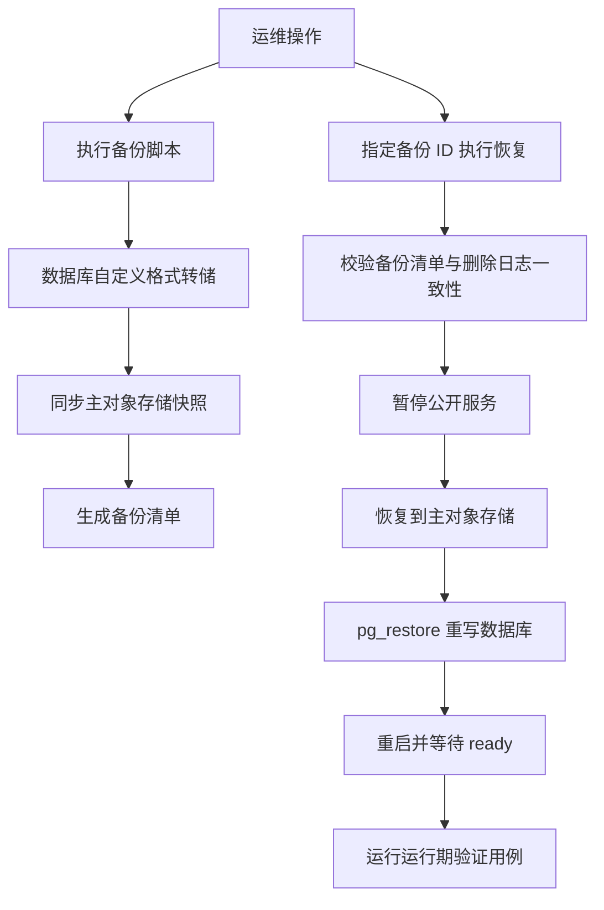

**图示来源**
- [backup-production.sh:1-55](file://scripts/backup-production.sh#L1-L55)
- [restore-production.sh:1-63](file://scripts/restore-production.sh#L1-L63)
- [verify_database_restore.py:1-100](file://scripts/verify_database_restore.py#L1-L100)
- [backup-restore.md:1-33](file://docs/operations/backup-restore.md#L1-L33)

**章节来源**
- [backup-production.sh:1-55](file://scripts/backup-production.sh#L1-L55)
- [restore-production.sh:1-63](file://scripts/restore-production.sh#L1-L63)
- [verify_database_restore.py:1-100](file://scripts/verify_database_restore.py#L1-L100)
- [backup-restore.md:1-33](file://docs/operations/backup-restore.md#L1-L33)

## 排错指南
- **生产配置拒绝启动**：检查以下必填项和约束：唯一访问令牌长度、关闭自动建表、强制 worker 模式、关闭开放注册、仅 HTTPS 域名 CORS、至少 32 位 metrics token、S3 后端与对象桶、独立删除日志桶、OpenAI 密钥与定价披露。
- **健康检查正常但就绪检查失败**：通常意味着数据库连接不可用；检查 `DATABASE_URL`、数据库服务状态、密码、端口以及连接池探测是否启用。
- **worker 未处理任务**：确认 `PROCESSING_MODE=worker`；检查 `WORKER_POLL_INTERVAL_SECONDS` 与 `WORKER_LEASE_SECONDS`；查看后台作业状态、租约是否过期、任务是否达到最大尝试次数。
- **OCR 失败**：确认源项未删除、源连接处于活跃状态、对象存储可下载原图；失败会写回 OCR 状态或导致同步任务部分失败。
- **删除后数据仍存在**：确认删除墓碑已成功回放；恢复后首次启动会重放 delete tombstones，随后对象才会真正消失。
- **恢复不一致**：核对备份 manifest 中的删除日志桶是否与当前部署一致；不同环境之间不要混用独立删除日志。

**章节来源**
- [config.py:40-132](file://src/personal_ai_life_os/config.py#L40-L132)
- [health.py:1-27](file://src/personal_ai_life_os/api/routes/health.py#L1-L27)
- [jobs.py:200-450](file://src/personal_ai_life_os/services/jobs.py#L200-L450)
- [verify_database_restore.py:1-100](file://scripts/verify_database_restore.py#L1-L100)
- [backup-restore.md:15-33](file://docs/operations/backup-restore.md#L15-L33)

## 结论
Personal-AI-Life-OS 的生产初始化是一个围绕“明确配置、显式迁移、持久化任务、对象存储与删除日志”的闭环。应用启动阶段优先保证数据库、搜索索引、删除回放和 worker 线程的稳定性；健康检查提供基础存活与就绪判定；指标端点汇总请求、作业、模型调用和删除生命周期；备份与恢复脚本将数据库、对象与删除日志纳入统一的恢复边界。对于分布式追踪与 APM 集成，当前仓库未提供专用 exporter 或 tracer 集成；可将现有指标采样作为短期指标源，并在此基础上接入外部监控系统。