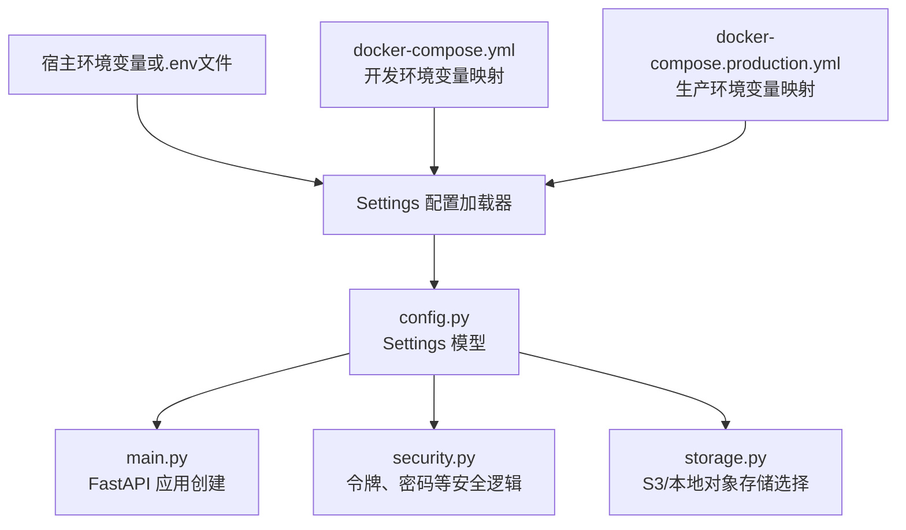
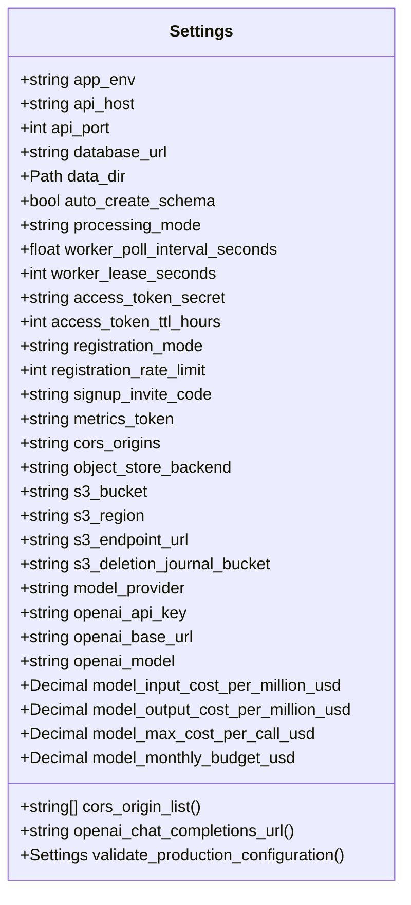
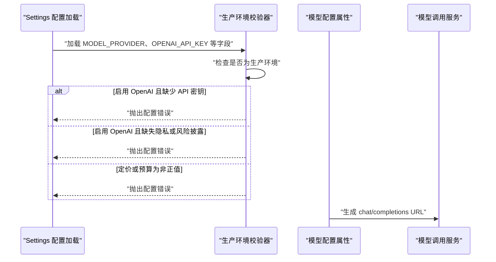
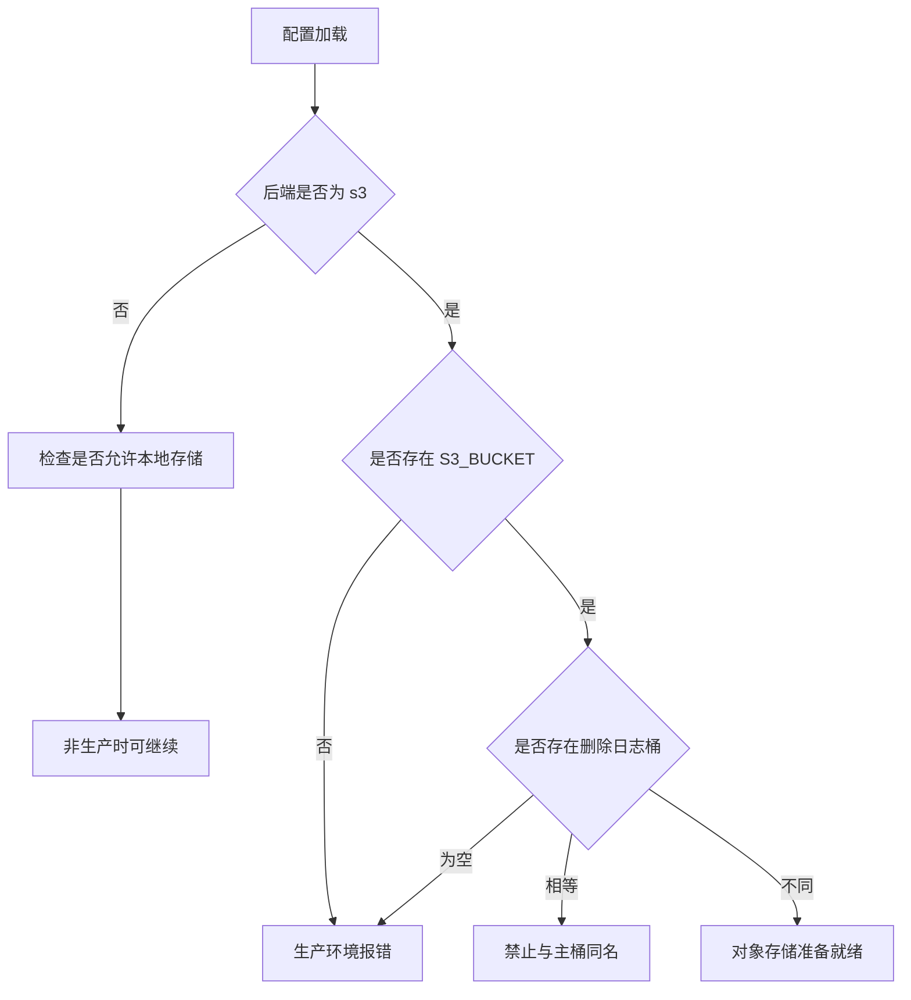
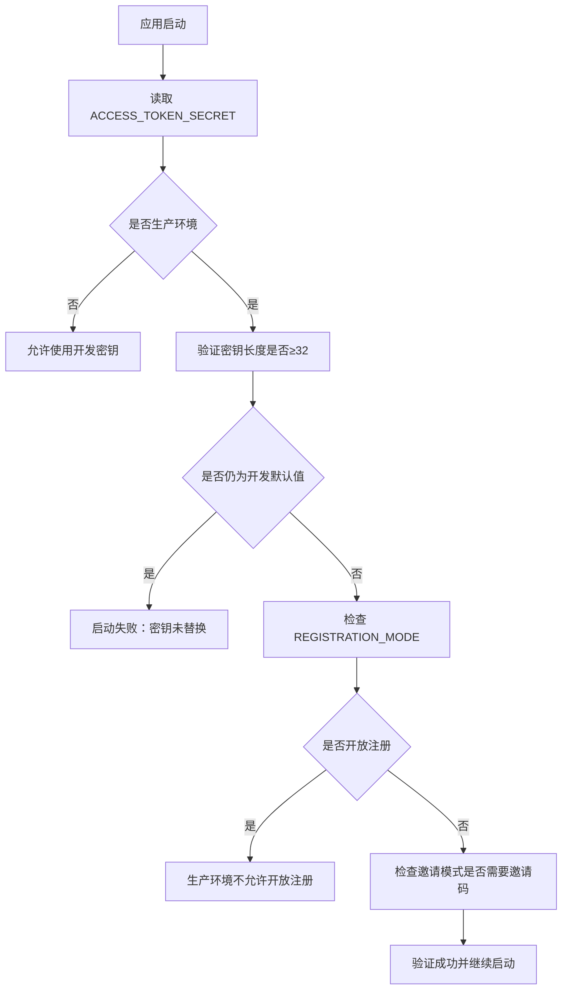
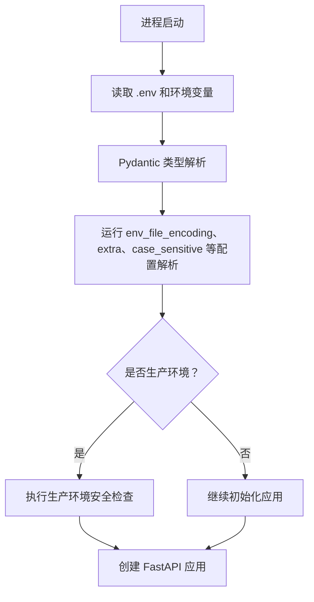
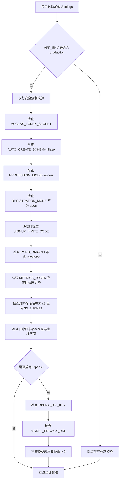

# 环境变量与敏感配置

<cite>
**本文引用的文件**   
- [config.py](file://src/personal_ai_life_os/config.py)
- [main.py](file://src/personal_ai_life_os/main.py)
- [security.md](file://SECURITY.md)
- [pyproject.toml](file://pyproject.toml)
- [docker-compose.yml](file://docker-compose.yml)
- [docker-compose.production.yml](file://docker-compose.production.yml)
- [test_config.py](file://tests/test_config.py)
</cite>

## 目录
1. [简介](#简介)
2. [项目结构中的配置边界](#项目结构中的配置边界)
3. [运行时配置模型总览](#运行时配置模型总览)
4. [必需环境变量的完整分类参考](#必需环境变量的完整分类参考)
5. [模型供应商配置：MODEL_PROVIDER 与 OPENAI_* 系列](#模型供应商配置model_provider-与-openai_-系列)
6. [对象存储连接配置：S3_* 系列](#对象存储连接配置s3_-系列)
7. [认证、注册与安全密钥管理](#认证注册与安全密钥管理)
8. [生产环境安全最佳实践](#生产环境安全最佳实践)
9. [配置加载、类型校验与热重载机制](#配置加载类型校验与热重载机制)
10. [调试模式与诊断输出控制](#调试模式与诊断输出控制)
11. [常见配置错误排查](#常见配置错误排查)
12. [配置决策流程图](#配置决策流程图)
13. [结论](#结论)

## 简介
本文面向运维人员、部署工程师和后端开发者，提供 Personal AI Life OS 中所有环境变量和敏感配置的完整说明。它不重复业务接口文档，而是聚焦于系统启动前“如何安全地注入配置”，以及系统在应用启动时如何验证这些配置是否满足运行要求。

核心原则：
- 配置以 Python 类型安全的 Pydantic Settings 模型为主入口。
- Docker Compose 负责在开发和生产环境中把外部变量映射到服务进程。
- `config.py` 中的 `validate_production_configuration` 是生产环境安全的最终守门人。
- 密钥不应进入源代码或常规日志，应通过环境变量或受管理的机密系统注入。

**章节来源**
- [config.py:1-132](file://src/personal_ai_life_os/config.py#L1-L132)
- [security.md:1-13](file://SECURITY.md#L1-L13)

## 项目结构中的配置边界
配置文件本身集中在 `src/personal_ai_life_os/config.py`，而实际运行时环境变量则主要定义在两个 Docker Compose 文件中：
- `docker-compose.yml`：面向本地开发和测试。
- `docker-compose.production.yml`：面向生产容器编排。

**图示来源**
- [config.py:14-132](file://src/personal_ai_life_os/config.py#L14-L132)
- [docker-compose.yml:10-50](file://docker-compose.yml#L10-L50)
- [docker-compose.production.yml:28-85](file://docker-compose.production.yml#L28-L85)

**章节来源**
- [config.py:1-132](file://src/personal_ai_life_os/config.py#L1-L132)
- [docker-compose.yml:1-78](file://docker-compose.yml#L1-L78)
- [docker-compose.production.yml:1-101](file://docker-compose.production.yml#L1-L101)
- [main.py:1-100](file://src/personal_ai_life_os/main.py#L1-L100)

## 运行时配置模型总览
`Settings` 类定义了全部支持的运行时字段。它不是普通字典，而是一个带类型约束、默认值和校验规则的 Pydantic 设置模型。

关键特点如下：
- 支持从 `.env` 文件读取，编码为 UTF-8。
- 环境变量名不区分大小写。
- 未知环境变量会被忽略，避免启动时被意外阻塞。
- 所有业务相关参数都有明确的默认值，使开发环境可直接运行。
- 生产环境通过自定义校验器强制更严格的安全策略。

**图示来源**
- [config.py:14-132](file://src/personal_ai_life_os/config.py#L14-L132)

**章节来源**
- [config.py:14-132](file://src/personal_ai_life_os/config.py#L14-L132)

## 必需环境变量的完整分类参考
以下表格按主题对配置项进行分类。每个条目给出作用、取值范围、典型默认值和安全含义。

### 通用运行时配置
| 变量 | 作用 | 有效值或范围 | 默认值或重要行为 |
|---|---|---|---|
| `APP_ENV` | 应用运行环境标识 | `development`、`test`、`production`、`desktop` | `development` |
| `API_HOST` | FastAPI 监听主机地址 | 任意可绑定的主机名或 IP | `127.0.0.1` |
| `API_PORT` | FastAPI 监听端口 | 整数端口 | `8000` |
| `DATABASE_URL` | SQLAlchemy 数据库连接串 | 数据库连接 URI | SQLite 开发库；Docker Compose 使用 PostgreSQL |
| `DATA_DIR` | 本地数据目录路径 | `Path` 类型的路径字符串 | `./data` |
| `AUTO_CREATE_SCHEMA` | 是否在启动时自动创建数据库结构 | 布尔值 | `True`；生产必须设为 `false` |
| `PROCESSING_MODE` | 处理模式 | `inline` 或 `worker` | `inline`；生产推荐 `worker` |
| `WORKER_POLL_INTERVAL_SECONDS` | 后台任务轮询间隔（秒） | 浮点数 | `0.5` |
| `WORKER_LEASE_SECONDS` | 后台任务租约时长（秒） | 正整数 | `60` |
| `IMPORTS_ENABLED` | 是否允许导入功能 | 布尔值 | `True` |
| `CORS_ORIGINS` | 允许的跨域前端来源列表，逗号分隔 | 多个域名或协议+域名 | 开发时允许本机前端端口 |

生产限制重点：
- `AUTO_CREATE_SCHEMA` 必须为 `false`，应改为使用 Alembic 迁移。
- `PROCESSING_MODE` 生产要求 `worker`，以便支持可恢复的数据库驱动工作队列。
- `CORS_ORIGINS` 必须仅包含已部署 HTTPS 前端来源，不能包含 `localhost` 或 `127.0.0.1`。

**章节来源**
- [config.py:20-43](file://src/personal_ai_life_os/config.py#L20-L43)
- [config.py:90-132](file://src/personal_ai_life_os/config.py#L90-L132)
- [docker-compose.yml:16-43](file://docker-compose.yml#L16-L43)
- [docker-compose.production.yml:39-67](file://docker-compose.production.yml#L39-L67)

### 模型供应商配置
见下文独立分类。

### 对象存储连接配置
见下文独立分类。

### 认证、注册与安全
见下文独立分类。

## 模型供应商配置：MODEL_PROVIDER 与 OPENAI_* 系列
本节专门说明 AI 模型调用所需的配置。当前代码实现支持 `none` 和 `openai`，并围绕 OpenAI 兼容接口组织字段。

| 变量 | 作用 | 有效值或范围 | 默认值或校验规则 |
|---|---|---|---|
| `MODEL_PROVIDER` | 启用哪个模型供应商 | `none`、`openai` | `none` |
| `OPENAI_API_KEY` | OpenAI 或其他兼容提供商的 API 密钥 | 字符串；可为空 | 可选；生产需根据供应商启用情况配置 |
| `OPENAI_BASE_URL` | OpenAI Chat Completions 基础 URL | 任意 URL 字符串 | `https://api.openai.com/v1` |
| `OPENAI_MODEL` | 请求使用的模型名称 | 字符串 | `gpt-4.1-mini` |
| `MODEL_DISCLOSURE_VERSION` | 模型披露版本标识 | 字符串 | `openai-chat-completions-v1` |
| `MODEL_DISCLOSURE_DATA` | 向用户说明被发送的数据范围 | 非空文本 | 说明时间线信息、标题、来源 ID 及图像描述场景 |
| `MODEL_DISCLOSURE_RETENTION` | 模型数据的保留与隐私提醒内容 | 文本；生产最少 20 字符 | 提示阅读提供商隐私与留存政策 |
| `MODEL_PRIVACY_URL` | 模型隐私政策的公开链接 | 字符串；可为空 | 生产启用 OpenAI 时需要真实 URL |
| `MODEL_INPUT_COST_PER_MILLION_USD` | 每百万个输入 token 的成本（美元） | 数值型；生产必须大于 0 | `0` |
| `MODEL_OUTPUT_COST_PER_MILLION_USD` | 每百万个输出 token 的成本（美元） | 数值型；生产必须大于 0 | `0` |
| `MODEL_MAX_COST_PER_CALL_USD` | 单次调用的最大成本预算（美元） | 数值型；生产必须大于 0 | `0.10` |
| `MODEL_MONTHLY_BUDGET_USD` | 月度模型成本预算（美元） | `Decimal`；生产需要正向预算 | `5.00` |
| `GRAPH_CLOUD_CONSENT_VERSION` | 图谱云端授权版本标识 | 字符串 | `graph-cloud-v1` |
| `MODEL_PROVIDERS` | 多模型供应商配置字符串 | 合法 JSON 对象字符串；可为空 | 用于扩展多个供应商配置 |
| `MODEL_TRUST_ENV` | 是否信任环境变量配置模型 | 布尔值 | `False` |

OpenAI 接口 URL 构造逻辑：
- 系统会去掉 `OPENAI_BASE_URL` 末尾的 `/`，然后拼接 `/chat/completions`。
- 示例测试证明空格和斜杠都会被清理，从而兼容网关形式的代理地址。

生产校验规则：
- 如果启用 OpenAI 模式但未配置 `OPENAI_API_KEY`，启动会失败。
- 如果使用外部模型，需要配置隐私政策 URL 和足够明确的风险留存说明。
- 输入的单价、输出的单价和每次调用预算都必须为正数。

**图示来源**
- [config.py:49-75](file://src/personal_ai_life_os/config.py#L49-L75)
- [config.py:116-132](file://src/personal_ai_life_os/config.py#L116-L132)
- [test_config.py:1-11](file://tests/test_config.py#L1-L11)

**章节来源**
- [config.py:49-75](file://src/personal_ai_life_os/config.py#L49-L75)
- [config.py:116-132](file://src/personal_ai_life_os/config.py#L116-L132)
- [docker-compose.production.yml:57-76](file://docker-compose.production.yml#L57-L76)
- [test_config.py:1-11](file://tests/test_config.py#L1-L11)

## 对象存储连接配置：S3_* 系列
对象存储后端决定系统上传的图片、导入内容和审计数据保存在哪里。

| 变量 | 作用 | 有效值或范围 | 默认值或约束 |
|---|---|---|---|
| `OBJECT_STORE_BACKEND` | 对象存储后端类型 | `local`、`s3` | `local`；生产要求 `s3` |
| `S3_BUCKET` | S3 主存储桶名称 | 字符串；可为空 | 生产必填 |
| `S3_REGION` | S3 区域 | 字符串；可为空 | 由后端 SDK 决定是否必填 |
| `S3_ENDPOINT_URL` | S3 兼容服务端点 URL | 字符串；可为空 | 自托管 S3 通常需要设置 |
| `S3_DELETION_JOURNAL_BUCKET` | 删除操作日志所在桶 | 字符串；不可与主桶相同 | 生产必填 |
| `S3_DELETION_JOURNAL_REGION` | 删除日志桶区域 | 字符串；可为空 | — |
| `S3_DELETION_JOURNAL_ENDPOINT_URL` | 删除日志桶端点 URL | 字符串；可为空 | — |

关键设计意图：
- 主桶和删除日志桶必须不同，以防止误删恢复能力。
- 生产环境必须启用 S3 兼容后端、主存储桶和删除日志桶。
- 该机制用于恢复“已删除记录”的审计轨迹，提高数据可追踪性。

**图示来源**
- [config.py:43-55](file://src/personal_ai_life_os/config.py#L43-L55)
- [config.py:98-132](file://src/personal_ai_life_os/config.py#L98-L132)

**章节来源**
- [config.py:43-55](file://src/personal_ai_life_os/config.py#L43-L55)
- [config.py:98-132](file://src/personal_ai_life_os/config.py#L98-L132)
- [docker-compose.production.yml:60-67](file://docker-compose.production.yml#L60-L67)

## 认证、注册与安全
### ACCESS_TOKEN_SECRET
这是应用签发和验证访问令牌的核心共享密钥。

| 项目 | 内容 |
|---|---|
| 用途 | JWT 或类似令牌签名、校验时使用 |
| 默认值 | 开发专用值，绝不能直接用于生产 |
| 最小长度 | 生产环境至少 32 个字符 |
| 安全风险 | 泄露会导致伪造会话、越权访问和数据泄露 |

### REGISTRATION_MODE
注册模式控制新用户能否自行注册。

| 值 | 含义 |
|---|---|
| `open` | 允许任何人注册；生产禁止 |
| `invitation` | 邀请制注册，必须配合 `SIGNUP_INVITE_CODE` |
| `closed` | 完全关闭注册 |

### SIGNUP_INVITE_CODE
当 `REGISTRATION_MODE=invitation` 时必须提供邀请码。

其他相关安全字段：
- `ACCESS_TOKEN_TTL_HOURS`：访问令牌过期时长（小时）。
- `REGISTRATION_RATE_LIMIT`：注册接口的速率限制次数，范围为 1–1000。
- `METRICS_TOKEN`：生产环境必须存在且至少 32 个字符的唯一值。
- `CORSA_ORIGINS`：生产环境不能包含本地回环地址。
- `DB_PASSWORD`、数据库用户名等：通过 `DATABASE_URL` 注入，不要硬编码进源码或配置快照。

**图示来源**
- [config.py:28-41](file://src/personal_ai_life_os/config.py#L28-L41)
- [config.py:100-119](file://src/personal_ai_life_os/config.py#L100-L119)
- [docker-compose.production.yml:44-52](file://docker-compose.production.yml#L44-L52)

**章节来源**
- [config.py:28-41](file://src/personal_ai_life_os/config.py#L28-L41)
- [config.py:90-132](file://src/personal_ai_life_os/config.py#L90-L132)
- [security.md:1-13](file://SECURITY.md#L1-L13)

## 生产环境安全最佳实践

### 密钥注入方式
推荐使用平台级密钥管理器或编排工具的环境变量机制注入，而不是将明文写入 `.env` 并提交到仓库：
- Kubernetes：使用 `Secret`、`ConfigMap` 或外部密钥提供者。
- Docker Swarm：使用 `secrets`。
- 云服务器：使用系统级 secret store 或容器镜像元数据注入。
- Docker Compose 示例已大量使用 `${VAR:?...}`，确保遗漏变量会在部署阶段直接失败。

### 配置文件权限控制
- `.env` 文件仅在本地开发机器上临时存在。
- Git ignore 应排除所有包含凭据的文件。
- CI/CD 流水线中不得导出完整的环境变量。
- 日志输出禁止包含聊天原文、图片二进制、访问令牌、模型响应中的敏感信息或删除后的原始内容。

### 敏感信息泄露防护
项目安全策略明确强调：
- 凭据和供应商密钥只能放在环境变量或受管密钥系统中。
- 源同步必须是用户授权且限范围的。
- 导入内容为不可信输入。
- 用户数据应按租户隔离、支持导出和删除。
- 日志不包含原始聊天文本、图像内容、访问令牌或智能体记忆内容。

**章节来源**
- [docker-compose.production.yml:32-101](file://docker-compose.production.yml#L32-L101)
- [security.md:5-13](file://SECURITY.md#L5-L13)

## 配置加载、类型校验与热重载机制

### 加载顺序和来源
`Settings` 默认配置优先从 `.env` 文件加载，随后再覆盖环境变量值。Docker Compose 会把宿主或运行时环境变量映射到容器进程。因此优先级可以理解为：
1. Pydantic Settings 字段默认值。
2. `.env` 文件。
3. 进程环境变量。
4. Docker Compose 提供的 `environment:` 配置或外部密钥源。

### 类型安全
所有字段都经过 Pydantic 类型验证：
- 枚举字段：例如 `app_env`、`processing_mode`、`object_store_backend`、`model_provider`。
- 整数字段：例如端口、超时、配额。
- `Decimal` 类型：用于金额预算，避免浮点精度问题。
- 路径类型：例如 `DATA_DIR`。
- JSON 字段：如 `MODEL_PROVIDERS` 会被解析并验证为 JSON 对象。

### 默认值处理
系统设计允许在非生产模式下直接运行，而不需要完整配置：
- 开发环境默认使用本地 SQLite 数据库。
- 默认禁用 OpenAI 供应商。
- 默认允许本地对象存储。
- 默认开放注册；生产模式会拒绝这一默认值。

### 热重载机制
本项目的配置加载器是进程启动时加载的 Settings 实例，并在应用生命周期内作为单例使用。当前实现没有内置“修改环境变量后自动重新加载配置”的功能。若需要热重载配置，应采用以下方式之一：
- 在进程启动前重新构建 Settings 实例并传入 `create_app`。
- 通过健康检查或就绪检查确认配置变更后重启进程。
- 在服务内部暴露受保护的重新加载端点，并由可信管理员触发。

注意：当前代码中的 `settings = Settings()` 是在模块级别创建的；这意味着同一进程内的多次修改不会自动反映到已有引用中，除非显式重建并替换依赖。

**图示来源**
- [config.py:14-28](file://src/personal_ai_life_os/config.py#L14-L28)
- [config.py:90-132](file://src/personal_ai_life_os/config.py#L90-L132)
- [main.py:38-106](file://src/personal_ai_life_os/main.py#L38-L106)

**章节来源**
- [config.py:14-132](file://src/personal_ai_life_os/config.py#L14-L132)
- [main.py:38-106](file://src/personal_ai_life_os/main.py#L38-L106)

## 调试模式与诊断输出控制
该项目没有统一的 `DEBUG` 或日志等级环境变量。日志主要通过 Python 标准日志库配置。具体表现如下：

- 主进程创建名为 `personal_ai_life_os` 的 logger。
- 桌面 sidecar 使用 `RotatingFileHandler`，将日志写入应用目录下的 `logs/sidecar.log`，日志级别默认为 `INFO`，文件大小和备份数量固定。
- `APP_ENV=production` 会隐藏 `/docs` 和 `/redoc`，但不等于关闭所有日志。
- `APP_ENV=desktop` 会禁用 OpenAPI 文档路由，并增加桌面专属认证头校验。
- 当前没有在 `Settings` 中暴露统一日志级别变量；若要按环境切换详细程度，建议在部署脚本或应用包装器中配置 logging handler，而非依赖某个未实现的 `LOG_LEVEL`。

建议在生产中控制诊断输出的方式：
- 将日志输出到集中式日志系统，而非仅落盘。
- 对异常堆栈进行脱敏，不输出令牌、用户名或用户数据。
- 对高频指标使用独立的 metrics 端点和受限访问机制。

**章节来源**
- [main.py:1-106](file://src/personal_ai_life_os/main.py#L1-L106)
- [desktop.py:85-89](file://src/personal_ai_life_os/desktop.py#L85-L89)

## 常见配置错误排查

| 现象 | 可能原因 | 解决方案 |
|---|---|---|
| 启动时报错：`ACCESS_TOKEN_SECRET must be set to a unique secret in production` | 使用了开发默认密钥 | 注入新的、唯一的 `ACCESS_TOKEN_SECRET`，并在部署系统安全管理 |
| 启动时报错：`ACCESS_TOKEN_SECRET must contain at least 32 characters` | 密钥太短 | 设置至少 32 字符的强随机密钥 |
| 启动时报错：`AUTO_CREATE_SCHEMA must be false in production` | 生产启用了自动建表 | 关闭 `AUTO_CREATE_SCHEMA`，改用 Alembic 迁移 |
| 启动时报错：Production requires the recoverable database-backed worker | 生产仍使用 inline 模式 | 设置 `PROCESSING_MODE=worker` |
| 启动时报错：Open self-registration is not allowed in production | 生产启用了开放注册 | 设置 `REGISTRATION_MODE=invitation` 或 `closed` |
| 启动时报错：SIGNUP_INVITE_CODE is required for invitation registration | 邀请模式未提供邀请码 | 设置 `SIGNUP_INVITE_CODE` |
| 启动时报错：CORS_ORIGINS must contain only the deployed HTTPS web origin | 包含 `localhost` 或 `127.0.0.1` | 仅保留已部署的 HTTPS 前端域名 |
| 启动时报错：METRICS_TOKEN must be set to a unique value of at least 32 characters | 漏配指标访问令牌 | 注入 `METRICS_TOKEN` |
| 启动时报错：Production requires a private S3-compatible object store and S3_BUCKET | 未启用 S3 或未指定主存储桶 | 设置 `OBJECT_STORE_BACKEND=s3` 和 `S3_BUCKET` |
| 启动时报错：Production requires S3_DELETION_JOURNAL_BUCKET | 缺少删除日志桶 | 设置独立的 `S3_DELETION_JOURNAL_BUCKET` |
| 启动时报错：S3_DELETION_JOURNAL_BUCKET must differ from S3_BUCKET | 删除日志桶与主桶同名 | 分配不同桶名 |
| 启动时报错：OPENAI_API_KEY is required when MODEL_PROVIDER=openai | 启用了模型但未提供密钥 | 注入 `OPENAI_API_KEY` |
| 启动时报错：external model use requires a privacy URL and explicit retention disclosure | 缺少隐私页或保留策略说明 | 配置 `MODEL_PRIVACY_URL` 和充分的保留提醒 |
| 启动时报错：pricing and budget validation failed | 模型成本配置为 0 或负数 | 设置正确的输入单价、输出单价和每次调用预算 |
| 启动时报错：MODEL_PROVIDERS must be valid JSON | 多模型供应商字段格式错误 | 修正为合法的 JSON 对象字符串 |
| OpenAPI 文档不可见 | 生产环境或被桌面模式禁用 | 确认 `APP_ENV` 和生产部署策略，这不是错误，而是安全行为 |

**章节来源**
- [config.py:90-132](file://src/personal_ai_life_os/config.py#L90-L132)
- [main.py:92-106](file://src/personal_ai_life_os/main.py#L92-L106)
- [docker-compose.production.yml:39-85](file://docker-compose.production.yml#L39-L85)

## 配置决策流程图

**图示来源**
- [config.py:90-132](file://src/personal_ai_life_os/config.py#L90-L132)

**章节来源**
- [config.py:90-132](file://src/personal_ai_life_os/config.py#L90-L132)

## 结论
Personal AI Life OS 的配置体系以类型安全的 Settings 模型为核心，并通过 Docker Compose 实现开发和生产的分离部署。生产环境的配置不是简单开关集合，而是一套强制性的安全约束：
- 密钥必须由部署系统注入。
- 外部模型调用需要完整的透明度、隐私和成本配置。
- 对象存储必须有独立删除日志桶，防止无法恢复的数据丢失。
- 注册、跨域、自动建表等功能在生产中被严格收紧。

在变更配置时，请始终先确认目标 `APP_ENV` 和对应 Compose 文件的变量注入策略；不要在源码、镜像层或常规日志中留下任何明文密钥。