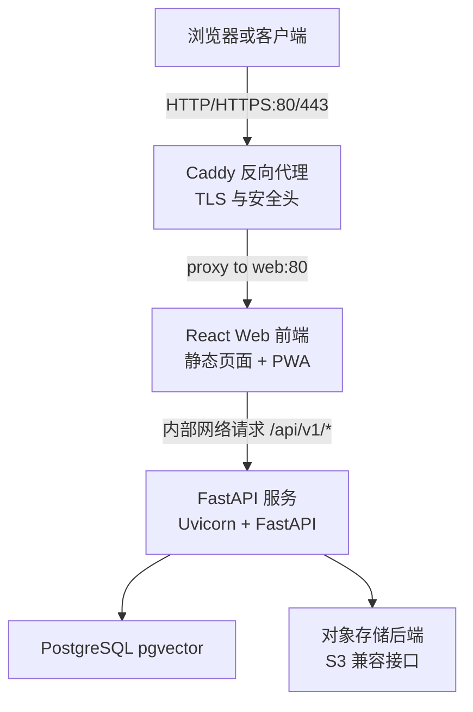
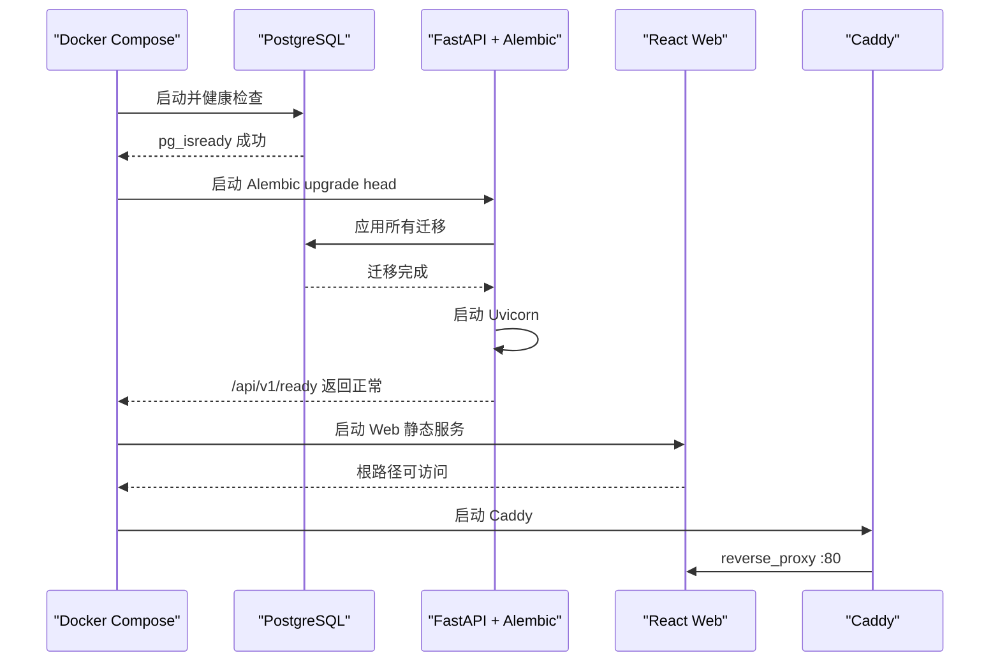
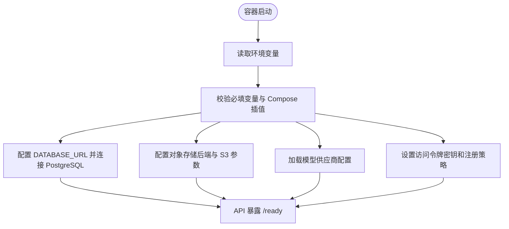
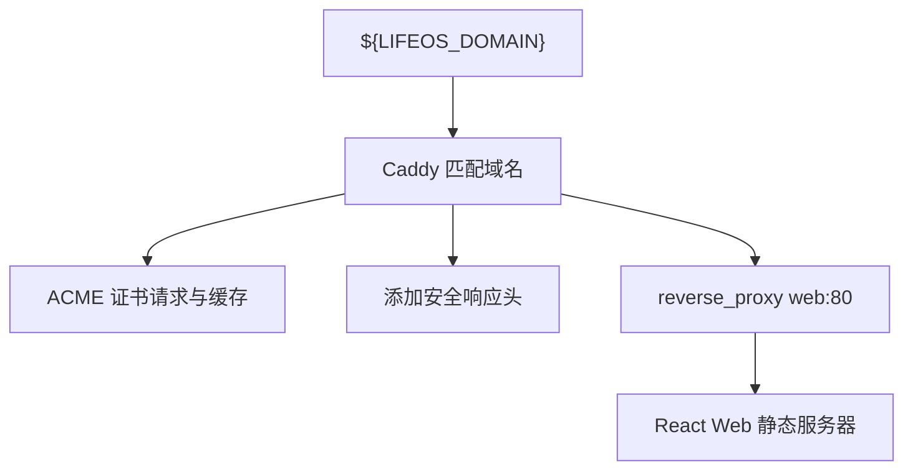
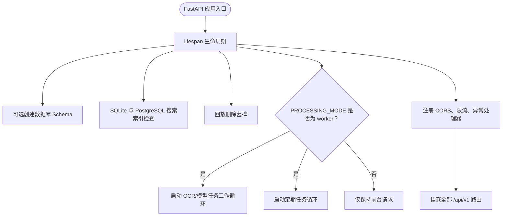
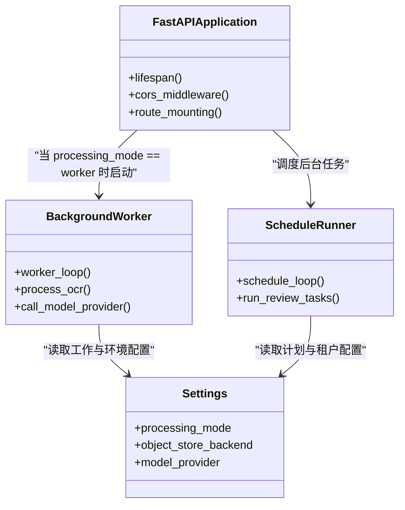
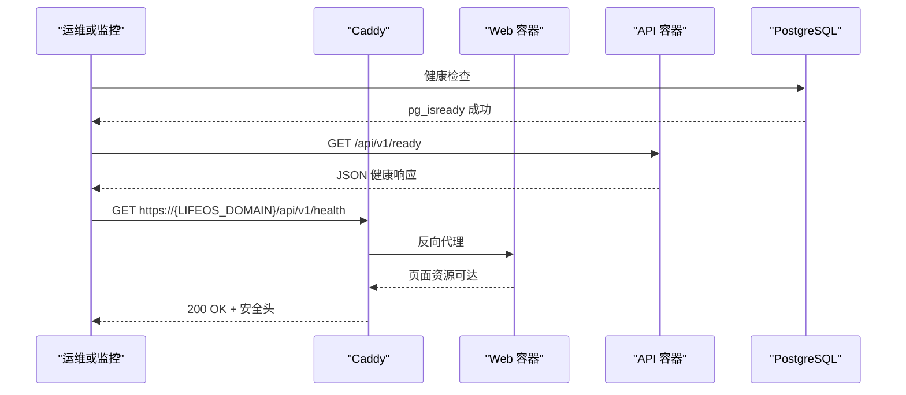

# 生产环境部署

<cite>
**本文引用的文件**
- [docker-compose.production.yml](file://docker-compose.production.yml)
- [Caddyfile](file://deploy/Caddyfile)
- [main.py](file://src/personal_ai_life_os/main.py)
- [health.py](file://src/personal_ai_life_os/api/routes/health.py)
- [deployment.md](file://docs/operations/deployment.md)
- [env.production.example](file://.env.production.example)
- [alembic.ini](file://alembic.ini)
- [web/Dockerfile](file://web/Dockerfile)
</cite>

## 目录
1. [引言](#引言)
2. [项目结构与部署架构总览](#项目结构与部署架构总览)
3. [服务编排与启动顺序](#服务编排与启动顺序)
4. [环境变量与配置注入机制](#环境变量与配置注入机制)
5. [TLS、域名绑定与反向代理安全加固](#tls域名绑定与反向代理安全加固)
6. [应用初始化流程](#应用初始化流程)
7. [工作进程模式与工作负载行为](#工作进程模式与工作负载行为)
8. [健康检查与运行验证](#健康检查与运行验证)
9. [完整部署命令序列](#完整部署命令序列)
10. [安全与性能最佳实践](#安全与性能最佳实践)
11. [故障排查指南](#故障排查指南)
12. [结论](#结论)

## 引言
本指南面向生产环境，说明如何通过 `docker-compose.production.yml` 部署 Personal-AI-Life-OS。文档涵盖 Caddy 反向代理、React Web 前端、FastAPI API 服务、PostgreSQL 数据库等组件的编排关系，环境变量注入模型，模型供应商与对象存储的配置方式，TLS 自动证书获取与 HTTPS 流程，Alembic 迁移和启动期健康检查，以及后台工作进程的调用路径。最后提供可操作的部署命令序列、健康检查方案和安全强化建议。

## 项目结构与部署架构总览
生产部署由四个核心容器组成：
- **Caddy**：公网入口，负责端口暴露、TLS 自动申请、响应头安全加固和反向代理。
- **Web（React）**：构建静态前端资源，对外提供 `/` 页面；通过内网访问 API。
- **API（FastAPI）**：业务逻辑、认证、对象存储、调度器和 OCR、模型任务队列的核心进程。
- **PostgreSQL**：持久化用户数据、会话状态、调度计划和对象元信息。

图表来源
- [docker-compose.production.yml:1-101](file://docker-compose.production.yml#L1-L101)
- [main.py:1-120](file://src/personal_ai_life_os/main.py#L1-L120)
- [Caddyfile:1-11](file://deploy/Caddyfile#L1-L11)

章节来源
- [docker-compose.production.yml:1-101](file://docker-compose.production.yml#L1-L101)
- [deployment.md:1-153](file://docs/operations/deployment.md#L1-L153)

## 服务编排与启动顺序
Compose 文件按依赖顺序启动服务，并使用 `depends_on.condition: service_healthy` 确保上下游就绪后再继续：

1. **PostgreSQL 首先启动并执行 `pg_isready`。**
2. **API 在数据库就绪后启动：** 先执行 Alembic 迁移，再启动 Uvicorn；随后探测 `/api/v1/ready`。
3. **Web 在 API 就绪后启动：** 通过本地 HTTP GET 校验根路径可达。
4. **Caddy 最后启动：** 仅在 `web` 健康后转发流量，保证外部域名在最终稳定状态下暴露。

图表来源
- [docker-compose.production.yml:3-80](file://docker-compose.production.yml#L3-L80)

章节来源
- [docker-compose.production.yml:3-80](file://docker-compose.production.yml#L3-L80)

## 环境变量与配置注入机制
Compose 中的变量遵循“缺失必填”语义，例如 `${VARIABLE:?Set VARIABLE}` 会在未定义时报错，避免镜像以半配置状态启动。API 是核心配置消费者，其关键配置分类如下：

| 配置类别 | 关键字段 | 含义与作用 |
|---|---|---|
| API 运行时 | `APP_ENV`、`API_HOST`、`API_PORT` | 指定生产环境、监听地址和端口。 |
| 数据库连接 | `DATABASE_URL` | 提供给数据库引擎和 SQLAlchemy 使用。 |
| 注册与访问控制 | `ACCESS_TOKEN_SECRET`、`REGISTRATION_MODE`、`SIGNUP_INVITE_CODE` | 管理访问令牌密钥、是否允许自注册及邀请码。生产默认禁止公开注册。 |
| CORS | `CORS_ORIGINS` | 允许的前端来源列表；生产模板默认只信任 `${LIFEOS_DOMAIN}`。 |
| 对象存储 | `OBJECT_STORE_BACKEND`、`S3_*` 系列 | 启用 S3 后端及其桶、区域、可选自定义端点和删除日志桶。 |
| 模型供应商 | `MODEL_PROVIDER`、`OPENAI_*`、模型披露与费用字段 | 配置 OpenAI 或兼容网关模型、隐私披露版本和数据描述、单次调用预算。 |
| 后台行为 | `PROCESSING_MODE`、`IMPORTS_ENABLED`、`METRICS_TOKEN` | 是否启用工作进程、临时禁用导入、指标访问令牌。 |

图表来源
- [docker-compose.production.yml:21-79](file://docker-compose.production.yml#L21-L79)
- [deployment.md:89-153](file://docs/operations/deployment.md#L89-L153)

章节来源
- [docker-compose.production.yml:1-101](file://docker-compose.production.yml#L1-L101)
- [deployment.md:89-153](file://docs/operations/deployment.md#L89-L153)

## TLS、域名绑定与反向代理安全加固
### 域名与证书
- `LIFEOS_DOMAIN` 是 Caddy 的反向代理域名占位符，Compose 中要求必须赋值。
- Caddy 容器映射 TCP 80 和 443，并附带 UDP 443；默认通过 ACME 协议自动申请证书。
- Caddyfile 将请求反向代理到内网 `web:80`，不再直接暴露 API。

### 反向代理安全头
Caddyfile 启用了多个 HTTP 安全响应头：

| 响应头 | 作用 |
|---|---|
| `Strict-Transport-Security` | 强制浏览器长期走 HTTPS，包含子域名。 |
| `X-Content-Type-Options` | 阻止 MIME 类型猜测。 |
| `X-Frame-Options DENY` | 禁止点击劫持。 |
| `Referrer-Policy no-referrer` | 减少敏感 URL 泄漏。 |
| `Permissions-Policy camera=(), microphone=(), geolocation()` | 在代理层限制摄像头、麦克风和位置权限。 |

### Caddyfile 工作方式

图表来源
- [docker-compose.production.yml:3-20](file://docker-compose.production.yml#L3-L20)
- [Caddyfile:1-11](file://deploy/Caddyfile#L1-L11)

章节来源
- [docker-compose.production.yml:3-20](file://docker-compose.production.yml#L3-L20)
- [Caddyfile:1-11](file://deploy/Caddyfile#L1-L11)
- [deployment.md:110-118](file://docs/operations/deployment.md#L110-L118)

## 应用初始化流程
API 应用的启动生命周期包含以下阶段：

1. **数据库引擎与会话工厂创建。**
2. **可选的 Schema 自动创建：** 当 `AUTO_CREATE_SCHEMA=true` 时建立元数据表。
3. **搜索索引保障：** 同步 SQLite FTS5 候选表；PostgreSQL 若开启自动建库也会尝试安装 `pg_trgm` 并建立 GIN 索引。
4. **对象存储重建：** 启动初期回放删除墓碑，保证历史删除记录一致。
5. **后台线程启动：** 根据 `PROCESSING_MODE=worker` 启动工作进程和定时任务循环。
6. **FastAPI 中间件注册：** CORS、全局安全响应头、鉴权、限流、异常处理、路由挂载。
7. **Alembic 迁移：** Compose 命令先行执行 `alembic upgrade head`，之后 API 才接受流量。

图表来源
- [main.py:32-118](file://src/personal_ai_life_os/main.py#L32-L118)
- [main.py:120-315](file://src/personal_ai_life_os/main.py#L120-L315)
- [docker-compose.production.yml:47-72](file://docker-compose.production.yml#L47-L72)
- [alembic.ini:1-40](file://alembic.ini#L1-L40)

章节来源
- [main.py:1-315](file://src/personal_ai_life_os/main.py#L1-L315)
- [docker-compose.production.yml:47-72](file://docker-compose.production.yml#L47-L72)
- [deployment.md:118-153](file://docs/operations/deployment.md#L118-L153)

## 工作进程模式与工作负载行为
### 模式语义
| 模式 | 行为 |
|---|---|
| `inline`（开发默认） | OCR 和模型请求在当前请求路径中同步执行，不启用独立后台调度。 |
| `worker`（生产默认） | API 进程启动一个后台工作线程和一个调度线程，执行 OCR、模型任务及周期性任务。 |

### 工作进程相关能力
- OCR、模型调用及后台作业由 `worker_loop` 调度，配合删除墓碑和对象存储进行异步处理。
- 定时任务如回顾生成由 `schedule_loop` 驱动，在生产 Compose 中默认为 worker 模式。
- 未来多 API 实例可通过数据库租赁机制协调任务抢占；当前模板运行单个 Uvicorn 进程。
- 如果任务消费外部模型供应商，会在调用前重新解析供应商和模型配置。

图表来源
- [main.py:80-118](file://src/personal_ai_life_os/main.py#L80-L118)
- [docker-compose.production.yml:47-79](file://docker-compose.production.yml#L47-L79)
- [deployment.md:50-86](file://docs/operations/deployment.md#L50-L86)

章节来源
- [main.py:80-118](file://src/personal_ai_life_os/main.py#L80-L118)
- [docker-compose.production.yml:47-79](file://docker-compose.production.yml#L47-L79)
- [deployment.md:50-86](file://docs/operations/deployment.md#L50-L86)

## 健康检查与运行验证
### 健康端点
- API 暴露 `/api/v1/health` 和 `/api/v1/ready`。
- Compose 对 API 执行 Python 脚本调用 `/api/v1/ready`，作为服务就绪条件。
- Web 通过 `wget` 检查自身根路径返回是否正常。
- Caddy 仅在 Web 健康后才开始接收外层流量。
- PostgreSQL 使用 `pg_isready` 检查数据库进程是否已准备接受连接。

图表来源
- [docker-compose.production.yml:9-20](file://docker-compose.production.yml#L9-L20)
- [docker-compose.production.yml:22-39](file://docker-compose.production.yml#L22-L39)
- [docker-compose.production.yml:51-66](file://docker-compose.production.yml#L51-L66)
- [health.py:1-80](file://src/personal_ai_life_os/api/routes/health.py#L1-L80)

章节来源
- [docker-compose.production.yml:9-66](file://docker-compose.production.yml#L9-L66)
- [health.py:1-80](file://src/personal_ai_life_os/api/routes/health.py#L1-L80)

## 完整部署命令序列
以下为推荐的生产部署操作序列：

| 步骤 | 命令 | 目的 |
|---|---|---|
| 1 | `cp .env.production.example .env` | 复制模板环境变量文件。 |
| 2 | 编辑 `.env`，填写 `LIFEOS_DOMAIN`、`DATABASE_URL`、对象存储凭证、`ACCESS_TOKEN_SECRET`、`REGISTRATION_MODE`、`MODEL_PROVIDER` 等。 | 注入真实配置并保护敏感信息。 |
| 3 | `docker compose -f docker-compose.production.yml config --quiet` | 校验 Compose 模板和环境变量插值是否合法。 |
| 4 | `docker compose -f docker-compose.production.yml up --build --detach --wait` | 构建镜像、拉取服务并等待健康检查通过。 |
| 5 | `curl --fail https://${LIFEOS_DOMAIN}/api/v1/health` | 验证 HTTPS 和健康端点。 |
| 6 | `curl --fail https://${LIFEOS_DOMAIN}/api/v1/ready` | 确认 API 已准备好服务请求。 |
| 7 | 测试邀请模式下的账户注册流程或已有账户登录。 | 验证认证和反向代理端到端可用性。 |
| 8 | 验证对象存储写入、OCR、模型调用和后台任务。 | 检查依赖外部系统连通性。 |
| 9 | 执行备份演练，并记录发布清单证据。 | 满足运维可恢复性要求。 |

注意：
- 不要提交 `.env`；它应仅由部署操作员可读。
- 首次启用 `MODEL_PROVIDER=openai` 时，需要补充真实密钥、隐私声明、价格披露和调用预算上限。
- 如果使用自定义网关而非官方 OpenAI 端点，需设置 `OPENAI_BASE_URL`。
- 模板默认只允许从 `${LIFEOS_DOMAIN}` 发起 CORS 请求；如需其他域名，应在配置中显式加入并重新部署。

章节来源
- [deployment.md:122-153](file://docs/operations/deployment.md#L122-L153)
- [docker-compose.production.yml:1-101](file://docker-compose.production.yml#L1-L101)

## 安全与性能最佳实践
### 反向代理与网络安全
- 通过 Caddy 只暴露 80 和 443 给公网，数据库和 API 端口不应被直接暴露。
- 启用 HSTS 并在可信域名下使用 HTTPS；避免降级为明文 HTTP。
- 保留 `Strict-Transport-Security`、`X-Frame-Options`、`X-Content-Type-Options`、`Referrer-Policy` 和 `Permissions-Policy`。
- 如需进一步防护，可在 Caddyfile 中添加更多 `Permissions-Policy` 特性限制和 IP 白名单。

### CORS 限制
- 将 `CORS_ORIGINS` 精确设置为应用实际前端域名；不要使用通配符。
- 生产环境中关闭 Swagger/OpenAPI 文档可降低自动调试工具攻击面。
- 桌面模式允许额外请求头，但普通 Web 模式不应暴露该扩展头。

### 认证与会话
- `ACCESS_TOKEN_SECRET` 必须使用随机高熵字符串。
- `REGISTRATION_MODE` 默认应为邀请制或关闭；开放注册仅限受控测试环境。
- `SIGNUP_INVITE_CODE` 用于受控邀请注册，应与账号体系配合管理。
- 利用现有登录和注册速率限制拦截暴力破解和注册滥用。

### 对象存储安全
- 对象桶必须禁用公共访问。
- 最小授权原则：只允许 API 需要的 read/write/list/delete/version-list/delete。
- 删除日志桶应放置在与主桶不同的账户或失败域，并由独立操作员管理清理权限。

### 计算资源限制
建议在 Compose 中进一步添加 CPU、内存限制和重启策略：
- 为 API 容器设置 `deploy.resources.limits` 或 `mem_limit`/`cpus`，防止 OOM 拖垮宿主。
- 对数据库容器设置持久卷配额和最大连接数，并结合数据库侧参数调优。
- 使用 Docker 的 `restart: unless-stopped` 与系统级崩溃检测配合，避免长时间不可用。

章节来源
- [docker-compose.production.yml:3-19](file://docker-compose.production.yml#L3-L19)
- [docker-compose.production.yml:51-72](file://docker-compose.production.yml#L51-L72)
- [Caddyfile:1-11](file://deploy/Caddyfile#L1-L11)
- [main.py:120-196](file://src/personal_ai_life_os/main.py#L120-L196)

## 故障排查指南
### 环境变量或密钥错误
- 现象：容器启动后立即退出，Compose 报缺失必填变量错误。
- 原因：`LIFEOS_DOMAIN`、`DATABASE_URL`、`ACCESS_TOKEN_SECRET`、`SIGNUP_INVITE_CODE`、`METRICS_TOKEN`、`S3_BUCKET`、`S3_DELETION_JOURNAL_BUCKET` 等未设置。
- 处理：补全 `.env` 后再次运行 `docker compose ... config --quiet` 和 `up`。

### Caddy 无法获得证书
- 现象：HTTP 正常但 HTTPS 失败，或域名未生效。
- 原因：DNS 未指向主机、80/443 未开放、邮箱或 ACME 凭据配置问题。
- 处理：确认 DNS、防火墙、Caddy 容器日志，并根据部署平台检查证书颁发过程。

### API 健康检查失败
- 现象：`/api/v1/ready` 超时或 5xx。
- 可能原因：Alembic 迁移失败、PostgreSQL 连接失败、对象存储无权限、模型调用失败影响就绪判断。
- 处理：查看 API 容器日志，分步验证数据库连接、对象存储桶权限、导入功能开关和模型供应商访问。

### 导入被暂停
- 现象：导入请求返回 503，错误代码表示导入暂停。
- 原因：`IMPORTS_ENABLED=false`。
- 处理：启用导入后重建 API 容器；该功能不影响只读请求。

### 工作进程未执行 OCR 或模型任务
- 现象：上传成功但未触发后续 OCR 或模型分析。
- 原因：`PROCESSING_MODE` 不是 `worker`，或模型供应商未正确配置、无预算或未获同意。
- 处理：确认 Compose 使用 worker 模式，核对 `MODEL_PROVIDER`、`OPENAI_*`、披露配置和预算字段。

章节来源
- [deployment.md:1-153](file://docs/operations/deployment.md#L1-L153)
- [docker-compose.production.yml:21-79](file://docker-compose.production.yml#L21-L79)
- [main.py:32-118](file://src/personal_ai_life_os/main.py#L32-L118)

## 结论
Personal-AI-Life-OS 的生产部署以 Docker Compose 为编排基础，Caddy 作为统一的 HTTPS 边界，React Web 提供前端体验，FastAPI 承载业务逻辑和后台工作进程，PostgreSQL 提供持久化数据支持。生产环境的关键在于：严格的环境变量管理、对象存储隔离、模型调用预算与隐私披露、严格的 CORS 与反向代理安全头、以及可靠的数据库与对象存储备份恢复流程。在上线前，请务必完成环境变量校验、健康检查、初步功能测试、IAM 与 Bucket 权限演练、以及完整的备份恢复练习。