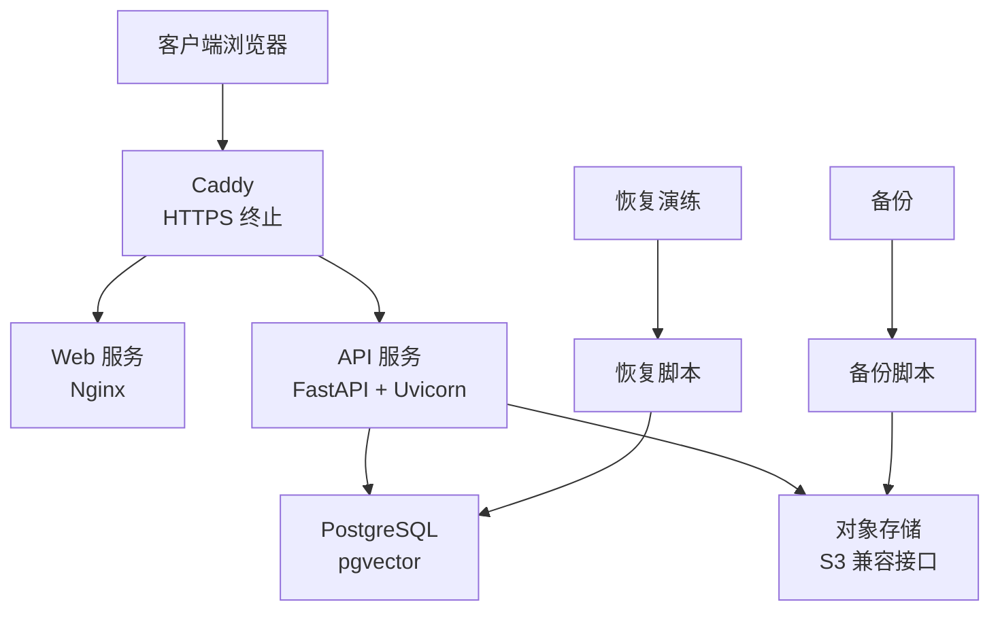
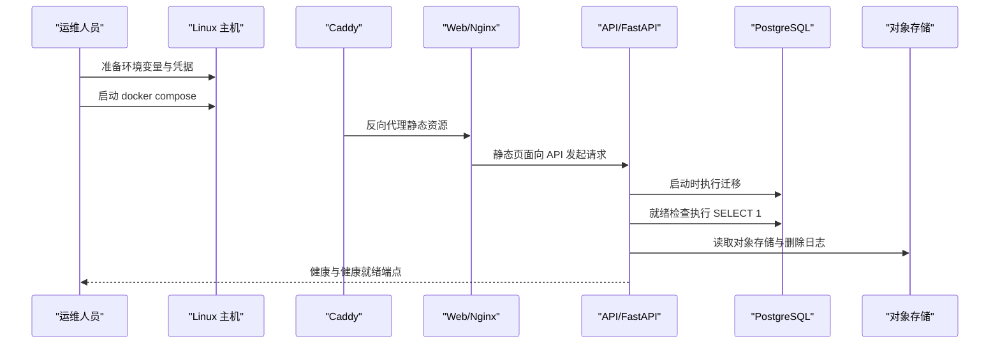
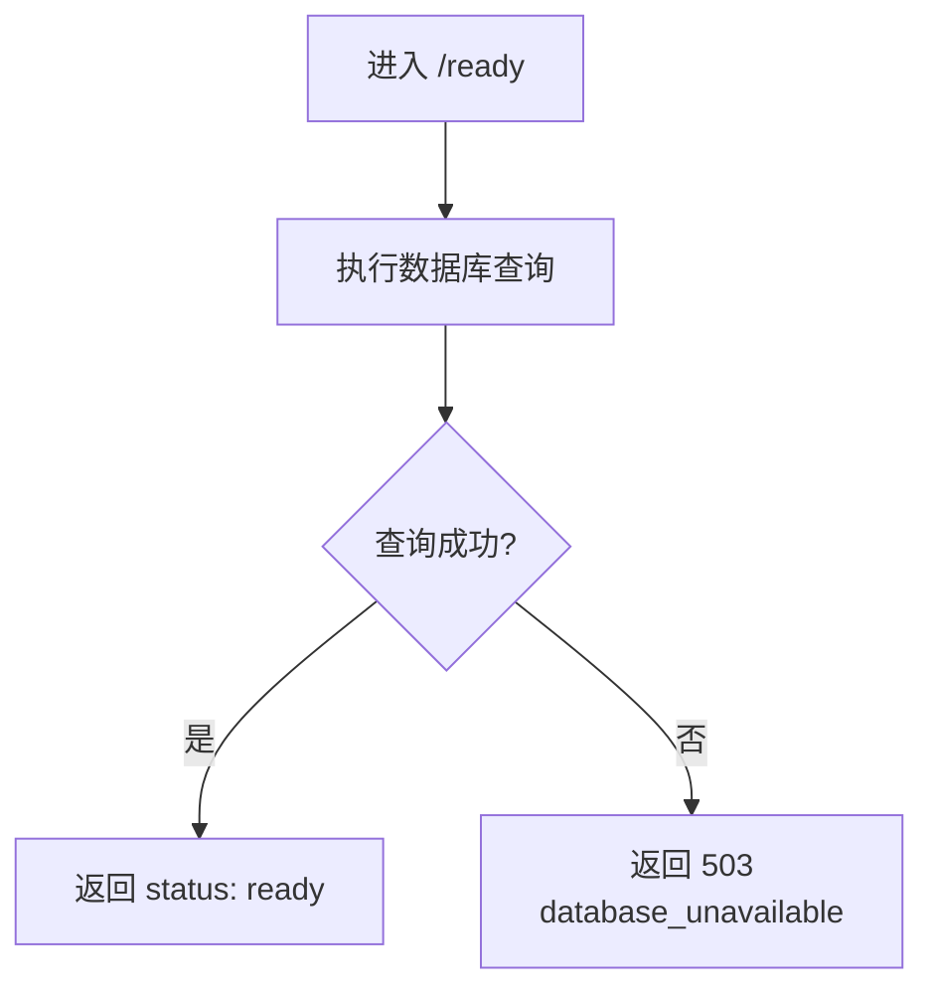
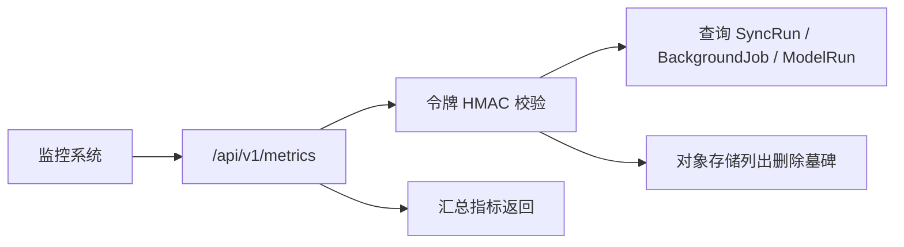
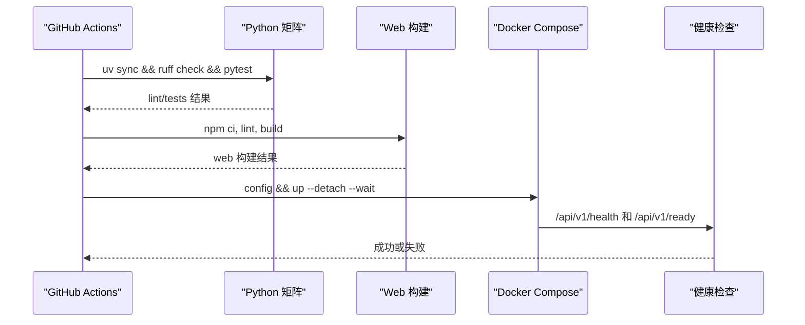
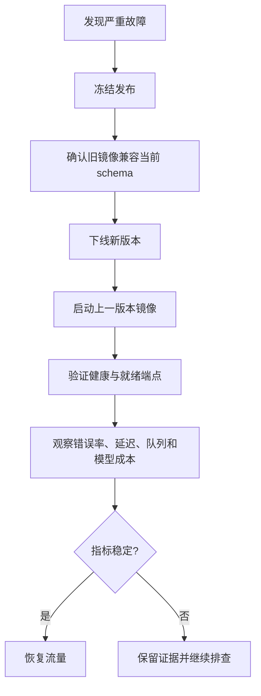

# 部署检查清单与验证步骤

<cite>
**本文引用的文件**   
- [文档/生产环境部署指南](file://docs/operations/deployment.md)
- [文档/MVP 验收记录](file://docs/operations/verification.md)
- [Docker Compose 生产配置](file://docker-compose.production.yml)
- [Docker Compose 开发配置](file://docker-compose.yml)
- [Caddy 反向代理配置](file://deploy/Caddyfile)
- [健康检查路由](file://src/personal_ai_life_os/api/routes/health.py)
- [指标路由](file://src/personal_ai_life_os/api/routes/metrics.py)
- [Web 服务 Dockerfile](file://web/Dockerfile)
- [GitHub Actions 持续集成流水线](file://.github/workflows/ci.yml)
- [生产备份脚本](file://scripts/backup-production.sh)
- [生产恢复脚本](file://scripts/restore-production.sh)
</cite>

## 目录

1. [简介](#简介)
2. [项目结构](#项目结构)
3. [核心部署组件](#核心部署组件)
4. [系统架构概览](#系统架构概览)
5. [标准化部署命令执行序列](#标准化部署命令执行序列)
6. [预部署检查清单](#预部署检查清单)
7. [关键节点验证流程](#关键节点验证流程)
8. [健康检查与自动化验证脚本](#健康检查与自动化验证脚本)
9. [持续集成流水线集成](#持续集成流水线集成)
10. [回滚策略与故障恢复预案](#回滚策略与故障恢复预案)
11. [监控告警、日志聚合与性能基准测试](#监控告警日志聚合与性能基准测试)
12. [常见问题诊断工具与排查步骤](#常见问题诊断工具与排查步骤)
13. [社区支持渠道与问题报告模板](#社区支持渠道与问题报告模板)
14. [结论](#结论)

## 简介

本文件面向 Personal-AI-Life-OS 的生产部署负责人，提供从预检查到最终验证的完整检查清单和标准操作序列。项目采用容器化部署：Caddy 负责 HTTPS 终止、TLS 证书申请和安全响应头；Nginx 托管构建后的 Web 前端；FastAPI 应用进程承担 API、认证、导入、搜索索引和后台任务编排；PostgreSQL 通过 pgvector 扩展承载数据库和业务状态。

当前代码库中的生产 Compose 文件是部署模板，本身未直接绑定云账户、域名、真实证书、对象存储桶或外部模型凭证。因此，本文把“模板能力”和“运营方必须完成的外部准备工作”区分开，使运维人员能够在已有基础设施之上按统一步骤完成部署，而不产生不存在的默认行为。

项目还包含桌面端构建、E2E 测试和本地合成数据验证流程；生产部署以线上网络、证书、存储、数据库和对外访问控制为核心目标。

**章节来源**
- [文档/生产环境部署指南:1-20](file://docs/operations/deployment.md#L1-L20)

## 项目结构

部署相关的关键目录和文件如下：

| 路径 | 用途 |
|---|---|
| `docker-compose.production.yml` | 生产 Compose 栈定义，包括 Caddy、Web、API、PostgreSQL 和服务间依赖顺序 |
| `deploy/Caddyfile` | Caddy 反向代理规则、HTTPS 与安全响应头配置 |
| `.github/workflows/ci.yml` | Python 与 Web  lint、测试、Web 构建、Compose 启动和健康检查 |
| `scripts/backup-production.sh` | 将 PostgreSQL 和对象存储同步到独立备份前缀 |
| `scripts/restore-production.sh` | 根据编号恢复数据库、对象存储并重启服务 |
| `docs/operations/deployment.md` | 部署前置条件、环境变量、模型配置、回滚说明 |
| `docs/operations/verification.md` | 本地、CI 和桌面发布候选版本的验证记录 |
| `web/Dockerfile` | Web 静态资源构建与 Nginx 运行镜像 |
| `src/personal_ai_life_os/api/routes/health.py` | `/api/v1/health` 与 `/api/v1/ready` 端点 |
| `src/personal_ai_life_os/api/routes/metrics.py` | 受保护的运行时指标接口 |



**图示来源**
- [Docker Compose 生产配置:1-101](file://docker-compose.production.yml#L1-L101)
- [Caddy 反向代理配置:1-11](file://deploy/Caddyfile#L1-L11)
- [健康检查路由:1-27](file://src/personal_ai_life_os/api/routes/health.py#L1-L27)
- [生产备份脚本:1-55](file://scripts/backup-production.sh#L1-L55)
- [生产恢复脚本:1-63](file://scripts/restore-production.sh#L1-L63)

**章节来源**
- [Docker Compose 生产配置:1-101](file://docker-compose.production.yml#L1-L101)
- [Caddy 反向代理配置:1-11](file://deploy/Caddyfile#L1-L11)
- [健康检查路由:1-27](file://src/personal_ai_life_os/api/routes/health.py#L1-L27)
- [指标路由:1-129](file://src/personal_ai_life_os/api/routes/metrics.py#L1-L129)
- [Web 服务 Dockerfile:1-12](file://web/Dockerfile#L1-L12)

## 核心部署组件

### Caddy HTTPS 与反向代理

Caddy 监听主机 TCP 80 和 443，并通过 `${LIFEOS_DOMAIN}` 启用自动 TLS。它把请求转发给内部 `web:80`；Web 层由 Nginx 提供静态资源，其健康检查通过本机 HTTP 根路径完成。安全响应头包括 HSTS、防嗅探、禁止嵌入、引用策略和权限限制。

需要注意：生产部署的安全策略不仅取决于 Caddyfile，还取决于运营商为域名配置的正确 DNS、公网端口开放策略、证书颁发机构访问能力和反向代理前的网络安全组。

| 检查项 | 预期结果 |
|---|---|
| `LIFEOS_DOMAIN` 已设置 | Caddy 可解析并生成站点块 |
| 主机 80、443 开放 | 外网能访问 HTTPS 入口 |
| HTTPS 证书已签发 | `https://YOUR_DOMAIN` 返回 200 |
| HSTS 头已生效 | 强制 HTTPS、子域包含、一年最大年龄 |
| Web 静态资源加载成功 | 前端页面可用 |
| API 路径经反向代理可达 | `/api/v1/health` 和 `/api/v1/ready` 正常 |

**章节来源**
- [Docker Compose 生产配置:1-19](file://docker-compose.production.yml#L1-L19)
- [Caddy 反向代理配置:1-11](file://deploy/Caddyfile#L1-L11)
- [Web 服务 Dockerfile:1-12](file://web/Dockerfile#L1-L12)

### API 服务与处理模式

API 在启动时执行 Alembic 迁移，然后以 Uvicorn 进程暴露 FastAPI 应用。生产模式下：

| 配置项 | 行为 |
|---|---|
| `APP_ENV=production` | 标识生产环境 |
| `PROCESSING_MODE=worker` | 启用数据库支持的 OCR 和模型任务工作线程 |
| `IMPORTS_ENABLED=true` | 允许数据导入（可通过环境变量关闭） |
| `REGISTRATION_MODE=invitation` | 注册默认仅限邀请码用户 |
| `METRICS_TOKEN` | 必须设置用于访问指标端点 |
| `ACCESS_TOKEN_SECRET` | 必须设置用于会话/令牌保护 |

启动命令显式调用 `alembic upgrade head`，所以数据库版本与应用代码版本必须匹配。若后续扩展多 API 实例，生产文档指出数据库租赁机制可用于任务协调，但当前模板默认启动一个 Uvicorn 进程。

**章节来源**
- [Docker Compose 生产配置:20-60](file://docker-compose.production.yml#L20-L60)
- [文档/生产环境部署指南:118-153](file://docs/operations/deployment.md#L118-L153)

### PostgreSQL 与向量搜索

数据库镜像使用 `pgvector/pgvector:pg16`。PostgreSQL 的健康检查依赖 `pg_isready`，API 的健康检查则在连接数据库后执行一次轻量查询，以便在就绪端点中同时反映数据库可用性。

搜索索引有两种实现路径：

| 后端 | 索引方式 | 维护方式 |
|---|---|---|
| SQLite | FTS5 trigram 候选表 | 需要手动重建搜索索引脚本 |
| PostgreSQL | `pg_trgm` 扩展及 GIN 索引 | 由数据库维护；安装失败时回退为 `LIKE` 模糊匹配 |

**章节来源**
- [Docker Compose 生产配置:61-82](file://docker-compose.production.yml#L61-L82)
- [健康检查路由:1-27](file://src/personal_ai_life_os/api/routes/health.py#L1-L27)
- [文档/生产环境部署指南:127-148](file://docs/operations/deployment.md#L127-L148)

### 对象存储与删除审计

应用写入对象时启用服务器端 AES256 加密。生产架构建议至少三个对象存储域：

1. 主对象存储桶：存放源文件、导入产物等私有键数据。
2. 备份桶：不同账户或故障域，保留带日期前缀的备份。
3. 删除日志桶：独立权限与独立操作员权限，用于删除墓碑。

启动时会把主桶中已有的墓碑复制到删除日志桶；此后删除操作需满足主桶权限、版本号清理以及备份生命周期策略。

**章节来源**
- [文档/生产环境部署指南:127-153](file://docs/operations/deployment.md#L127-L153)
- [生产备份脚本:10-20](file://scripts/backup-production.sh#L10-L20)
- [生产恢复脚本:12-27](file://scripts/restore-production.sh#L12-L27)

## 系统架构概览



**图示来源**
- [Docker Compose 生产配置:1-101](file://docker-compose.production.yml#L1-L101)
- [健康检查路由:1-27](file://src/personal_ai_life_os/api/routes/health.py#L1-L27)

## 标准化部署命令执行序列

以下序列假设部署已在 Linux 主机完成，且具备 Docker Engine 与 Docker Compose 插件。请根据现有基础设施调整数据库连接、对象存储地址和域名。

### 第一阶段：确认仓库与环境

```text
cd /path/to/Personal-AI-Life-OS
git describe --tags --dirty
```

**目的**：锁定要部署的代码分支、提交信息和是否含有未提交的修改。

**第二阶段：校验环境变量**

```bash
grep -n '.*' .env.production.example | wc -l
cp .env.production.example .env
```

随后替换：

- `DATABASE_URL`
- `POSTGRES_DB`
- `POSTGRES_USER`
- `POSTGRES_PASSWORD`
- `ACCESS_TOKEN_SECRET`
- `SIGNUP_INVITE_CODE`
- `METRICS_TOKEN`
- `MODEL_PROVIDER`
- `OPENAI_API_KEY`
- `OPENAI_BASE_URL`
- `OPENAI_MODEL`
- `LIFEOS_DOMAIN`
- `S3_BUCKET`
- `BACKUP_S3_URI`
- `S3_DELETION_JOURNAL_BUCKET`

完成后重新校验：

```bash
docker compose -f docker-compose.production.yml config --quiet
curl --fail https://YOUR_DOMAIN/api/v1/health
curl --fail https://YOUR_DOMAIN/api/v1/ready
```

**注意**：如果尚未配置 DNS 或证书，应先使用 `http://127.0.0.1:8000/api/v1/health` 在内网验证 API；对外域名应在防火墙、负载均衡器和域名解析均就绪后再开放。

**第三阶段：拉取镜像与启动服务**

```bash
docker compose -f docker-compose.production.yml up --build --detach --wait
```

启动后应观察：

1. `db` 服务健康状态为 healthy。
2. `api` 服务执行了 `alembic upgrade head`。
3. `web` 服务可访问 `/`。
4. Caddy 取得 HTTPS 证书。
5. 匿名对象存储访问被拒绝。
6. 无公网暴露数据库端口或 API 管理端口。

**第四阶段：冒烟验证**

| 检查 | 命令或方式 | 成功标准 |
|---|---|---|
| 服务全部健康 | `docker compose ps` | 所有服务 healthy |
| API 健康 | `curl -sS https://YOUR_DOMAIN/api/v1/health` | 返回 `status: ok` |
| API 就绪 | `curl -sS https://YOUR_DOMAIN/api/v1/ready` | 返回 `status: ready` |
| Web 前端 | 浏览器打开 `https://YOUR_DOMAIN` | 页面加载无跨域错误 |
| 指标鉴权 | 不带令牌访问 `/api/v1/metrics` | 返回禁用或鉴权错误 |
| 正确注册模式 | 尝试公开注册 | 应拒绝非邀请注册 |

**第五阶段：业务冒烟测试**

在邀请注册开启的前提下，依次验证以下路径：

1. 使用邀请码创建新用户。
2. 登录并查看基础页面。
3. 创建一条快速笔记。
4. 触发一次小型数据导入。
5. 执行一次简单检索。
6. 检查后台作业队列是否为空。
7. 退出登录，确认会话失效。

若某个功能失败，不要继续扩容或引入真实流量；先定位对应日志，再修复后再重复冒烟序列。

**章节来源**
- [文档/生产环境部署指南:59-115](file://docs/operations/deployment.md#L59-L115)
- [Docker Compose 生产配置:1-101](file://docker-compose.production.yml#L1-L101)
- [健康检查路由:1-27](file://src/personal_ai_life_os/api/routes/health.py#L1-L27)

## 预部署检查清单

### 系统与容器要求

| 检查项 | 最小要求或策略 |
|---|---|
| 操作系统 | Linux |
| 容器引擎 | Docker Engine |
| 编排工具 | Docker Compose 插件 |
| CPU/内存 | 视并发、OCR 任务和模型调用而定，应单独压测 |
| 磁盘空间 | 数据库 WAL、增量对象、搜索索引和日志 |
| 时间同步 | NTP 可用，避免 JWT、任务过期和日志错位 |

**章节来源**
- [文档/生产环境部署指南:101-106](file://docs/operations/deployment.md#L101-L106)

### 网络与域名

| 检查项 | 要求 |
|---|---|
| DNS | `LIFEOS_DOMAIN` 指向主机 IP |
| 入站端口 | TCP 80、443 开放 |
| 出站网络 | Caddy 可访问证书颁发机构 |
| 外部模型 | OpenAI 或兼容网关可连通 |
| S3 兼容接口 | API、备份和恢复脚本均可写读 |
| 数据库网络 | API 能访问 PostgreSQL 地址 |

### 安全凭据与权限

| 凭据或权限 | 最低安全要求 |
|---|---|
| `DATABASE_URL` | 仅部署机可读；密码 URL 编码；使用强口令 |
| `ACCESS_TOKEN_SECRET` | 随机值，不提交至代码库 |
| `SIGNUP_INVITE_CODE` | 每次生产部署轮换 |
| `METRICS_TOKEN` | 仅允许监控系统使用 |
| 主对象存储桶 | 私有、启用 SSE-AES256、阻止公共访问 |
| 备份桶 | 与主桶隔离、启用加密、设置 35 天生命周期 |
| 删除日志桶 | 只读权限给恢复流程；删除权限交给独立操作员 |
| 模型密钥 | 放入运营商秘钥管理系统 |

### 端口占用检查

```bash
ss -tlnp | grep -E ':80|:443|:8000|:5432'
netstat -tlnp 2>/dev/null || echo "端口检查工具不可用"
```

确认：

- 80、443 应由宿主 Caddy 监听。
- 8000 仅在容器内对 API 进程使用。
- 5432 不应暴露给公网。

### 依赖包安装与离线环境

如果使用离线环境，请在联网节点预先拉取以下镜像：

| 镜像 | 用途 |
|---|---|
| `caddy:2-alpine` | HTTPS 与反向代理 |
| `nginx:*-alpine` | Web 前端容器镜像 |
| `pgvector/pgvector:pg16` | PostgreSQL 和向量扩展 |

Python/Web 依赖应通过 `uv sync --locked` 和 `web/package-lock.json` 保持确定性。部署镜像构建阶段会重建 Web 前端，因此需确保 Node 和 npm 可在容器中工作。

**章节来源**
- [Docker Compose 生产配置:1-101](file://docker-compose.production.yml#L1-L101)
- [GitHub Actions 持续集成流水线:18-41](file://.github/workflows/ci.yml#L18-L41)
- [文档/生产环境部署指南:101-115](file://docs/operations/deployment.md#L101-L115)

## 关键节点验证流程

### 容器状态检查

```bash
docker compose -f docker-compose.production.yml ps
```

预期状态：

| 服务 | 期望健康状态 |
|---|---|
| `caddy` | healthy |
| `web` | healthy |
| `api` | healthy |
| `db` | healthy |

如果某个服务未健康：

1. 查看该服务日志：`docker compose -f docker-compose.production.yml logs --tail=300 <service>`。
2. 检查依赖服务是否已经 healthy。
3. 检查环境变量是否正确注入。
4. 检查数据库或对象存储权限。
5. 必要时进入容器调试：`docker compose exec api sh`。

**章节来源**
- [Docker Compose 生产配置:1-101](file://docker-compose.production.yml#L1-L101)

### 网络连通性测试

```bash
curl -sS -o /dev/null -w "%{http_code}" https://YOUR_DOMAIN
curl -sS https://YOUR_DOMAIN/api/v1/health | python -m json.tool
curl -sS https://YOUR_DOMAIN/api/v1/ready | python -m json.tool
```

同时检查：

- DNS 解析到正确的宿主 IP。
- 安全组和防火墙放行 443。
- TLS 证书链完整。
- WAF 或云厂商边缘服务未拦截业务路径。
- PWA manifest、service worker 等静态资源路径没有被误拦截。

**章节来源**
- [Docker Compose 生产配置:1-19](file://docker-compose.production.yml#L1-L19)
- [健康检查路由:1-27](file://src/personal_ai_life_os/api/routes/health.py#L1-L27)

### HTTPS 证书验证

```bash
echo | openssl s_client -connect YOUR_DOMAIN:443 -servername YOUR_DOMAIN 2>/dev/null | openssl x509 -noout -subject -dates -issuer
```

验证要点：

| 字段 | 预期 |
|---|---|
| subject | CN 包含 `LIFEOS_DOMAIN` |
| issuer | 可信任 CA 或自动签发链有效 |
| not before/after | 证书尚未过期 |
| HSTS | 响应头包含严格传输安全 |
| 强制 HTTPS | HTTP 重定向或直接拒绝 |

**章节来源**
- [Caddy 反向代理配置:1-11](file://deploy/Caddyfile#L1-L11)

### 功能冒烟测试

| 功能 | 操作步骤 | 成功标准 |
|---|---|---|
| 用户注册 | 使用邀请码创建账户 | 邀请模式下仅持有合法 invite code 的用户可注册 |
| 登录 | 输入用户名和密码 | 返回有效会话 |
| 上传导入 | 选择 Markdown 或图片等支持格式 | 任务进入后台并完成 |
| 检索 | 输入已知关键词 | 返回有序搜索结果 |
| 图标/图片预览 | 访问包含对象的页面 | 对象可读取 |
| 关闭导入 | 设置 `IMPORTS_ENABLED=false` | 导入返回暂停态，只读路径仍可用 |
| 指标访问 | 使用无效令牌访问 `/api/v1/metrics` | 返回 401 或 404 |

关闭导入的能力可作为生产切换试验：设置 `IMPORTS_ENABLED=false` 后重启 API，确认无法写入新导入，但历史记录仍可读。

**章节来源**
- [文档/生产环境部署指南:27-68](file://docs/operations/deployment.md#L27-L68)
- [Docker Compose 生产配置:21-60](file://docker-compose.production.yml#L21-L60)

## 健康检查与自动化验证脚本

### 内置健康端点

| 端点 | 语义 | 返回值示例关键字 |
|---|---|---|
| `GET /api/v1/health` | 轻量存活检查 | `status: ok` |
| `GET /api/v1/ready` | 存活并检查数据库连通 | `status: ready` |

`/ready` 会在异常情况下返回 503，并在响应中包含数据库不可用的原因代码，便于外部监控区分“进程存在”和“真正可用”。



**图示来源**
- [健康检查路由:7-27](file://src/personal_ai_life_os/api/routes/health.py#L7-L27)

### 健康检查自动化脚本

以下脚本可用于外部探测器、Kubernetes探针、蓝绿开关或滚动升级判定逻辑。请将 `<HEALTH_ENDPOINT>`、`<METRICS_TOKEN>` 和 `<DOMAIN>` 替换为实际值。

```bash
#!/usr/bin/env bash
set -euo pipefail

HEALTH_ENDPOINT="https://$DOMAIN/api/v1/ready"
METRICS_ENDPOINT="https://$DOMAIN/api/v1/metrics"
TOKEN="${METRICS_TOKEN:?请设置 METRICS_TOKEN}"
MAX_RETRIES=30
RETRY_INTERVAL=5

for i in $(seq 1 "$MAX_RETRIES"); do
    if curl -sS -f "$HEALTH_ENDPOINT" >/dev/null; then
        echo "API 就绪"
        break
    fi
    echo "等待第 $i/$MAX_RETRIES 次"
    sleep "$RETRY_INTERVAL"
done

RESPONSE=$(curl -sS -H "Authorization: Bearer $TOKEN" "$METRICS_ENDPOINT")
if [[ "$RESPONSE" =~ errors\.[a-zA-Z_]+ ]]; then
    echo "警告：指标中出现错误计数" >&2
fi
```

这个脚本只展示调用结构，不包含敏感凭据；部署时应从运行时变量或秘钥管理器注入。

**章节来源**
- [健康检查路由:1-27](file://src/personal_ai_life_os/api/routes/health.py#L1-L27)
- [指标路由:1-32](file://src/personal_ai_life_os/api/routes/metrics.py#L1-L32)

### 指标端点的可观测维度

指标端点需要 `Bearer` 令牌鉴权，返回约一分钟内采样、最近 24 小时统计、后台作业队列、删除延迟分位、模型调用成本估计和待处理删除数等信息。可用于：

- 监控请求延迟 P95。
- 监控每小时/24 小时内 5xx 比例。
- 监控导入失败数和进行中的导入。
- 监控队列积压与最老排队作业时长。
- 监控删除墓碑堆积。
- 监控外部模型调用量、失败量和预算回落情况。



**图示来源**
- [指标路由:1-129](file://src/personal_ai_life_os/api/routes/metrics.py#L1-L129)

**章节来源**
- [指标路由:1-129](file://src/personal_ai_life_os/api/routes/metrics.py#L1-L129)

## 持续集成流水线集成

GitHub Actions 流水线覆盖以下阶段：

1. 多 Python 版本（3.11、3.12）环境。
2. `uv sync --locked --all-groups` 安装依赖。
3. `ruff check` 语法和风格检查。
4. `pytest` 单元测试。
5. Web 端 `npm ci`、`npm run lint`、`npm run build`。
6. Docker Compose 配置文件校验。
7. 容器启动、分离运行和健康检查。
8. 无论结果如何打印日志。
9. 最后清理卷以避免持久污染。



**图示来源**
- [GitHub Actions 持续集成流水线:1-57](file://.github/workflows/ci.yml#L1-L57)
- [Docker Compose 生产配置:1-101](file://docker-compose.production.yml#L1-L101)
- [健康检查路由:1-27](file://src/personal_ai_life_os/api/routes/health.py#L1-L27)

### CI 结果解释与扩展建议

| 当前行为 | 扩展建议 |
|---|---|
| Lint 失败则阻断 | 增加代码覆盖率阈值 |
| 测试失败则阻断 | 增加端到端测试用例 |
| Web 构建失败则阻断 | 增加 PWA 安装、manifest 和 service worker 测试 |
| Compose 健康检查失败则阻断 | 增加指标采集验证 |
| 清理卷以防止污染 | 增加发布制品归档 |
| 无外部证书/S3 | 保留模拟环境，但增加上线前检查任务 |

生产发布流水线应额外增加：

1. 固定源码树哈希和镜像 digest。
2. 仅允许受保护分支合并。
3. 双人审批后才推送到生产镜像仓库。
4. 推送前执行备份快照。
5. 灰度发布后等待指标稳定。
6. 自动回滚检查失败的环境。

**章节来源**
- [GitHub Actions 持续集成流水线:1-57](file://.github/workflows/ci.yml#L1-L57)

## 回滚策略与故障恢复预案

### 何时需要回滚

出现以下任一问题时，优先考虑回滚：

- 新镜像不能连接数据库。
- Alembic 迁移失败或遗留数据漂移。
- 搜索索引损坏或结果严重退步。
- 导入任务大量失败。
- 外部模型调用成本异常飙升。
- 删除墓碑未完成导致数据丢失风险。
- 对象存储同步异常。

### 应用版本回滚流程

1. 冻结变更，不再接受新的发布。
2. 确认旧镜像能否读取当前数据库 schema。
3. 停止入口流量：在 DNS、反向代理或负载均衡层下线新版本。
4. 拉起上一版本镜像并执行迁移检查。
5. 执行备份和恢复演练，确认旧镜像可启动。
6. 逐步切回流量并观察 `/api/v1/healthy`、`/api/v1/ready`、延迟、错误率和队列长度。

文档明确说明：只有当旧镜像能够读取当前 schema 时，应用回滚才是安全的。Alembic 迁移具有降级路径，但降级通常只移除新增表、列或索引，并不会恢复已删除用户数据。



**图示来源**
- [文档/生产环境部署指南:148-153](file://docs/operations/deployment.md#L148-L153)

### 数据库与对象存储回退

推荐顺序：

1. 立即停止 API。
2. 保存事故现场和最新日志。
3. 从可信备份 ID 恢复。
4. 先在隔离库恢复数据库。
5. 比对对象存储快照一致性。
6. 启动 API 并以只读模式验证。
7. 检查 `/api/v1/ready` 和删除墓碑状态。
8. 全量验证后再重新接入读写。

恢复脚本会自动比较所选备份的删除日志桶是否与当前环境一致，否则拒绝恢复，避免在元数据不一致的情况下盲目恢复。

**章节来源**
- [生产恢复脚本:1-63](file://scripts/restore-production.sh#L1-L63)
- [文档/生产环境部署指南:148-153](file://docs/operations/deployment.md#L148-L153)

## 监控告警、日志聚合与性能基准测试

### 监控指标

建议将以下指标接入 Prometheus、云监控或 SIEM 平台：

| 指标类别 | 建议告警阈值 |
|---|---|
| API 存活 | `/api/v1/health` 连续失败超过 2 分钟 |
| API 就绪 | `/api/v1/ready` 不可用立即告警 |
| 外部 5xx | 每分钟显著上升 |
| 延迟 P95 | 超过基线或 SLA |
| 导入失败 24h | 大于历史均值并持续一定时间 |
| 作业队列积压 | 积压作业数或最老作业时长超阈 |
| 删除墓碑堆积 | 待处理数量或最老未处理时间超阈 |
| 模型失败率 | 调用失败明显增多或预算回落频繁 |
| HTTPS 证书到期 | 距离过期小于 30 天 |

### 日志聚合分析

建议在宿主机或容器编排平台收集：

- Caddy 访问日志与 TLS 错误。
- Nginx Web 访问日志。
- API 访问日志、错误堆栈和迁移日志。
- PostgreSQL 慢查询和连接日志。
- 后台作业执行日志。
- 对象存储访问失败日志。

聚合方案应支持：

- 按请求 id、账号、任务 id 关联日志。
- 高优先级 5xx 和鉴权失败即时告警。
- 按模块过滤健康、导入、搜索、模型调用。
- 保留周期符合合规要求。
- 生产日志不得携带用户文本或敏感凭据。

### 性能基准测试方法

项目提供 `scripts/benchmark_mvp.py`，可用于局部基线对比。官方记录显示在本地 SQLite 环境下，特定查询类型的 P95 远低于 500ms 目标，导入也低于上限。

生产压测应补充：

| 场景 | 目标 |
|---|---|
| 时间范围查询 P95 | 低于业务 SLA |
| 来源过滤查询 P95 | 低于业务 SLA |
| 关键词搜索 P95 | 低于业务 SLA |
| 批量导入吞吐 | 不低于业务峰值预估 |
| 模型调用并发 | 不超过供应商限流 |
| 对象存储写入吞吐 | 不阻塞主路径 |
| 数据库最大连接数 | 保留足够余量 |
| 对象存储删除延迟 | 墓碑不会长期堆积 |

### 恢复与备份演练

建议每半年至少执行一次完整恢复演练：

1. 创建隔离库。
2. 执行备份。
3. 停写生产。
4. 执行恢复。
5. 校验数据库完整性。
6. 校验对象一致性。
7. 验证删除墓碑状态。
8. 验证 `/api/v1/ready`。
9. 验证主要业务流程。
10. 记录耗时、回滚点、失败点和改进项。

**章节来源**
- [指标路由:1-129](file://src/personal_ai_life_os/api/routes/metrics.py#L1-L129)
- [文档/MVP 验收记录:44-77](file://docs/operations/verification.md#L44-L77)
- [生产备份脚本:1-55](file://scripts/backup-production.sh#L1-L55)
- [生产恢复脚本:1-63](file://scripts/restore-production.sh#L1-L63)

## 常见问题诊断工具与排查步骤

### 容器与服务诊断

| 问题 | 诊断命令 | 常见原因 |
|---|---|---|
| API 一直不健康 | `docker compose logs api --tail=200` | 数据库不可达、迁移失败、环境变量缺失 |
| Web 打不开页面 | `docker compose logs web --tail=200` | Nginx 配置、静态资源、缓存、镜像构建失败 |
| HTTPS 失败 | 检查 Caddy 日志和证书状态 | DNS、证书颁发失败、端口未开放 |
| 对象存储报错 | 检查 S3 端点和权限 | bucket 策略、IAM、跨域、区域设置 |
| 导入缓慢 | 查看指标中的 `imports_failed_24h` 和队列 | 外部模型限流、对象存储延迟、任务积压 |
| 搜索不准确 | 检查 search index 重建状态 | PostgreSQL 扩展未安装、索引重建未完成 |

### 数据库诊断

```bash
docker compose exec db pg_isready
docker compose exec db psql -U "$POSTGRES_USER" -d "$POSTGRES_DB" -c "SELECT 1;"
docker compose exec db psql -U "$POSTGRES_USER" -d "$POSTGRES_DB" -c "\dt"
```

若迁移失败：

1. 检查 Alembic 版本是否与应用匹配。
2. 检查数据库中已应用的迁移。
3. 核对数据库角色权限。
4. 不要在在线数据上直接手工修改 schema。
5. 如需恢复，优先从备份回滚，而不是原地 downgrading。

### Web/PWA 问题

Web 文档强调：

- Service Worker 和 File System Access API 需要在安全上下文下工作。
- HTTPS 或 `http://127.0.0.1`/`localhost` 才可能成功。
- 本地开发服务器有意不注册 SW，应以生产构建产物验证。
- manifest 类型必须是 `application/manifest+json`。
- manifest 和 SW 应设置 `no-cache`。

PWA 安装失败时优先检查：

- 当前上下文是否安全。
- DNS 和证书是否正常。
- 浏览器控制台是否有 SW 相关错误。
- manifest 路径和内容是否符合规范。
- 移动端分享和快速捕获是否仍连到正确 API origin。

**章节来源**
- [Docker Compose 生产配置:1-101](file://docker-compose.production.yml#L1-L101)
- [Caddy 反向代理配置:1-11](file://deploy/Caddyfile#L1-L11)
- [文档/生产环境部署指南:79-100](file://docs/operations/deployment.md#L79-L100)
- [健康检查路由:7-27](file://src/personal_ai_life_os/api/routes/health.py#L7-L27)

## 社区支持渠道与问题报告模板

### 支持渠道

| 渠道 | 用途 |
|---|---|
| GitHub Issues | 缺陷报告、功能建议、部署问题 |
| GitHub Discussions | 架构讨论、社区经验分享 |
| CONTRIBUTING.md | 参与贡献和规范说明 |
| SECURITY.md | 安全问题披露流程 |
| RELEASE/迭代记录 | 发行版本信息和回归记录 |

报告前请先确认：

1. 使用的代码版本或镜像 digest。
2. 是否使用 `docker-compose.production.yml` 模板。
3. 是否经过 `docker compose config --quiet` 校验。
4. 是否启用了外部模型、S3、搜索扩展或自定义域名。
5. 是否能复现。
6. 是否需要隐私数据。需要时请脱敏。

### 问题报告模板

```text
标题：[部署问题] <一句话描述>

环境信息：
- 仓库版本或提交哈希：
- 镜像 tag 或 digest：
- Docker Compose 文件：docker-compose.production.yml 或自定义版本
- 操作系统和内核：
- 网络与证书提供方：
- 对象存储提供方：
- PostgreSQL 版本/托管平台：
- 模型提供商（如有）：

问题复现步骤：
1. 
2. 
3. 

期望行为：

实际行为：

相关日志摘要：
- Caddy/Nginx 日志：
- API 日志：
- 数据库日志：
- 对象存储访问错误：

健康检查结果：
- /api/v1/health 响应体：
- /api/v1/ready 响应体：
- /api/v1/metrics 指标片段（不含隐私数据）：

已尝试解决措施：

附件：
- 脱敏后的 compose 配置片段
- 非敏感日志片段
```

**章节来源**
- [README 与贡献说明](file://CONTRIBUTING.md)
- [安全政策](file://SECURITY.md)
- [文档/MVP 验收记录:1-20](file://docs/operations/verification.md#L1-L20)

## 结论

Personal-AI-Life-OS 的生产部署是一个多组件协作过程，核心在于：先确认外部基础设施（DNS、TLS、数据库、对象存储），再以 Compose 模板启动容器，再通过 `/health`、`/ready`、HTTPS 和业务冒烟逐步证明服务可用，最后通过指标、备份和演练保障可观测性和可恢复性。

部署负责人应始终遵循以下原则：

1. 先备份，再变更。
2. 用命令行幂等执行，不依赖人工记忆。
3. 所有环境变量和凭据进运行时配置，不入库。
4. 用 `config --quiet` 和健康端点代替盲信启动成功。
5. 用指标确认长时间运行稳定性。
6. 用真实备份做回滚演练。
7. 回滚前先确认旧镜像兼容当前 schema。
8. 出现问题先冻结、隔离、取证、恢复，再复盘改进。