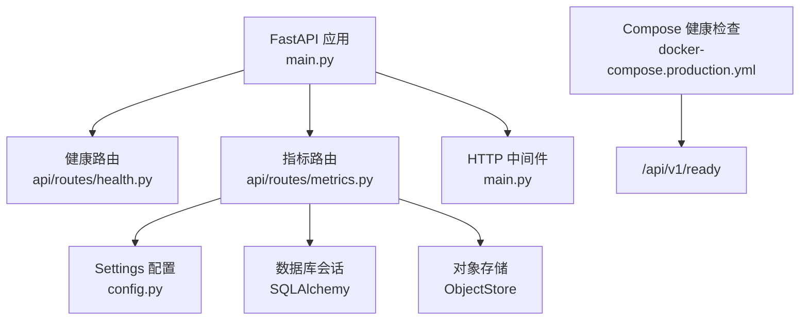
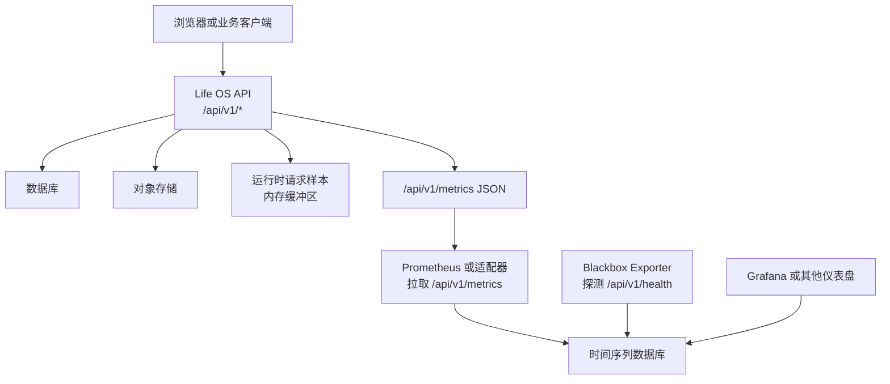
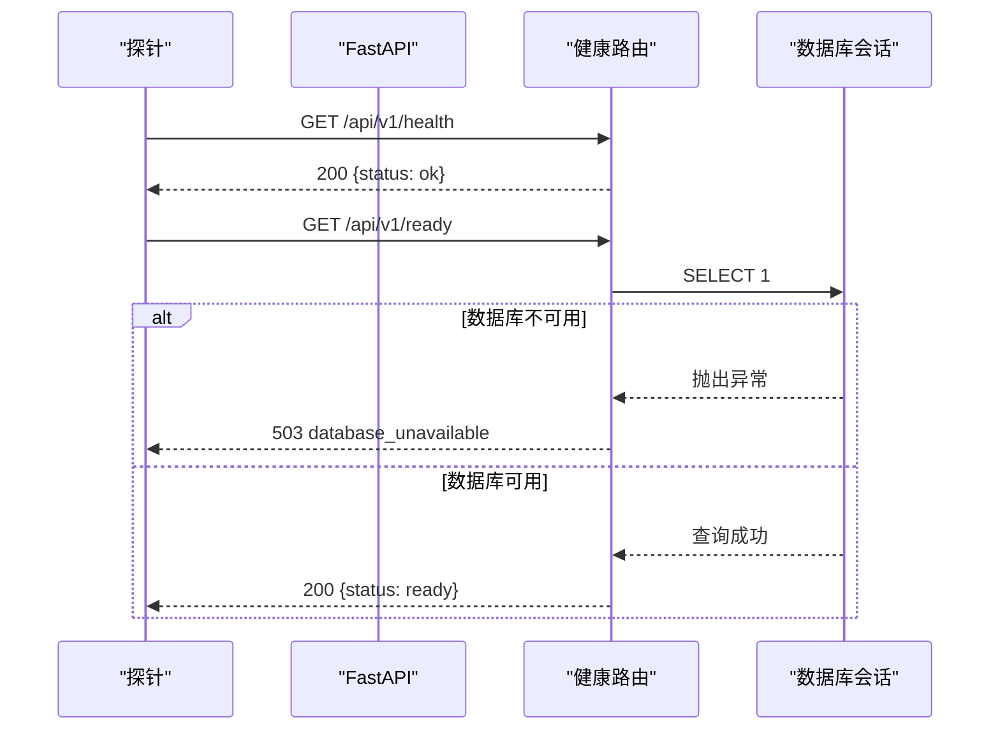
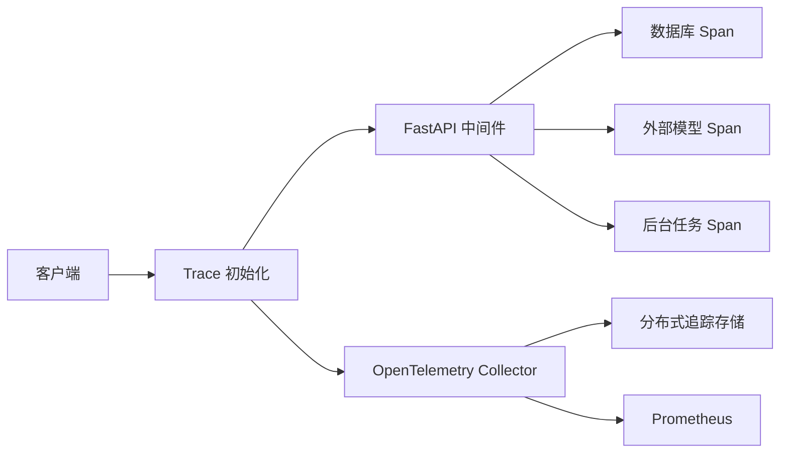
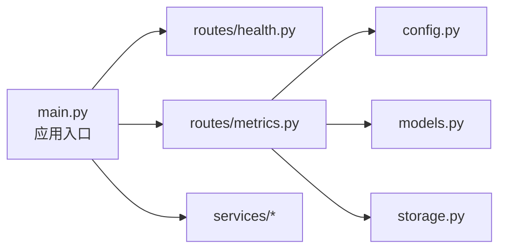
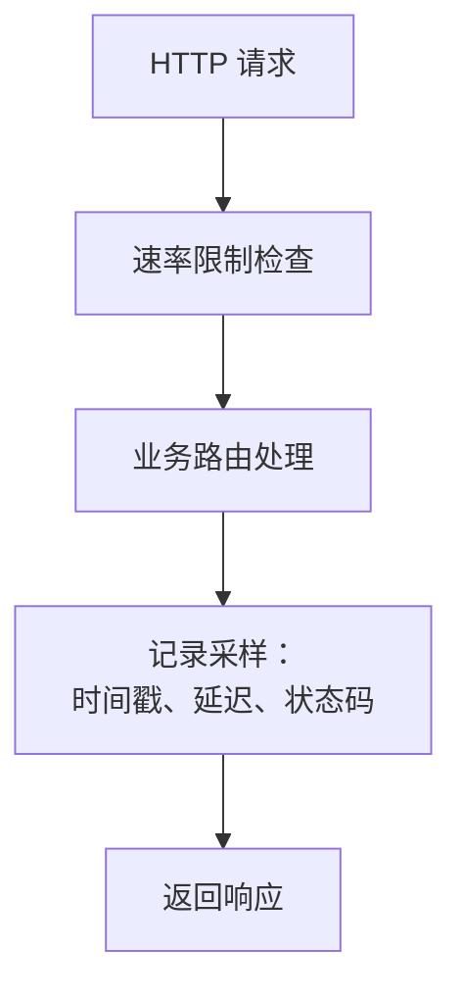

# 监控告警与指标收集

<cite>
**本文引用的文件**   
- [src/personal_ai_life_os/main.py](file://src/personal_ai_life_os/main.py)
- [src/personal_ai_life_os/api/routes/health.py](file://src/personal_ai_life_os/api/routes/health.py)
- [src/personal_ai_life_os/api/routes/metrics.py](file://src/personal_ai_life_os/api/routes/metrics.py)
- [src/personal_ai_life_os/config.py](file://src/personal_ai_life_os/config.py)
- [docker-compose.production.yml](file://docker-compose.production.yml)
- [tests/test_health.py](file://tests/test_health.py)
- [pyproject.toml](file://pyproject.toml)
- [README.md](file://README.md)
- [docs/operations/deployment.md](file://docs/operations/deployment.md)
</cite>

## 目录
1. [简介](#简介)
2. [项目结构中与监控相关的组件](#项目结构中与监控相关的组件)
3. [核心能力概览](#核心能力概览)
4. [架构总览](#架构总览)
5. [健康检查端点实现原理](#健康检查端点实现原理)
6. [指标暴露机制与 Prometheus 集成方式](#指标暴露机制与-prometheus-集成方式)
7. [关键指标语义与采集范围](#关键指标语义与采集范围)
8. [日志收集策略](#日志收集策略)
9. [故障检测与告警规则建议](#故障检测与告警规则建议)
10. [资源监控与容量规划](#资源监控与容量规划)
11. [分布式追踪现状与建议](#分布式追踪现状与建议)
12. [监控仪表板模板与告警通知渠道](#监控仪表板模板与告警通知渠逍)
13. [依赖分析](#依赖分析)
14. [性能考量](#性能考量)
15. [故障排查指南](#故障排查指南)
16. [结论](#结论)

## 简介
本文说明 Personal-AI-Life-OS 中现有监控能力，并据此给出生产可用的告警规则、指标定义、日志策略、资源监控方案和分布式追踪扩展建议。该项目当前未直接暴露标准 Prometheus `/metrics` 文本协议接口，而是提供一个需要令牌鉴权的 JSON 状态聚合接口 `/api/v1/metrics`。因此，Prometheus 应通过 `blackbox_exporter` 或自定义 scraper 拉取该接口后转译为可用指标；或者由外部网关将指标数据写入时间序列存储。

同时，项目提供了两个内置健康检查路径：
- `/api/v1/health`：轻量存活探针，只判断服务进程是否可响应。
- `/api/v1/ready`：就绪探针，会执行最小数据库查询以确认后端数据库连接可用。

这些设计便于在 Kubernetes、Docker Compose、反向代理和编排系统中进行可用性探测，但完整的生产监控仍然需要补充外部模型调用成本跟踪、错误率统计、任务队列积压以及底层主机资源指标。

**本节来源**
- [src/personal_ai_life_os/api/routes/health.py:6-27](file://src/personal_ai_life_os/api/routes/health.py#L6-L27)
- [src/personal_ai_life_os/main.py:249-315](file://src/personal_ai_life_os/main.py#L249-L315)
- [src/personal_ai_life_os/api/routes/metrics.py:8-129](file://src/personal_ai_life_os/api/routes/metrics.py#L8-L129)
- [docker-compose.production.yml:74-95](file://docker-compose.production.yml#L74-L95)

## 项目结构中与监控相关的组件
从代码组织看，监控与运维相关能力分散在应用入口、路由配置、配置校验和生产部署文件中，而非集中在独立的 `monitoring` 模块中：

| 文件 | 职责 | 对监控的意义 |
|---|---|---|
| `main.py` | FastAPI 应用创建、中间件、全局异常处理、路由注册 | 采样 HTTP 请求延迟、返回统一错误格式、注入安全响应头 |
| `api/routes/health.py` | `/api/v1/health` 与 `/api/v1/ready` | 提供存活与就绪探针 |
| `api/routes/metrics.py` | `/api/v1/metrics` | 提供受保护的运行状态、导入失败数、任务队列、外部模型用量和删除清理状态 |
| `config.py` | Pydantic Settings | 集中配置 `METRICS_TOKEN`、外部模型定价和预算、对象存储与部署模式 |
| `docker-compose.production.yml` | 生产 Compose 编排 | 使用 `/api/v1/ready` 作为 API 健康检查，要求设置 `METRICS_TOKEN` |
| `pyproject.toml` | Python 依赖声明 | 项目依赖 FastAPI、SQLAlchemy、Uvicorn、Boto3 等，没有内置 Prometheus 客户端 |
| `README.md` | 项目说明 | 提供开发流程、外部模型使用和验证命令 |
| `docs/operations/deployment.md` | 部署文档 | 说明如何设置 `METRICS_TOKEN`、启用 worker 模式和使用就绪检查 |

**图表来源**
- [src/personal_ai_life_os/main.py:249-315](file://src/personal_ai_life_os/main.py#L249-L315)
- [src/personal_ai_life_os/api/routes/health.py:6-27](file://src/personal_ai_life_os/api/routes/health.py#L6-L27)
- [src/personal_ai_life_os/api/routes/metrics.py:8-129](file://src/personal_ai_life_os/api/routes/metrics.py#L8-L129)
- [docker-compose.production.yml:74-95](file://docker-compose.production.yml#L74-L95)

**本节来源**
- [src/personal_ai_life_os/main.py:1-315](file://src/personal_ai_life_os/main.py#L1-L315)
- [src/personal_ai_life_os/api/routes/health.py:1-27](file://src/personal_ai_life_os/api/routes/health.py#L1-L27)
- [src/personal_ai_life_os/api/routes/metrics.py:1-129](file://src/personal_ai_life_os/api/routes/metrics.py#L1-L129)
- [src/personal_ai_life_os/config.py:1-132](file://src/personal_ai_life_os/config.py#L1-L132)
- [docker-compose.production.yml:1-101](file://docker-compose.production.yml#L1-L101)
- [pyproject.toml:1-58](file://pyproject.toml#L1-L58)

## 核心能力概览
项目当前已实现的监控相关能力包括：

1. **轻量存活探针**：`/api/v1/health` 直接返回服务标识和健康状态，不访问数据库。
2. **数据库就绪探针**：`/api/v1/ready` 执行简单 SQL 查询；失败时返回 `503 database_unavailable`。
3. **受限运营指标接口**：`/api/v1/metrics` 聚合请求抽样、导入状态、任务队列、外部模型调用成本和删除清理情况。
4. **基于令牌的指标访问控制**：使用 `Authorization: Bearer <token>`，并通过常量时间比较避免时序侧信道风险。
5. **HTTP 请求延迟采样**：中间件记录最近 1000 条请求的单调时间和响应耗时，用于估算 P95。
6. **统一错误响应结构**：HTTP 异常、校验异常和未捕获异常都会转为结构化 `error` 字段响应。
7. **基础容器健康检查**：Compose 在生产模式下用 `/api/v1/ready` 探测 API 是否可启动并使用数据库。

尚未实现的能力包括：
- 标准 Prometheus 文本指标端点。
- OpenTelemetry、Jaeger、Zipkin 等分布式追踪库的内置集成。
- 结构化 JSON 日志框架（例如 structlog）及文件轮转器。
- 原生 CPU、内存、磁盘 I/O 操作系统指标采集。
- 自动化告警规则和通知渠道（邮件、Slack、企业微信）。

**本节来源**
- [src/personal_ai_life_os/api/routes/health.py:9-27](file://src/personal_ai_life_os/api/routes/health.py#L9-L27)
- [src/personal_ai_life_os/api/routes/metrics.py:15-129](file://src/personal_ai_life_os/api/routes/metrics.py#L15-L129)
- [src/personal_ai_life_os/main.py:212-277](file://src/personal_ai_life_os/main.py#L212-L277)
- [docker-compose.production.yml:74-95](file://docker-compose.production.yml#L74-L95)

## 架构总览
下图展示一个典型的 Prometheus + Blackbox Exporter + Life OS 监控数据流。由于项目未原生输出 Prometheus 指标，外部系统需要承担“采集适配”的职责。

**图表来源**
- [src/personal_ai_life_os/main.py:212-277](file://src/personal_ai_life_os/main.py#L212-L277)
- [src/personal_ai_life_os/api/routes/metrics.py:15-129](file://src/personal_ai_life_os/api/routes/metrics.py#L15-L129)
- [src/personal_ai_life_os/api/routes/health.py:9-27](file://src/personal_ai_life_os/api/routes/health.py#L9-L27)
- [docker-compose.production.yml:74-95](file://docker-compose.production.yml#L74-L95)

## 健康检查端点实现原理

### 存活检查 `/api/v1/health`
该端点是 liveness 探针的典型实现：
- 不需要数据库连接。
- 不需要身份认证。
- 返回稳定且极简的状态。
- 适用于快速杀死无响应的进程，但不保证依赖正常。

它适合放在容器编排系统的 `livenessProbe` 中，或者反向代理的连通性探测中。

### 就绪检查 `/api/v1/ready`
该端点是 readiness 探针的典型实现：
- 使用 SQLAlchemy 会话执行 `SELECT 1`。
- 成功则返回就绪状态。
- 异常时返回 `503`，错误码为 `database_unavailable`，消息表示数据库未就绪。
- 不对外部暴露数据库地址、用户名或连接信息。

它适合放在 `readinessProbe` 或负载均衡器的上游摘除逻辑中。Compose 生产配置正是使用该路径检查 API 是否可启动。

**图表来源**
- [src/personal_ai_life_os/api/routes/health.py:9-27](file://src/personal_ai_life_os/api/routes/health.py#L9-L27)
- [docker-compose.production.yml:84-95](file://docker-compose.production.yml#L84-L95)

**本节来源**
- [src/personal_ai_life_os/api/routes/health.py:9-27](file://src/personal_ai_life_os/api/routes/health.py#L9-L27)
- [tests/test_health.py:1-22](file://tests/test_health.py#L1-L22)
- [docker-compose.production.yml:84-95](file://docker-compose.production.yml#L84-L95)

## 指标暴露机制与 Prometheus 集成方式

### 当前暴露方式
项目没有实现标准的 Prometheus `/metrics` 文本协议。`/api/v1/metrics` 返回的是聚合后的 JSON 结构，包含窗口大小、请求抽样数量、HTTP 错误数、P95 延迟、导入失败数、后台任务状态、模型调用统计、预估成本、待删除对象数量和删除操作耗时等字段。

### 认证机制
- 如果 `METRICS_TOKEN` 未配置，请求直接返回 `404 metrics_disabled`。
- 如果需要令牌但请求未携带 `Authorization` 或不是 `Bearer` 开头，返回 `401 metrics_auth_required`。
- 令牌使用 HMAC 的恒定时间比较方法 `hmac.compare_digest`，可降低时序攻击风险。
- 令牌来自 `request.app.state.settings.metrics_token`。

### 推荐集成方案
根据当前实现，最适合的方式是外部 Prometheus 实例定期以管理员身份调用 `/api/v1/metrics`，并把关键字段映射为时间序列指标，例如：

| 字段含义 | 推荐指标命名方式 | 指标类型 |
|---|---|---|
| HTTP 请求抽样总数 | `lifeos_http_requests_sampled` | gauge 或 counter |
| HTTP 5xx 抽样数 | `lifeos_http_5xx_sampled` | gauge 或 counter |
| 95% 响应时间 | `lifeos_http_request_latency_p95_ms` | gauge |
| 过去 24 小时导入失败数 | `lifeos_imports_failed_24h` | counter |
| 正在处理的导入数 | `lifeos_imports_processing` | gauge |
| 排队任务数 | `lifeos_jobs_queued` | gauge |
| 运行中任务数 | `lifeos_jobs_running` | gauge |
| 过去 24 小时失败任务数 | `lifeos_jobs_failed_24h` | counter |
| 最旧排队任务时长秒 | `lifeos_job_queue_oldest_seconds` | gauge |
| 待删除对象数 | `lifeos_deletions_pending` | gauge |
| 外部模型调用次数 | `lifeos_external_model_calls` | counter |
| 外部模型失败次数 | `lifeos_external_model_failures` | counter |
| 预算回退次数 | `lifeos_external_model_budget_fallbacks` | counter |
| 预算超限次数 | `lifeos_external_model_budget_exceeded` | counter |
| 输入 token 总数 | `lifeos_external_model_input_tokens_total` | counter |
| 输出 token 总数 | `lifeos_external_model_output_tokens_total` | counter |
| 总预估成本美元 | `lifeos_external_model_estimated_cost_usd` | gauge |
| 删除操作 95% 耗时 | `lifeos_deletion_duration_p95_seconds` | gauge |
| 账户删除待处理数 | `lifeos_deletion_accounts_blocked` | gauge |
| 源删除挂起数 | `lifeos_deletion_sources_blocked` | gauge |

另一种方式是使用 Blackbox Exporter 仅探测 `/api/v1/health` 和 `/api/v1/metrics` 的可达性，再由专门的指标抓取脚本完成 JSON 解析和指标转译。

**本节来源**
- [src/personal_ai_life_os/api/routes/metrics.py:15-129](file://src/personal_ai_life_os/api/routes/metrics.py#L15-L129)
- [src/personal_ai_life_os/config.py:23-41](file://src/personal_ai_life_os/config.py#L23-L41)
- [src/personal_ai_life_os/config.py:112-132](file://src/personal_ai_life_os/config.py#L112-L132)

## 关键指标语义与采集范围

### HTTP 响应时间与错误率
- 响应时间来源于中间件记录的请求开始时间到处理结束时间，单位为毫秒。
- 每个样本保存三个值：采样时间点、耗时、HTTP 状态码。
- P95 计算基于最近 600 秒内的样本，并对所有延迟排序后按百分位索引取值。
- 5xx 计数基于样本状态码是否大于等于 500。
- 最大保留样本数为 1000，属于固定容量滑动窗口，不会无限增长。

注意：这是近似值，因为样本只保存在内存双端队列中，重启后会丢失。

### 导入状态
- 过去 24 小时内失败的同步任务数量。
- 当前处于处理状态的同步任务数量。

### 后台任务队列
- 等待执行的任务数。
- 已经领取并开始执行的任务数。
- 过去 24 小时内失败的任务数。
- 最老可执行但仍未被领取的任务年龄秒数。

这个指标用于检测 Worker 是否阻塞、数据库锁竞争、任务调度延迟和作业堆积。

### 外部模型调用成本
- 外部模型总调用次数。
- 失败次数，包含 `failed` 和 `fallback`。
- 预算回退次数。
- 预算超限次数。
- 输入 token、输出 token。
- 整体、周复盘、照片描述三类分组的成本累计。

模型成本数据来自 `ModelRun` 实体，结合 `model_input_cost_per_million_usd`、`model_output_cost_per_million_usd`、`model_max_cost_per_call_usd`、`model_monthly_budget_usd` 等配置项使用。

### 删除清理状态
- 对象存储中的删除墓碑数量。
- 未完成删除的最长等待时间。
- 因关联对象未清理而暂停删除的源数量。
- 申请删除但未完成的账户数量。
- 已完成删除操作的 95% 耗时。

这是幂等删除和恢复场景的重要观测面，有助于发现对象存储、删除令牌或依赖关系导致的停滞删除。

**本节来源**
- [src/personal_ai_life_os/api/routes/metrics.py:23-129](file://src/personal_ai_life_os/api/routes/metrics.py#L23-L129)
- [src/personal_ai_life_os/config.py:59-108](file://src/personal_ai_life_os/config.py#L59-L108)

## 日志收集策略

### 当前日志行为
项目中没有统一的结构化日志配置。`main.py` 使用 Python 标准 `logging` 模块创建名为 `personal_ai_life_os` 的 logger，并在内部未捕获异常时记录异常的类名。其他文件虽然存在多处 logger 或 print-like 用法，但仓库文档未提供统一的日志级别、格式或输出目标约定。

这意味着生产环境不应假设所有重要事件都以结构化 JSON 输出到文件；更可靠的做法是在部署层统一捕获标准输出/stderr，并在应用层逐步替换为结构化日志。

### 推荐结构化日志格式
建议在现有 logger 上增加统一的 JSON 事件结构，至少包含以下字段：

| 字段 | 含义 | 示例类型 |
|---|---|---|
| `timestamp` | ISO 8601 时间 | 字符串 |
| `level` | `DEBUG`/`INFO`/`WARNING`/`ERROR`/`CRITICAL` | 枚举 |
| `service` | `personal-ai-life-os` | 字符串 |
| `env` | 部署环境 | 字符串 |
| `trace_id` | 请求链路 ID | 字符串 |
| `span_id` | 当前跨度 ID | 字符串 |
| `method` | HTTP 方法 | 字符串 |
| `path` | 请求路径 | 字符串 |
| `status_code` | HTTP 状态码 | 整数 |
| `duration_ms` | 处理耗时毫秒 | 浮点数 |
| `operation` | 业务操作名称 | 字符串 |
| `owner_id` | 用户隔离标识 | 可选字符串 |
| `cost_usd` | 本次外部模型成本 | 可选数值 |
| `error_code` | 应用级错误码 | 可选字符串 |
| `message` | 人类可读消息 | 字符串 |

### 日志轮转配置
建议：
- 主应用日志按天轮转。
- 大体积导入、OCR、定时任务、外部模型调用的日志单独分类。
- 开启 gzip 压缩，保留 7-14 天。
- 禁止把敏感凭据写入日志。
- 将应用 stdout/stderr 交给容器平台或宿主日志采集器。

### 日志聚合方案
推荐的组合如下：

| 场景 | 推荐方案 | 说明 |
|---|---|---|
| 单主机或少量容器 | filebeat/logstash → Elasticsearch/OpenSearch | 成熟、可视能力强 |
| Cloud-native | Fluent Bit → Loki | 成本低，适合 Kubernetes |
| APM 一体化 | OpenTelemetry Collector → Tempo/Jaeger + Prometheus/Grafana | 适合后续接入追踪 |
| 企业 SIEM | ELK 或 Splunk | 合规和安全审计更强 |

项目内本身没有集成上述日志框架，因此这属于部署增强项。

**本节来源**
- [src/personal_ai_life_os/main.py:47-66](file://src/personal_ai_life_os/main.py#L47-L66)
- [src/personal_ai_life_os/main.py:305-313](file://src/personal_ai_life_os/main.py#L305-L313)
- [pyproject.toml:7-33](file://pyproject.toml#L7-L33)

## 故障检测与告警规则建议

以下规则基于 `/api/v1/metrics` 的字段语义推导，而不是直接从某个告警配置文件读取。实际使用时需结合部署规模、模型定价、预算和 SLA 调整阈值。

| 故障场景 | 指标表达式或判断条件 | 建议严重性 | 典型动作 |
|---|---|---|---|
| 服务不可用 | `/api/v1/health` 连续失败 | `critical` | 自动重启服务，通知运维人员 |
| 数据库不可用 | `/api/v1/ready` 返回非 200 | `critical` | 停止流量、升级数据库、检查网络连接 |
| HTTP 错误率飙升 | 5xx 样本占比高于历史基线或超过 1-5% | `warning`/`critical` | 查看上游服务和模型提供商状态 |
| 响应时间恶化 | P95 明显超过基线 | `warning`/`critical` | 分析慢请求、数据库慢查询、模型延迟 |
| 导入批量失败 | `imports_failed_24h` 上升速度异常 | `warning` | 检查数据源、权限、解析逻辑 |
| 导入长时间处理 | `imports_processing > 0` 持续过久 | `warning` | 检查 Worker 和对象存储 |
| 任务堆积 | `jobs_queued` 持续增长 | `warning` | 扩容 Worker、检查数据库锁和任务依赖 |
| 任务长期停滞 | `job_queue_oldest_seconds` 过高 | `critical` | 检查 Worker 状态、Lease 释放和任务重试 |
| 对象存储异常 | 删除操作 P95 升高或待删除对象增长过快 | `warning`/`critical` | 检查 S3/Bucket 权限、网络、版本清理 |
| 账户或源删除阻塞 | `deletion_accounts_blocked` 或 `deletion_sources_blocked` 高 | `critical` | 检查依赖关系和清理顺序 |
| 外部模型频繁失败 | `external_model_failures` 快速增长 | `warning` | 关闭问题 Provider 或使用后备模型 |
| 预算回退频繁 | `external_model_budget_fallbacks` 显著上升 | `warning` | 审查预算配置和用户活动 |
| 预算超支风险 | `external_model_budget_exceeded` 上升 | `critical` | 暂停非必要建模任务 |
| 模型成本快速增长 | `external_model_estimated_cost_usd` 接近月度预算 | `warning` | 降低频率、切换低价模型 |

### 示例告警定义（概念说明）
下面以常见 PromQL 思路举例，实际命名应与前节推荐的指标命名保持一致：

| 告警名称 | 条件示例 | 解释 |
|---|---|---|
| `HealthServiceDown` | `probe_success{job="blackbox", target="/api/v1/health"} == 0` | 健康探针失败 |
| `DatabaseUnavailable` | `probe_success{job="blackbox", target="/api/v1/ready"} == 0` | 就绪探针失败 |
| `HighHttpErrorRate` | `rate(lifeos_http_5xx_sampled[5m]) > threshold` | 近 5 分钟 5xx 速率偏高 |
| `LatencySpike` | `increase(lifeos_http_request_latency_p95_ms[10m]) > baseline` | P95 延迟短期突增 |
| `JobQueueStalled` | `rate(lifeos_job_queue_oldest_seconds[10m]) > 0 and lifeos_job_queue_oldest_seconds > 1800` | 队列最老任务停留超过 30 分钟 |
| `ExternalModelCostNearBudget` | `lifeos_external_model_estimated_cost_usd >= monthly_budget_usd * 0.8` | 接近月度预算 |
| `DeletionProcessStalled` | `increase(lifeos_deletion_duration_p95_seconds[10m]) > 0 and deletion_p95 > expected` | 删除耗时显著变长 |

**本节来源**
- [src/personal_ai_life_os/api/routes/health.py:16-27](file://src/personal_ai_life_os/api/routes/health.py#L16-L27)
- [src/personal_ai_life_os/api/routes/metrics.py:23-129](file://src/personal_ai_life_os/api/routes/metrics.py#L23-L129)
- [src/personal_ai_life_os/config.py:75-108](file://src/personal_ai_life_os/config.py#L75-L108)

## 资源监控与容量规划

项目没有在 Python 层暴露操作系统级资源指标。因此，CPU、内存、磁盘 I/O、线程数和网络带宽应由宿主机、容器运行时或云平台监控系统采集，例如：
- Linux：node_exporter 或 systemd journal 采集。
- Kubernetes：Prometheus node exporter + cAdvisor。
- 桌面版：Tauri 进程管理器和 Windows 性能计数器。
- 云托管：各厂商自带指标系统。

### 推荐监控维度

| 资源 | 指标 | 观察重点 | 容量规划建议 |
|---|---|---|---|
| CPU | 使用率、负载、上下文切换 | 高模型导出、搜索重建、OCR 期间峰值 | API+Worker 分离，Worker 按任务并行度伸缩 |
| 内存 | RSS、堆占用、线程数 | 内存泄漏、大规模批量导入 | 设置 OOM kill 限制，启用 JVM/Python GC 观察 |
| 磁盘 I/O | 吞吐、延迟、使用率 | 导入图片、对象本地存储、SQLite/PostgreSQL WAL | 使用 SSD；大附件走对象存储 |
| PostgreSQL | 连接数、备份延迟、索引大小 | 连接耗尽、复制延迟、索引膨胀 | 连接池限制、定期 vacuum、冷数据归档 |
| 对象存储 | Bucket 大小、请求延迟、错误率 | 删除墓碑增长、版本爆炸 | 启用生命周期、去重和删除计划 |
| Worker | 队列长度、平均任务耗时、失败率 | 背压和消费不均衡 | 按队列深度水平扩展 |

### 基线和报警阈值
- 日常 CPU 峰值通常允许短时高于平均线上限。
- 内存应始终低于容器或进程限制。
- 磁盘使用超过 80% 预警，超过 90% 紧急。
- 数据库连接使用超过 70% 预警，超过 90% 紧急。
- 模型成本应以月为单位滚动统计，并按 provider 和目标目的拆分。

本项目未实现这些主机指标采集，需依赖部署平台和外部导出器补充。

**本节来源**
- [pyproject.toml:7-33](file://pyproject.toml#L7-L33)
- [README.md:77-118](file://README.md#L77-L118)
- [docker-compose.production.yml:96-101](file://docker-compose.production.yml#L96-L101)

## 分布式追踪现状与建议

### 当前实现
在当前代码中：
- 没有显式引入 OpenTelemetry、OpenTracing、Jaeger 或 ZipKin。
- 没有跨线程传递 trace ID 的标准设施。
- `main.py` 中的 HTTP 中间件负责性能计时和速率限制，但没有生成链路 spans。
- 异步任务由独立线程调度，进一步增加了链路追踪难度。

因此，目前无法在源码层面直接识别一次模型调用链、搜索链或导入链上的具体瓶颈节点。

### 推荐追踪方案
建议分层引入：

1. **HTTP 层**
   - 每个进入 API 的请求分配唯一 `trace_id`。
   - 将 trace ID 写入响应头，便于前端或客户端调试。
   - FastAPI middleware 记录请求方法和路径耗时。

2. **数据库层**
   - 使用 SQLAlchemy instrumentation 记录每条 SQL 的语句、参数摘要、执行时间和行数。
   - 对慢查询做阈值采样，避免高频小查询产生海量 span。
   - 把数据库 URL、密码、完整 SQL 中的敏感字段脱敏。

3. **外部模型调用层**
   - 每个 `ModelRun` 绑定 trace ID。
   - 记录 provider、model、tokens、成本、重试和失败原因。
   - 将 cost 和 tokens 写入指标，将耗时写入追踪。

4. **后台任务层**
   - Worker 和调度线程从队列任务继承 trace ID。
   - 任务开始、提交、完成、失败都记录 span。
   - 失败任务必须带可诊断错误码。

5. **采集器**
   - OpenTelemetry Collector 可同时输出 Prometheus 指标和 Jaeger/Tempo/Jaeger-style traces。
   - 日志增加 `trace_id`，便于三件套联合分析。

由于该图是架构建议，并非仓库现有实现，因此不附加图表来源。

**本节来源**
- [src/personal_ai_life_os/main.py:212-277](file://src/personal_ai_life_os/main.py#L212-L277)
- [src/personal_ai_life_os/api/routes/metrics.py:53-129](file://src/personal_ai_life_os/api/routes/metrics.py#L53-L129)
- [pyproject.toml:7-33](file://pyproject.toml#L7-L33)

## 监控仪表板模板与告警通知渠道

### 仪表板分区建议
建议 Grafana 或同类平台至少包含以下分区：

| 分区 | 关键面板 |
|---|---|
| 服务健康 | `/api/v1/health`、`/api/v1/ready` 探针结果 |
| HTTP 性能 | 请求速率、错误率、P95/P99 延迟 |
| 导入系统 | 成功数、失败数、处理中数、延迟分位数 |
| 任务队列 | 队列长度、处理中数、最老任务年龄、失败趋势 |
| 外部模型 | 调用次数、失败率、token 用量、成本趋势、预算比例 |
| 删除清理 | 待删除数、阻塞源、阻塞账户、删除延迟 |
| 资源使用 | CPU、内存、磁盘、数据库连接 |
| 错误与日志 | 结构化错误码分布、最近错误日志 |

### 告警通知渠道
当前仓库没有内置邮件、Slack 或企业微信通知实现。通知应在 Prometheus Alertmanager 或云告警系统中配置，而不是直接在应用内硬编码。

| 渠道 | 适用场景 | 配置注意事项 |
|---|---|---|
| Email | 中小团队、低频告警 | 避免重复告警风暴，加入接收人和维护窗口 |
| Slack | 日常运维协作 | 区分通道和机器人账号，防止生产噪音 |
| 企业微信机器人 | 国内团队协作 | 注意 webhook 安全，限制 IP，签名校验 |
| PagerDuty/值班系统 | P0 级故障 | 明确升级策略和责任人 |
| 钉钉/飞书机器人 | 中国大陆团队 | 注意网络安全和回调地址可见性 |

无论使用哪种渠道，都应遵循以下原则：
- 先区分警告和严重。
- 避免一次性发出成千上万重复告警。
- 每条告警包含链接到对应仪表板和 runbook。
- 对“模型预算超支”“任务队列停滞”“数据库不可用”“删除对象停滞”等建立明确应急预案。

**本节来源**
- [src/personal_ai_life_os/api/routes/metrics.py:23-129](file://src/personal_ai_life_os/api/routes/metrics.py#L23-L129)
- [src/personal_ai_life_os/config.py:75-108](file://src/personal_ai_life_os/config.py#L75-L108)

## 依赖分析

### 语言与框架依赖
项目的 Python 依赖表明这是一个 FastAPI 应用，使用 SQLAlchemy 访问数据库，使用 boto3 访问 S3 兼容对象存储，使用 uvicorn 提供 ASGI 服务，并使用 Pillow、PyPDF、python-docx、icalendar 等工具处理导入内容。

| 依赖类别 | 代表包 | 监控意义 |
|---|---|---|
| Web 框架 | fastapi、uvicorn | HTTP 度量、中间件、异常处理入口 |
| 数据库 | sqlalchemy、alembic、psycopg | 连接数、慢查询、迁移状态 |
| 对象存储 | boto3 | 列表、上传、删除、版本、配额、延迟 |
| 文档和图片 | Pillow、pypdf、python-docx | OCR 失败、大文件解析延迟 |
| 日历导入 | icalendar | ICS 展开和周期事件数量 |

### 模块间依赖关系

**图表来源**
- [src/personal_ai_life_os/main.py:26-66](file://src/personal_ai_life_os/main.py#L26-L66)
- [src/personal_ai_life_os/api/routes/metrics.py:8-16](file://src/personal_ai_life_os/api/routes/metrics.py#L8-L16)

**本节来源**
- [src/personal_ai_life_os/main.py:26-66](file://src/personal_ai_life_os/main.py#L26-L66)
- [src/personal_ai_life_os/api/routes/metrics.py:8-16](file://src/personal_ai_life_os/api/routes/metrics.py#L8-L16)
- [pyproject.toml:7-33](file://pyproject.toml#L7-L33)

## 性能考量

### 指标采样代价
`/api/v1/metrics` 会：
- 扫描最近 600 秒的内存请求样本。
- 读取数据库中多个聚合计数。
- 遍历近期 `ModelRun` 记录。
- 访问对象存储的删除墓碑列表。
- 对删除持续时间排序并计算 P95。

在高吞吐环境中，应避免让 Prometheus 过于频繁地抓取 `/api/v1/metrics`，否则会产生额外的数据库查询和对象存储读放大。建议抓取间隔保持在 15-60 秒之间，并根据集群规模调整。

### 内存缓冲区
请求样本使用 `deque(maxlen=1000)`，因此最多保留 1000 个最近样本。这对低到中流量系统是合理的，但对极高 QPS 环境，P95 只能反映最近一小段时间的快照，不具备精确滑动窗口统计。

### 数据库负载
指标端点多次查询 `BackgroundJob`、`SyncRun`、`ModelRun`、`SourceConnection`、`User`。如果没有合适的索引，这些聚合查询可能成为热点。尤其当外部模型调用量很大时，`ModelRun` 表的增长会影响扫描效率。

### 安全响应头
中间件为所有响应默认添加 `X-Content-Type-Options`、`X-Frame-Options`、`Referrer-Policy` 和 `Content-Security-Policy`，有助于降低点击劫持、嗅探和内容注入风险。这与监控无关，但对生产可用性很关键。

**图表来源**
- [src/personal_ai_life_os/main.py:212-277](file://src/personal_ai_life_os/main.py#L212-L277)

**本节来源**
- [src/personal_ai_life_os/main.py:212-277](file://src/personal_ai_life_os/main.py#L212-L277)
- [src/personal_ai_life_os/api/routes/metrics.py:23-129](file://src/personal_ai_life_os/api/routes/metrics.py#L23-L129)

## 故障排查指南

### 健康检查失败
| 现象 | 可能原因 | 排查步骤 |
|---|---|---|
| `/api/v1/health` 失败 | 进程崩溃、端口不可达、反向代理拦截 | 检查进程状态、端口监听、代理转发 |
| `/api/v1/ready` 失败 | 数据库连接失败、认证失败、PostgreSQL 未就绪 | 检查 `DATABASE_URL`、PostgreSQL healthcheck、连接数 |
| Compose 一直重启 | readiness probe 失败导致编排系统重启 | 查看容器日志和 `DATABASE_URL` |

### 指标接口不可访问
| 现象 | 可能原因 | 排查步骤 |
|---|---|---|
| 404 metrics disabled | 未设置 `METRICS_TOKEN` | 设置环境变量并重启服务 |
| 401 metrics auth required | 缺少 `Authorization` 或 Bearer token | 使用正确的 token 发送 `Authorization: Bearer <token>` |
| 403/网络拒绝 | 安全组、防火墙或反向代理未放行 | 检查部署入口和域名访问策略 |

### 指标不准确
- P95 是基于内存样本的近似值，重启后重置。
- 如果外部模型调用很多，`ModelRun` 查询开销会增加。
- 删除墓碑数量过多时会增加 JSON 序列化和排序负担。
- 建议在生产环境对关键报表增加缓存或独立指标写入。

### 异常响应结构
未处理的异常会被转换为统一 `500 internal_error` 响应，同时记录未处理异常的类型名。标准化错误有利于告警分组和排障，但不应把详细栈信息暴露给普通用户。

**本节来源**
- [src/personal_ai_life_os/api/routes/health.py:16-27](file://src/personal_ai_life_os/api/routes/health.py#L16-L27)
- [src/personal_ai_life_os/api/routes/metrics.py:15-42](file://src/personal_ai_life_os/api/routes/metrics.py#L15-L42)
- [src/personal_ai_life_os/main.py:305-313](file://src/personal_ai_life_os/main.py#L305-L313)
- [docker-compose.production.yml:74-95](file://docker-compose.production.yml#L74-L95)

## 结论
Personal-AI-Life-OS 当前提供了可靠的轻量健康检查和受保护的性能状态接口，适合作为现代服务的运行时观测起点。其关键优势在于：
- `/api/v1/health` 和 `/api/v1/ready` 分别覆盖存活和就绪场景。
- `/api/v1/metrics` 覆盖 HTTP、任务、导入、外部模型和删除清理等核心链路。
- 指标访问有明确的令牌保护和常量时间比较。
- 生产部署要求强制设置 `METRICS_TOKEN`、worker 模式、私有对象存储和外部模型预算配置。

若要形成完整生产监控体系，需要补充：
1. 外部系统抓取 `/api/v1/metrics` 并映射为 Prometheus 时间序列指标。
2. Blackbox Exporter 探测健康与就绪端点。
3. Prometheus Alertmanager 配置阈值告警和分级通知。
4. 日志系统收集 JSON 日志并提供检索能力。
5. 宿主机和数据库原生指标纳入统一仪表盘。
6. 在未来版本中考虑引入 OpenTelemetry，使请求、数据库、任务和模型调用形成统一链路追踪。

这样即可在不改变现有应用行为的前提下，构建出完整的可观测性闭环。