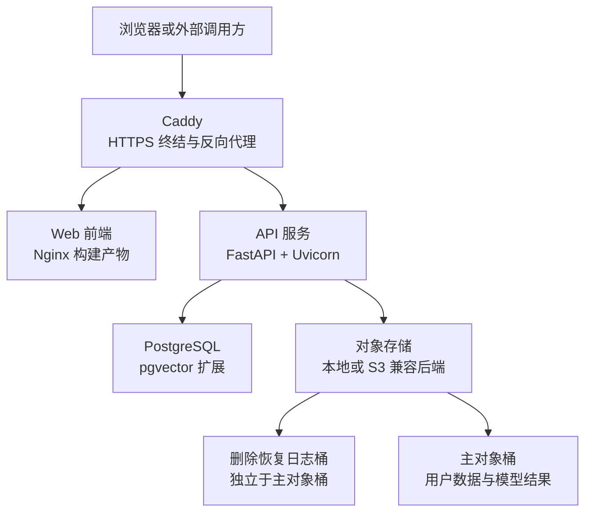
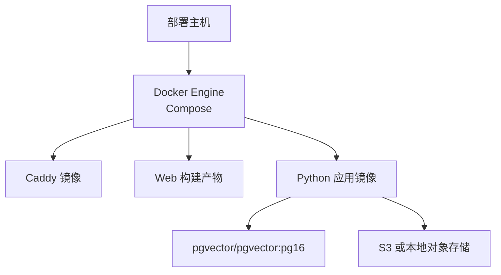
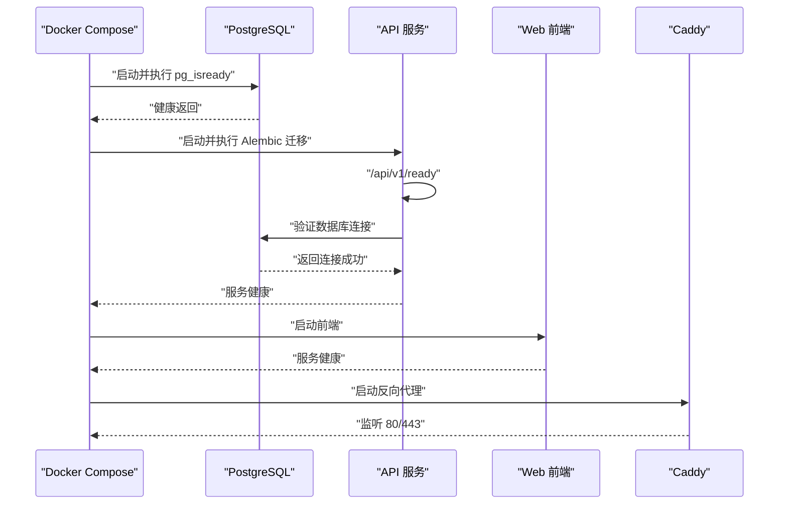
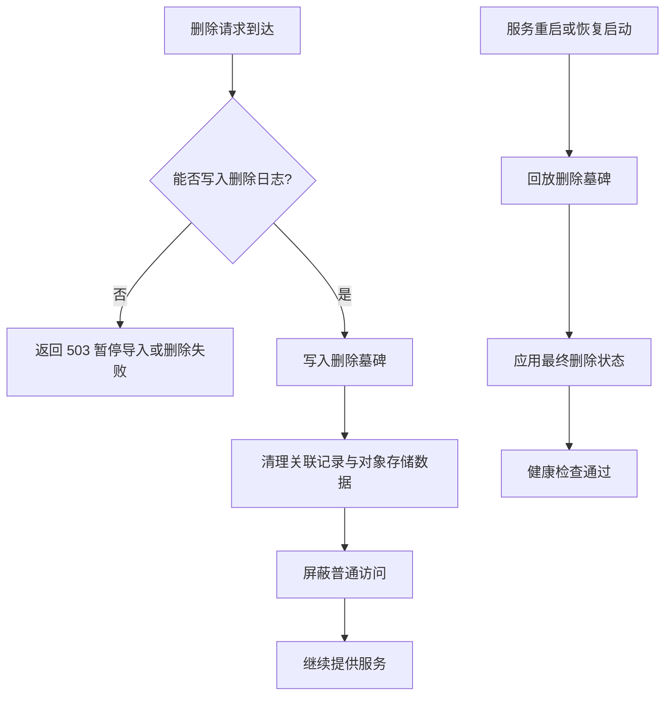
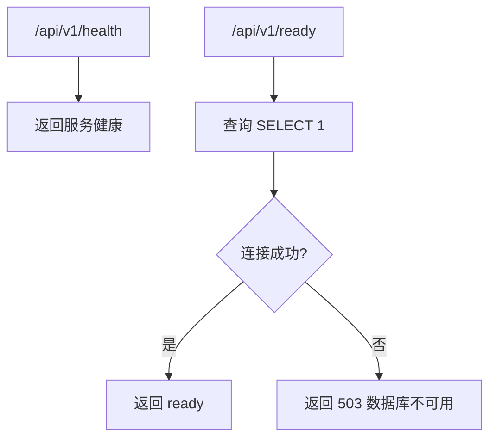
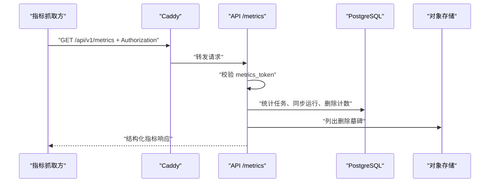
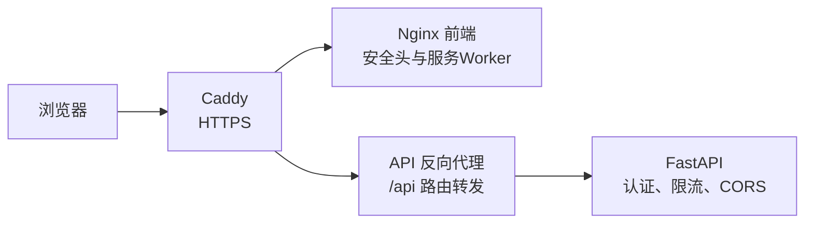
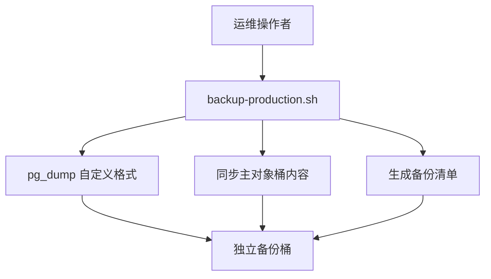
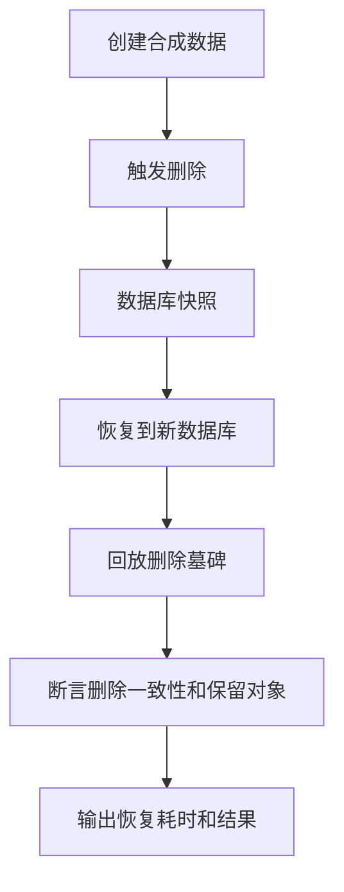
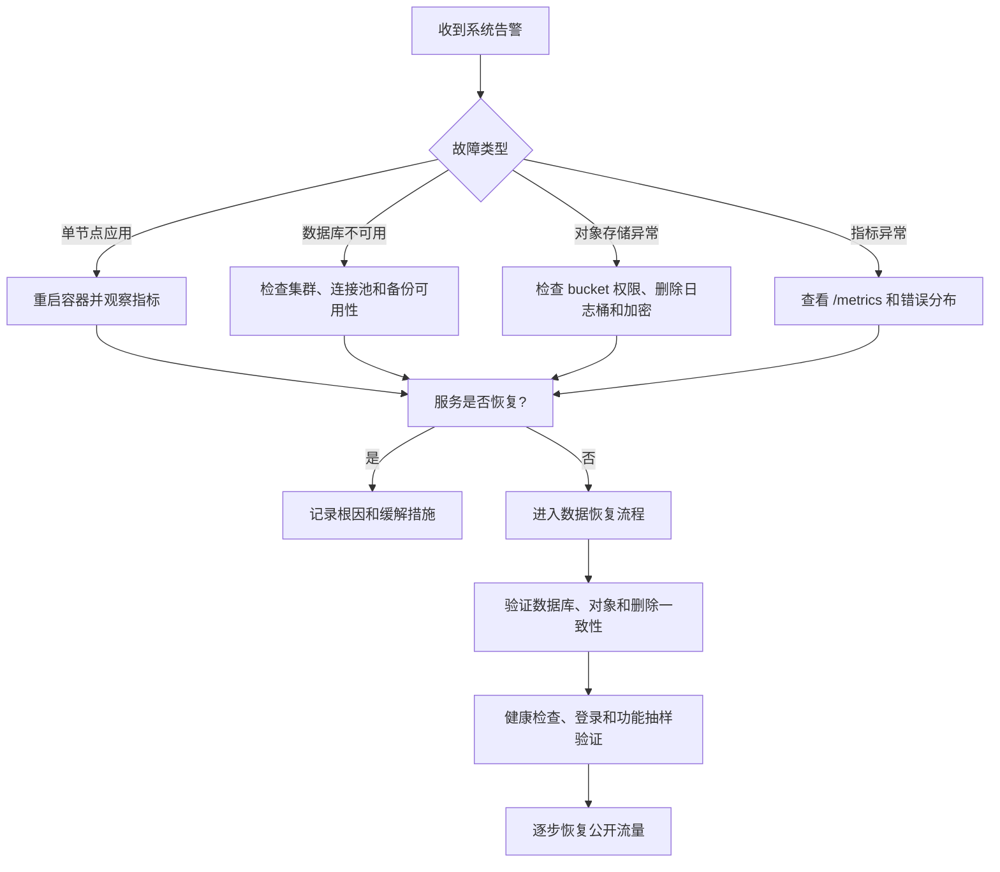

# 部署与运维

<cite>
**本文引用的文件**   
- [docker-compose.production.yml](file://docker-compose.production.yml)
- [docker-compose.yml](file://docker-compose.yml)
- [Dockerfile](file://Dockerfile)
- [main.py](file://src/personal_ai_life_os/main.py)
- [config.py](file://src/personal_ai_life_os/config.py)
- [health.py](file://src/personal_ai_life_os/api/routes/health.py)
- [metrics.py](file://src/personal_ai_life_os/api/routes/metrics.py)
- [deployment.md](file://docs/operations/deployment.md)
- [backup-restore.md](file://docs/operations/backup-restore.md)
- [release-checklist.md](file://docs/operations/release-checklist.md)
- [nginx.conf](file://web/nginx.conf)
- [privacy.md](file://docs/architecture/privacy.md)
- [backup-production.sh](file://scripts/backup-production.sh)
- [restore-production.sh](file://scripts/restore-production.sh)
- [verify_database_restore.py](file://scripts/verify_database_restore.py)
- [verify_joint_restore.py](file://scripts/verify_joint_restore.py)
</cite>

## 目录

1. [引言](#引言)
2. [项目结构与运行边界](#项目结构与运行边界)
3. [生产系统要求](#生产系统要求)
4. [容器编排与依赖服务](#容器编排与依赖服务)
5. [环境变量与安全配置](#环境变量与安全配置)
6. [对象存储与删除恢复](#对象存储与删除恢复)
7. [健康检查与指标收集](#健康检查与指标收集)
8. [日志、前端安全与访问控制](#日志前端安全与访问控制)
9. [数据备份与恢复策略](#数据备份与恢复策略)
10. [发布流程与灰度发布](#发布流程与灰度发布)
11. [性能调优与容量规划](#性能调优与容量规划)
12. [监控仪表板与告警建议](#监控仪表板与告警建议)
13. [灾难恢复预案](#灾难恢复预案)
14. [常见问题排查](#常见问题排查)
15. [结论](#结论)

## 引言

Personal-AI-Life-OS 是一个以用户为中心的个人上下文采集、审阅和归档系统。它通过 FastAPI 暴露业务接口，使用 PostgreSQL 做持久化存储，并提供可扩展的对象后端（本地文件系统或 S3 兼容存储）。生产部署采用基于 Docker Compose 的服务编排，前置反向代理使用 Caddy，静态 Web 客户端由 Nginx 提供。

该项目的生产部署文档包含以下目标：

- 说明生产环境的机器、镜像、数据库和对象存储要求。
- 给出 Docker Compose 中 PostgreSQL、API、Web 和反向代理的部署顺序和启动逻辑。
- 描述环境变量、敏感信息管理和环境差异化配置原则。
- 介绍健康检查端点、可观测性指标、登录限流、CORS 和安全加固。
- 明确数据库备份、对象存储快照、删除清理恢复和操作审计边界。
- 设计发布、版本对齐、向后兼容性检查和可选的灰度回滚流程。
- 补充性能调优、容量规划和典型故障处理步骤。

**本节不涉及具体源码逐行分析。**

## 项目结构与运行边界

从生产运维角度看，仓库中最关键的部署单元是三个层次：

| 层级 | 组件 | 作用 |
|---|---|---|
| 反向代理层 | Caddy | 对外暴露 80、443；管理 HTTPS 证书；把请求转发到 Web 前端和 API。 |
| 应用层 | API 进程 | FastAPI 应用、Alembic 迁移、后台工作线程、计划任务和删除清理回放。 |
| 数据层 | PostgreSQL | 会话、用户、来源、任务、指标元数据和搜索结果等结构化数据。 |
| 对象存储层 | 本地文件或 S3 兼容后端 | 用户上传的原始内容、模型输出草稿、删除标记和其他对象。 |

图表来源
- [docker-compose.production.yml:3-22](file://docker-compose.production.yml#L3-L22)
- [docker-compose.production.yml:24-48](file://docker-compose.production.yml#L24-L48)
- [docker-compose.production.yml:50-76](file://docker-compose.production.yml#L50-L76)

关键行为来自启动时加载配置、创建数据库连接、初始化对象存储，并在 worker 模式下启动后台任务循环和调度循环。应用状态变量保存设置、数据库引擎、会话工厂、对象存储以及最近的请求样本，这些样本被指标接口用于估算延迟百分位。

**章节来源**
- [main.py:43-106](file://src/personal_ai_life_os/main.py#L43-L106)
- [docker-compose.production.yml:3-101](file://docker-compose.production.yml#L3-L101)

### 运行时入口

API 容器的启动命令执行 Alembic 迁移并启动 Uvicorn。生产镜像默认暴露端口 8000，但生产编排通常只让反向代理访问该端口，而不是直接暴露到公网。

- 入口函数创建应用生命周期管理器。
- `auto_create_schema=false` 时使用 Alembic 迁移。
- worker 模式会启动背景任务和计划任务线程。
- 停止阶段会协调任务线程结束并释放数据库连接。

**章节来源**
- [Dockerfile:17-25](file://Dockerfile#L17-L25)
- [main.py:65-115](file://src/personal_ai_life_os/main.py#L65-L115)
- [docker-compose.production.yml:37-47](file://docker-compose.production.yml#L37-L47)

## 生产系统要求

### 主机与运行环境

| 项目 | 要求 | 说明 |
|---|---|---|
| 操作系统 | Linux | 官方生产 Compose 文档要求具备 Docker Engine 和 Compose 插件的 Linux 主机。 |
| Docker | 支持 Compose v2 | 用于拉起 Caddy、Web、API、PostgreSQL 及数据卷。 |
| 域名 | DNS 指向主机 IP | 用于 Caddy 自动 TLS。 |
| 出站网络 | 需要访问托管 PostgreSQL 和对象存储 | 生产模板通常使用托管数据库和私有 S3 兼容桶。 |
| 入站端口 | TCP 80/443 | 仅面向反向代理公开；不应开放数据库或 API 直连端口。 |
| 磁盘 | 至少满足数据库与对象存储增长需求 | PostgreSQL 数据卷与对象桶应分别考虑容量和保留策略。 |
| 时间 | 稳定的 UTC 时钟 | 任务过期、备份标识和指标窗口都依赖可靠时间。 |

生产部署模板未内建 Redis。当前队列和调度主要依赖 PostgreSQL 中的后台任务表、租赁时长和轮询间隔，因此 PostgreSQL 的性能直接影响批量导入和异步任务吞吐。

**章节来源**
- [docker-compose.production.yml:50-76](file://docker-compose.production.yml#L50-L76)
- [config.py:14-42](file://src/personal_ai_life_os/config.py#L14-L42)
- [deployment.md:108-135](file://docs/operations/deployment.md#L108-L135)
- [privacy.md:30-53](file://docs/architecture/privacy.md#L30-L53)

### 软件与依赖版本约束

| 依赖 | 版本或来源 | 用途 |
|---|---|---|
| Python | 3.12 slim 基础镜像 | 运行 FastAPI 应用。 |
| Alembic | 随项目依赖安装 | 数据库迁移。 |
| uvicorn | 随项目依赖安装 | WSGI/ASGI 服务器。 |
| PostgreSQL | pgvector/pgvector:pg16 | 结构化数据与向量查询扩展。 |
| Tesseract OCR | tesseract-ocr、英文和简体中文语言包 | 照片识别。 |
| Caddy | caddy:2-alpine | 反向代理与 TLS。 |
| Nginx | 由 web/Dockerfile 构建前端的镜像包含 Nginx 配置 | 静态前端资源和服务 Worker 相关配置。 |
| AWS CLI | 备份恢复脚本需要 | 与 S3 兼容对象存储交互。 |

图表来源
- [Dockerfile:1-16](file://Dockerfile#L1-L16)
- [docker-compose.production.yml:3-48](file://docker-compose.production.yml#L3-L48)
- [docker-compose.production.yml:50-76](file://docker-compose.production.yml#L50-L76)

**章节来源**
- [Dockerfile:1-25](file://Dockerfile#L1-L25)
- [docker-compose.production.yml:3-76](file://docker-compose.production.yml#L3-L76)

## 容器编排与依赖服务

### 服务依赖与启动顺序

生产编排中的服务启动不是完全并行，而是依赖关系与健康检查驱动的链式启动：

1. PostgreSQL 必须健康，才允许 API 启动。
2. API 的 `ready` 端点能访问数据库后才认为自身就绪。
3. Web 前端等待 API 就绪。
4. Caddy 在 Web 就绪后接管流量。

图表来源
- [docker-compose.production.yml:3-48](file://docker-compose.production.yml#L3-L48)
- [docker-compose.production.yml:50-76](file://docker-compose.production.yml#L50-L76)

### PostgreSQL 配置

生产数据库使用 `pgvector/pgvector:pg16`，通过环境变量传递数据库名、用户名和密码。数据存储挂载到持久卷 `postgres_data`。

- 建议使用托管 PostgreSQL，并启用加密、私网接入和最小权限账号。
- 不要在生产中使用开发默认的用户名、密码或随机名称。
- 如果部署自定义基础镜像，应确认已安装 `pg_trgm` 扩展以满足搜索索引迁移条件；否则降级为 `LIKE` 路径。

搜索索引方面，SQLite 使用本地 FTS5 trigram，而 PostgreSQL 迁移尝试安装 `pg_trgm` 并创建多个 GIN 索引。若扩展不可用，搜索仍可通过现有 `LIKE` 路径进行候选匹配，但最终所有权、删除状态和当前版本过滤仍然严格执行。

**章节来源**
- [docker-compose.production.yml:50-76](file://docker-compose.production.yml#L50-L76)
- [deployment.md:136-162](file://docs/operations/deployment.md#L136-L162)

### Redis 集成现状

当前仓库没有 Redis 服务定义。队列依赖 `BackgroundJob` 表、工作线程的租约时长和轮询间隔，计划任务也通过独立的调度线程实现。Redis 可以作为未来增强点，例如缓存热点源、任务状态或分布式锁，但本指南不假定其可用。

在引入 Redis 前需回答：

| 问题 | 推荐评估方式 |
|---|---|
| 是否出现数据库负载过高 | 观察 `queued_jobs`、`job_queue_oldest_seconds` 和数据库慢查询。 |
| 是否需要多进程任务竞争 | 当前单进程即可使用数据库租约；多进程可评估外部分布式锁。 |
| 是否需要持久化速率限制 | 当前速率限制基于内存缓冲。 |
| 是否能接受 Redis 新增故障面 | 增加 Redis 会提高可用性依赖。 |

在未引入 Redis 的生产环境中，应将 PostgreSQL 视为唯一状态后端，并确保足够的连接池、索引和 CPU 能力。

**本节不涉及具体源码片段。**

## 环境变量与安全配置

### 核心环境变量分类

| 类别 | 关键字段 | 生产要求 |
|---|---|---|
| 运行环境 | `APP_ENV`、`API_HOST`、`API_PORT` | 生产设为 `production`，API 绑定 `0.0.0.0:8000`。 |
| 数据库 | `DATABASE_URL` | 指向私有 PostgreSQL，URL 密码需 URL 编码。 |
| 认证密钥 | `ACCESS_TOKEN_SECRET` | 生产唯一且长度不少于 32 字符。 |
| 注册模式 | `REGISTRATION_MODE`、`SIGNUP_INVITE_CODE` | 生产禁止开放注册，邀请码不可为空。 |
| 指标访问 | `METRICS_TOKEN` | 生产唯一且长度不少于 32 字符。 |
| 跨域 | `CORS_ORIGINS` | 仅允许部署域的前缀，不能含 `localhost` 或环回地址。 |
| 对象存储 | `OBJECT_STORE_BACKEND`、`S3_*` | 生产要求 S3 兼容后端，且删除日志桶不得与主桶同名。 |
| 模型提供者 | `MODEL_PROVIDER`、`OPENAI_*` | 可选，需要隐私披露、价格字段和预算上限。 |

配置文件类从环境变量加载 Settings，并使用 Pydantic 的类型校验。生产模式的 validator 会对密钥长度、注册模式、跨域来源、对象存储、删除日志桶和模型定价进行强制约束。

**章节来源**
- [config.py:14-132](file://src/personal_ai_life_os/config.py#L14-L132)
- [docker-compose.production.yml:18-48](file://docker-compose.production.yml#L18-L48)

### 敏感信息管理

仓库默认允许读取 `.env`，并通过 `pydantic_settings.BaseSettings` 注入。生产部署应避免以下做法：

- 将 `.env` 提交到代码库。
- 使用开发默认 secret。
- 把凭据写进日志。
- 对数据库密码不做 URL 编码导致环境变量解析失败。
- 共用一个域名或桶命名给所有环境。

推荐方案包括：

- 使用宿主机的加密卷或云平台 Key Manager。
- 使用 CI 拉取密钥写入受控运行容器。
- 使用 Kubernetes Secrets、云厂商参数系统或 Vault。
- 定期轮换 `ACCESS_TOKEN_SECRET`、`METRICS_TOKEN`、数据库密码和对象存储凭据。
- 在变更单中记录影响范围和不记录敏感值本身。

### 环境差异化配置

| 环境 | 用途 | 默认行为 |
|---|---|---|
| development | 本地开发 API、开发前端、SQLite。 | 可本地直连 8000、5173、5432。 |
| test | 单元测试、集成测试。 | 关闭交互式文档和外部暴露。 |
| production | 多人访问、TLS、私有数据库、S3 对象存储。 | 关闭 `/docs`、强制 worker 模式、禁用自注册。 |
| desktop | 桌面端内置模式。 | 需要每个启动会话的唯一桌面密钥，启用本地路径权限。 |

开发 compose 使用 SQLite 和本地对象存储以便本地快速调试；生产 compose 则强制使用 PostgreSQL、S3 兼容后端和 worker 模式。

**章节来源**
- [config.py:14-48](file://src/personal_ai_life_os/config.py#L14-L48)
- [docker-compose.yml:1-78](file://docker-compose.yml#L1-L78)
- [docker-compose.production.yml:18-48](file://docker-compose.production.yml#L18-L48)

## 对象存储与删除恢复

### 对象存储后端

应用支持 `local` 和 `s3` 两种后端。生产应使用 S3 兼容后端，并将主对象桶与删除恢复日志桶分开。

| 配置键 | 含义 |
|---|---|
| `OBJECT_STORE_BACKEND` | 对象存储后端类型。 |
| `S3_BUCKET` | 主对象桶。 |
| `S3_REGION` | 区域。 |
| `S3_ENDPOINT_URL` | S3 兼容网关或自定义端点。 |
| `S3_DELETION_JOURNAL_BUCKET` | 删除回收站或墓碑记录桶。 |
| `S3_DELETION_JOURNAL_REGION` | 日志桶区域覆盖。 |
| `S3_DELETION_JOURNAL_ENDPOINT_URL` | 日志桶端点覆盖。 |

生产 validator 要求：

- 对象存储后端必须是 `s3`。
- `S3_BUCKET` 不为空。
- `S3_DELETION_JOURNAL_BUCKET` 存在。
- 主桶与删除日志桶名称不同。

### 删除与恢复流程

删除流程并不只是简单删除对象：系统先写入对象存储中的删除标记或墓碑，再清理关联资源，随后在启动时回放这些墓碑，确保恢复后的数据库状态与实际删除意图一致。

图表来源
- [main.py:43-115](file://src/personal_ai_life_os/main.py#L43-L115)
- [health.py:14-27](file://src/personal_ai_life_os/api/routes/health.py#L14-L27)
- [privacy.md:30-53](file://docs/architecture/privacy.md#L30-L53)

生产对象桶应具备：

- 阻止公共访问。
- 服务端加密。
- 按版本管理时的完整删除覆盖验证。
- 最少权限凭证：读写指定前缀和版本列表、删除旧版本。
- 与备份桶和删除日志桶分开。

**章节来源**
- [config.py:44-76](file://src/personal_ai_life_os/config.py#L44-L76)
- [docker-compose.production.yml:18-48](file://docker-compose.production.yml#L18-L48)
- [deployment.md:163-191](file://docs/operations/deployment.md#L163-L191)
- [privacy.md:30-53](file://docs/architecture/privacy.md#L30-L53)

## 健康检查与指标收集

### 健康端点

API 提供两个常用端点：

| 端点 | 方法 | 作用 |
|---|---|---|
| `/api/v1/health` | GET | 轻量存活检查。 |
| `/api/v1/ready` | GET | 检查数据库连接；连接失败返回 503。 |

生产 Compose 使用 `/ready` 作为健康检查入口。该端点会执行一次 SQL，如果失败则返回带错误代码的响应，便于负载均衡器判断服务是否真正可用。

图表来源
- [health.py:10-27](file://src/personal_ai_life_os/api/routes/health.py#L10-L27)
- [docker-compose.production.yml:37-47](file://docker-compose.production.yml#L37-L47)

### 指标接口

`/api/v1/metrics` 需要在请求头中提供 Authorization Bearer Token，Token 必须与配置的 `metrics_token` 匹配。

指标包括：

| 指标组 | 主要数值 |
|---|---|
| HTTP 质量 | 采样请求数、5xx 比例、P95 延迟。 |
| 导入任务 | 最近 24 小时失败数、处理中数量。 |
| 后台任务 | 排队数、运行数、24 小时失败数、最旧队列年龄。 |
| 删除状态 | 待处理删除数、最久等待秒数、P95 持续时间。 |
| 模型调用 | 调用次数、失败次数、预算回退次数、输入输出 token、估计成本。 |
| 账户与来源 | 正在删除的来源、请求删除的账户。 |

图表来源
- [metrics.py:1-129](file://src/personal_ai_life_os/api/routes/metrics.py#L1-L129)
- [docker-compose.production.yml:18-48](file://docker-compose.production.yml#L18-L48)

注意：指标中的数据不包含用户源内容或图像字节，也不包含用户身份，只包含聚合计数、token 用量和估计成本。但是 Prometheus 抓取链路仍需保持私密访问。

**章节来源**
- [health.py:10-27](file://src/personal_ai_life_os/api/routes/health.py#L10-L27)
- [metrics.py:1-129](file://src/personal_ai_life_os/api/routes/metrics.py#L1-L129)

## 日志、前端安全与访问控制

### 反向代理与安全头

生产推荐使用 Caddy 作为 HTTPS 入口；仓库同时包含 Nginx 配置示例，其中设置了多种安全响应头。

| 安全头 | 值 | 目的 |
|---|---|---|
| `X-Content-Type-Options` | `nosniff` | 防止 MIME 嗅探。 |
| `X-Frame-Options` | `DENY` | 防止点击劫持。 |
| `Referrer-Policy` | `no-referrer` | 减少referrer泄露。 |
| `Content-Security-Policy` | 严格自域策略 | 限制脚本、连接目标和对象加载。 |

注意：此 CSP 允许内联样式，生产可根据实际前端构建情况进一步收紧。API 路由通过 CORS 中间件设置允许的跨域来源，且生产 validator 禁止包含 `localhost` 或环回地址。

图表来源
- [nginx.conf:1-37](file://web/nginx.conf#L1-L37)
- [docker-compose.production.yml:3-22](file://docker-compose.production.yml#L3-L22)
- [main.py:146-217](file://src/personal_ai_life_os/main.py#L146-L217)

### 登录保护与限流

应用实现简单的基于客户端 IP 的请求计数：

| 路由 | 限制窗口 | 限制次数 | 额外控制 |
|---|---:|---:|---|
| POST 登录 | 300 秒 | 10 次 | 返回 429。 |
| POST 注册 | 3600 秒 | 可配置默认值 | 生产禁止开放注册。 |
| 来源导入 | 60 秒 | 30 次 | 可通过 `IMPORTS_ENABLED` 整体暂停导入。 |

当导入被暂停时，对应上传接口返回 503；读路径应保持可用。这种全局暂停可作为紧急防护机制，防止大规模导入造成系统过载。

**章节来源**
- [nginx.conf:1-37](file://web/nginx.conf#L1-L37)
- [main.py:146-217](file://src/personal_ai_life_os/main.py#L146-L217)

## 数据备份与恢复策略

### 备份范围

备份应覆盖：

1. PostgreSQL 自定义格式转储。
2. 主对象存储桶中的对象内容。
3. 备份清单，包含备份 ID、创建时间和关联的删除日志桶。

生产脚本会将数据库转储、对象内容和 manifest 复制到单独的备份桶，并使用 AES256 服务端加密。备份桶不得与主对象桶或删除日志桶相同。

图表来源
- [backup-production.sh:1-55](file://scripts/backup-production.sh#L1-L55)
- [backup-restore.md:1-33](file://docs/operations/backup-restore.md#L1-L33)

### 恢复过程

恢复脚本会：

1. 验证备份 ID 和时间戳格式。
2. 校验备份桶与主桶、日志桶分离。
3. 要求操作者再次输入备份 ID 确认。
4. 从备份桶下载数据库转储和清单。
5. 检查清单中的删除日志桶是否一致。
6. 停止 Caddy、Web 和 API 服务。
7. 先拉起 PostgreSQL。
8. 同步对象到主对象桶。
9. 使用 `pg_restore --clean` 恢复数据库。
10. 重新启动服务，使应用能够回放删除墓碑并达到 `/ready`。

对于数据库和主对象桶同时丢失的情况，需要先切换到新的主对象桶，然后依靠独立保存的删除日志桶重建删除一致性。

**章节来源**
- [restore-production.sh:1-63](file://scripts/restore-production.sh#L1-L63)
- [backup-restore.md:1-33](file://docs/operations/backup-restore.md#L1-L33)

### 演练与自动化

#### 单元测试化恢复演练

`verify_database_restore.py` 会在本地开发栈中：

- 创建一个新账户和测试数据。
- 模拟一条删除操作。
- 导出数据库。
- 恢复到一个临时数据库。
- 回放删除墓碑。
- 断言已删除项确实被删除，而控制项仍可读。

`verify_joint_restore.py` 更进一步：

- 使用 Moto 作为本地 S3 模拟器。
- 创建主桶、恢复桶和日志桶。
- 模拟删除、暂停源、拒绝导入等边界行为。
- 模拟日志桶暂时不可用的删除场景。
- 销毁主数据库和桶后进行恢复。
- 验证恢复后的数据删除一致性。

图表来源
- [verify_database_restore.py:1-100](file://scripts/verify_database_restore.py#L1-L100)
- [verify_joint_restore.py:1-173](file://scripts/verify_joint_restore.py#L1-L173)

#### 自动化建议

脚本本身适合作为手动运行手册和演练用例，但如果要纳入生产自动化，建议改为：

- 在独立 CI runner 上执行。
- 从密钥管理服务读取备份访问凭据。
- 不依赖宿主机上的共享 `.env`，而是在 job 内部注入。
- 将备份成功状态推送至监控系统和工单平台。
- 失败时发送高严重级别告警。
- 保留最后一次恢复演练结果的审计证据。

**章节来源**
- [scripts/backup-production.sh:1-55](file://scripts/backup-production.sh#L1-L55)
- [scripts/restore-production.sh:1-63](file://scripts/restore-production.sh#L1-L63)
- [scripts/verify_database_restore.py:1-100](file://scripts/verify_database_restore.py#L1-L100)
- [scripts/verify_joint_restore.py:1-173](file://scripts/verify_joint_restore.py#L1-L173)
- [docs/operations/backup-restore.md:1-33](file://docs/operations/backup-restore.md#L1-L33)

## 发布流程与灰度发布

### 版本号管理

应用版本号来自 Python 包的 `__version__`，并出现在 FastAPI 元数据中。迁移由 Alembic 管理，每个迁移代表数据库结构的一次演进。发布前必须：

1. 更新源代码版本。
2. 编写或确认 Alembic 迁移。
3. 保证迁移有向下兼容的数据语义。
4. 执行 `alembic check` 确认模型无漂移。
5. 在预发布环境跑通迁移和核心端到端测试。

生产文档列出了 v0.5 起的主要迁移 revision，说明回滚需要理解每张表的增量变化，并优先使用正向修复而非原地降级。

### 向后兼容性检查

| 检查项 | 方法 |
|---|---|
| 数据库结构 | 在只读副本或预览环境应用迁移。 |
| API 接口 | 运行现有请求集和 E2E 测试。 |
| Web 前端 | 生产构建并通过 PWA 安装路径。 |
| 对象存储 | 校验旧格式对象仍可被读取。 |
| 模型提供者 | 使用本地或受限提供者验证调用路径。 |
| 角色权限 | 覆盖匿名、所有者、其他用户、删除和撤销源等场景。 |

发布清单明确要求：Lint、测试、Web 构建、Compose 配置校验、README 支持和支持矩阵均已通过，但真实数据的多租户 beta 仍被标注为“未准备”。这符合最小风险发布的实践：先把非人风险场景闭环，再逐步扩大受众。

### 灰度发布与回滚

#### 灰度策略

| 灰度阶段 | 流量比例 | 判定标准 |
|---|---:|---|
| 蓝绿或金丝雀 | 1% | `/health`、`/ready`、`/metrics` 无异常。 |
| 小规模用户 | 1%~5% | 导入成功率、P95 延迟和 5xx 稳定。 |
| 扩大灰度 | 10%~50% | 任务队列延迟、模型预算和对象删除正常。 |
| 全量上线 | 100% | 备份恢复演练通过，告警阈值无持续触发。 |

建议在灰度期间：

- 使用新标签部署新版本。
- 新旧版本共享同一数据库。
- 新数据库变更后不允许回退旧代码镜像。
- 只回滚镜像，不回滚数据。
- 使用反向代理开关切换权重。
- 观察指标中的 P95 延迟、错误率和队列最老年龄。

#### 回滚策略

| 失败类型 | 正确动作 | 禁止动作 |
|---|---|---|
| 新功能 Bug | 切回上一版本镜像 | 回滚数据库。 |
| 迁移错误 | 先停止流量，评估修复后再重新迁移。 | 跳过迁移或手动改表。 |
| 性能退化 | 回滚镜像并扩容资源。 | 盲目增大连接数。 |
| 数据不一致 | 恢复已验证备份并重新回放删除日志。 | 在不回放墓碑的情况下恢复数据库。 |

**章节来源**
- [main.py:117-144](file://src/personal_ai_life_os/main.py#L117-L144)
- [deployment.md:192-224](file://docs/operations/deployment.md#L192-L224)
- [release-checklist.md:1-37](file://docs/operations/release-checklist.md#L1-L37)
- [privacy.md:47-53](file://docs/architecture/privacy.md#L47-L53)

## 性能调优与容量规划

### 应用层

| 优化方向 | 建议 |
|---|---|
| 进程数 | 根据 CPU 核数和 I/O 并发选择 1~N 个 API 实例；单进程更容易追踪 worker 线程。 |
| 队列模型 | 优先使用 worker 模式，避免阻塞在线请求。 |
| 导入限流 | 根据上游限速和磁盘 IO 调整默认请求频率。 |
| 模型成本 | 设置合理的每百万 token 价格和单次调用上限，避免无限消耗。 |
| OCR | Tesseract 需要足够内存；大图像批处理可能引发峰值内存压力。 |

worker 模式适合 OCR、外部审查和用户请求的照片描述。inline 模式适合本地单实例快速实验，但不具备生产推荐的持久化任务队列语义。

### 数据库层

| 指标 | 关注点 |
|---|---|
| 活跃连接数 | 接近最大连接数时会导致连接耗尽。 |
| 事务延迟 | 长时间导入会影响用户页面加载。 |
| 索引缺失 | 导入频繁字段缺少索引会增加扫描。 |
| VACUUM/ANALYZE | PostgreSQL 在大量增删后需要统计信息和清理。 |
| 向量索引 | 如需向量检索，需评估 HNSW 或 IVFFlat 的成本。 |

### 对象存储层

| 维度 | 容量公式思路 |
|---|---|
| 主对象存储 | = 活跃对象大小 × 增长率 × 保留天数 + 删除残留。 |
| 备份对象存储 | = 每日快照大小 × 保留天数 + 生命周期过渡空间。 |
| 删除日志 | = 删除事件数 × 平均墓碑大小 × 保留窗口。 |
| 带宽 | = 每日增量对象大小 + 恢复流量。 |

注意：生产文档要求删除日志桶位于独立的故障域，以避免“数据库、对象桶、删除日志桶同时在同一个灾备事故中损坏”。

### 反压与降级

| 场景 | 当前机制 | 扩展建议 |
|---|---|---|
| 登录暴力破解 | 请求计数限流 | 结合 WAF、IP 白名单和行为风控。 |
| 导入过载 | 每来源导入限流 + 全局暂停 | 增加队列深度、消费者数和磁盘容量。 |
| 模型额度耗尽 | 预算回退和本地模板 | 提前告警，禁止自动扩大额度。 |
| 对象删除日志不可用 | 返回 503 暂停删除/导入 | 显示可恢复错误，不降级为静默失败。 |
| 队列积压 | 指标暴露 `job_queue_oldest_seconds` | 自动扩缩 worker 或导入分片。 |

[本节提供通用运维指导，不引用特定源码段落]

## 监控仪表板与告警建议

### 必要指标面板

建议至少维护以下四个面板：

| 面板 | 指标 | 预警意义 |
|---|---|---|
| 服务健康 | `/health`、`/ready` 可达性 | 立即发现应用或数据库不可用。 |
| 响应质量 | P95 延迟、HTTP 5xx、登录和导入限流 | 检测性能退化和滥用。 |
| 队列与导入 | 排队数、运行数、失败数、队列最老时间 | 发现后台任务堵塞。 |
| 外部模型 | 调用次数、失败率、预算回退、估计成本 | 控制费用和可用性。 |
| 删除恢复 | 待处理删除、最久等待时间、P95 持续时间 | 检测数据一致性风险。 |
| 存储 | 桶大小、版本数、删除残留对象、备份状态 | 预防存储泄漏和备份失效。 |

### 告警规则建议

| 规则 | 持续时间 | 严重级别 | 动作 |
|---|---:|---:|---|
| `/ready` 不可达 | 5 分钟 | 紧急 | 通知 on-call、检查数据库和迁移。 |
| 5xx 错误超过阈值 | 10 分钟 | 高 | 回滚最近发布、分析错误码。 |
| 队列最老任务超过 30 分钟 | 15 分钟 | 高 | 扩容 worker 或调查死锁。 |
| 模型预算回退持续增长 | 2 小时 | 中 | 核对 token 用量和价格配置。 |
| 删除等待超过 30 分钟 | 20 分钟 | 高 | 检查对象存储权限和日志桶可用性。 |
| 备份连续失败 | 1 天 | 紧急 | 人工介入备份系统。 |

### 指标采集方案

| 组件 | 采集方式 |
|---|---|
| 应用指标 | 定期抓取 `/api/v1/metrics`。 |
| 日志 | 收集容器 stdout/stderr 到集中式日志系统。 |
| 数据库 | 查询 PostgreSQL 状态、慢查询、复制延迟。 |
| 对象存储 | 通过桶指标或对象 API 统计体积和请求数。 |
| TLS | 监控证书到期时间。 |
| 反向代理 | 监控上游返回码、TLS 握手失败和上游超时。 |

指标接口需要通过 Authorization 头访问，因此采集器必须从密钥管理系统安全获取 `METRICS_TOKEN`，并限制采集网络的暴露面。

[本节为概念性监控设计，不直接映射源码实现细节]

## 灾难恢复预案

### 分级事件

| 等级 | 定义 | RTO/RPO 参考 |
|---|---|---:|
| L1 | 单个前端或代理故障 | RTO < 5 分钟，RPO ≈ 0。 |
| L2 | API 或 worker 崩溃 | RTO < 15 分钟，RPO ≤ 最新备份。 |
| L3 | PostgreSQL 单机故障 | RTO < 30 分钟，RPO ≤ 最新备份。 |
| L4 | 主对象存储丢失 | RTO > 1 小时，依赖备份桶与删除日志桶。 |
| L5 | 数据与对象桶同时丢失 | RTO 最长，依赖离线或异地备份。 |

### 决策树

### 灾难恢复步骤

1. 隔离公开流量或切换至只读模式。
2. 确认哪一层的依赖不可用：数据库、对象存储、模型服务、TLS、DNS。
3. 若有可替换实例，先切换到备用副本。
4. 无法自愈时开始恢复：先对象内容，再数据库。
5. 确认删除日志桶与备份清单中的信息一致。
6. 启动 API，等待 `/ready`。
7. 使用合成账户验证账号、来源、时间线和归档行为。
8. 检查删除对象的桶版本或标记已被正确清理。
9. 记录 RTO、RPO、受影响用户和数据差异。

**章节来源**
- [docker-compose.production.yml:3-48](file://docker-compose.production.yml#L3-L48)
- [restore-production.sh:1-63](file://scripts/restore-production.sh#L1-L63)
- [privacy.md:47-53](file://docs/architecture/privacy.md#L47-L53)

## 常见问题排查

| 现象 | 可能原因 | 排查步骤 | 缓解措施 |
|---|---|---|---|
| `/ready` 返回 503 | 数据库不可用或迁移未完成 | 检查 `db` 容器健康状态和连接参数。 | 固定数据库地址；重试重启；查看日志。 |
| Web 无法访问 API | CORS 配置错误或反向代理路由异常 | 检查浏览器网络面板和 `CORS_ORIGINS`。 | 更新允许来源；确认 Caddy/Nginx 转发到 API。 |
| 登录或注册返回 429 | 触发了速率限制 | 查看客户端 IP 和请求频率。 | 放宽误判来源；加强防刷；检查上游限制。 |
| 对象上传成功但读取返回 404 | 权限、对象键或删除墓碑不一致 | 检查 S3 桶权限、对象前缀和删除日志。 | 重传对象；回放墓碑；检查删除操作。 |
| 删除长时间等待 | 日志桶不可用或删除对象量大 | 查看 `deletion_pending` 和 `deletion_oldest_pending_seconds`。 | 修复日志桶权限；拆分删除任务。 |
| 迁移失败 | 模型驱动与数据库结构不一致 | 运行 `alembic check` 和预览迁移。 | 修正代码或使用备份恢复。 |
| 备份恢复后仍显示已删除项 | 未正确回放删除墓碑 | 验证日志桶与 manifest。 | 确保启动时回放墓碑后再开放流量。 |
| 模型费用异常上升 | 价格配置错误或调用失控 | 查看 `external_model_estimated_cost_usd` 和失败回落。 | 降低配额；纠正单价；关闭外部提供者。 |

### 最小化恢复流程

对于多数生产问题，建议按以下步骤逐步收缩：

1. 确认健康端点。
2. 打开只读或只保留核心 API。
3. 检查日志和指标。
4. 重置可恢复状态（如暂停导入）。
5. 重启单副本验证镜像和迁移。
6. 使用备份验证完整恢复路径。
7. 灰度恢复流量并观察指标。
8. 复盘并更新应急预案。

**章节来源**
- [health.py:10-27](file://src/personal_ai_life_os/api/routes/health.py#L10-L27)
- [metrics.py:38-129](file://src/personal_ai_life_os/api/routes/metrics.py#L38-L129)
- [deployment.md:225-251](file://docs/operations/deployment.md#L225-L251)
- [deployement 文档关于回滚与权限的描述见上文来源链接]

## 结论

Personal-AI-Life-OS 的生产部署核心思想是：**基础设施最小化、数据边界清晰、恢复路径可演练**。

- 使用 Caddy 管理 TLS，仅对外暴露 Web 和受控 API。
- 使用 PostgreSQL 作为强一致主数据源，不再假设 Redis。
- 使用 S3 兼容对象存储承载用户内容和模型输出，并用独立日志桶保证删除一致性。
- 使用严格的 Settings validator 强制生产密钥、对象存储、跨域来源和模型披露配置。
- 使用 Health/Ready/Metrics 三端构建基础可观测性。
- 使用脚本化的数据库转储和对象同步完成备份，并通过本地演练脚本验证删除回放。
- 通过发布前 Checklist 明确“本地候选人”和“面向他人使用的托管 beta”之间的边界。
- 灰度优先回滚镜像而不回滚数据，仅在数据异常时回到已知正确的备份点。

生产环境正式上线前，应至少完成一次真实域的 TLS 检查、一次独立备份桶演练、一次恢复演练、一次删除一致性验证和一次灰度回滚演练，并把全部证据保存在可审计的发布记录中。

**本节为总结性内容，不直接分析具体源码。**