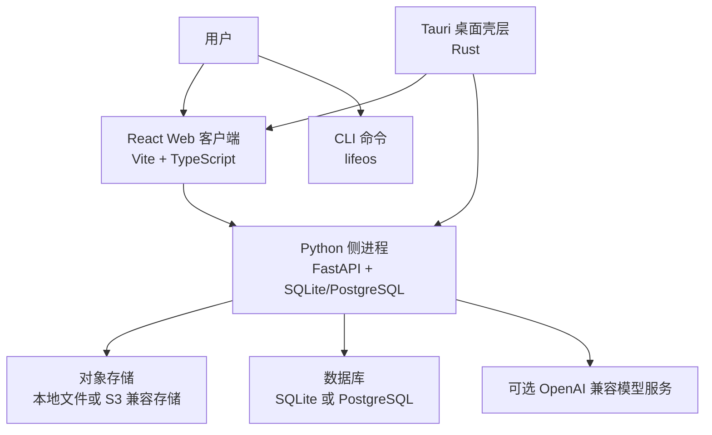
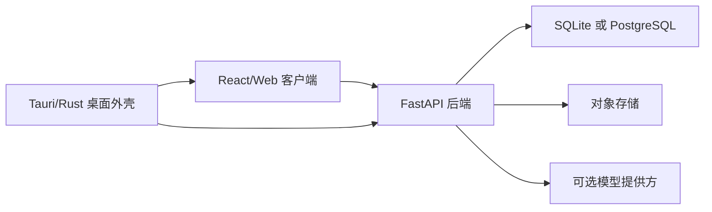
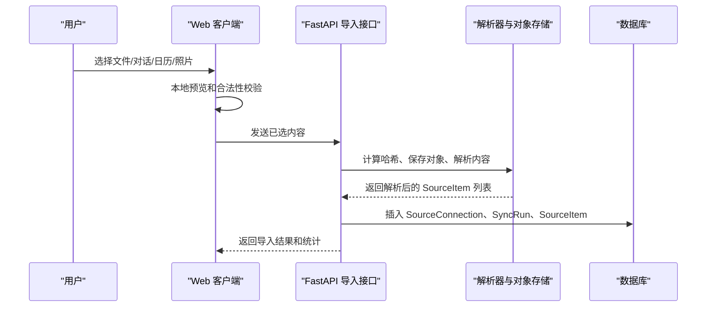
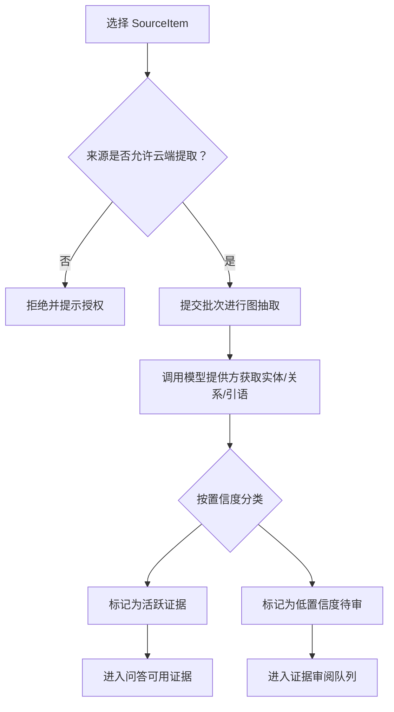
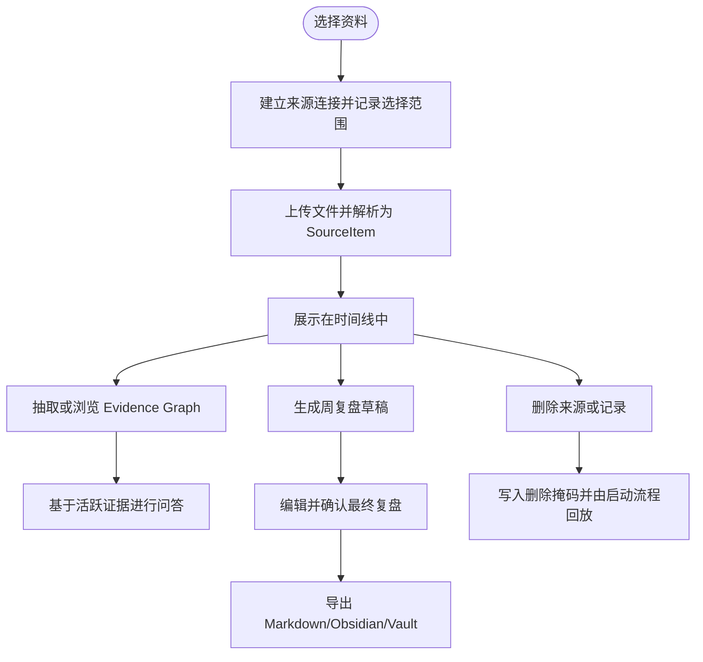
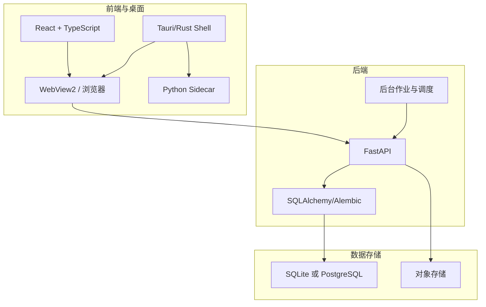
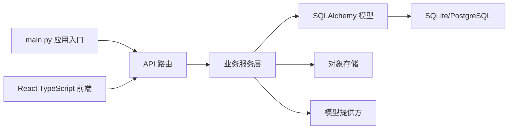

# 项目概览

<cite>
**本文引用的文件**   
- [README.md](file://README.md)
- [产品需求文档（prd.md）](file://docs/product/prd.md)
- [架构总览（overview.md）](file://docs/architecture/overview.md)
- [FastAPI 应用入口 main.py](file://src/personal_ai_life_os/main.py)
- [领域数据模型 models.py](file://src/personal_ai_life_os/models.py)
- [Web 客户端包配置 package.json](file://web/package.json)
- [Web 客户端应用入口 App.tsx](file://web/src/App.tsx)
- [Python 项目与依赖 pyproject.toml](file://pyproject.toml)
- [Windows Tauri/Rust 桌面包 Cargo.toml](file://desktop/src-tauri/Cargo.toml)
</cite>

## 目录
1. [引言](#引言)
2. [项目结构](#项目结构)
3. [核心概念](#核心概念)
4. [架构总览](#架构总览)
5. [核心功能模块](#核心功能模块)
6. [数据处理流程](#数据处理流程)
7. [多语言与 Monorepo 协作关系](#多语言与-monorepo-协作关系)
8. [技术栈与部署拓扑](#技术栈与部署拓扑)
9. [初学者入门路径](#初学者入门路径)
10. [开发者架构理解路径](#开发者架构理解路径)
11. [性能、可靠性与安全特性](#性能可靠性和安全特性)
12. [故障排查建议](#故障排查建议)
13. [结论](#结论)

## 引言

Personal-AI-Life-OS 是一个以用户隐私和控制权为核心的个人知识系统。它帮助用户把散落在聊天记录、日历、照片、记忆文件和快速笔记中的工作学习记录，整理成可搜索、可审查、可引用的时间线、证据图谱和周复盘内容。系统的设计愿景是：用较低的管理负担保存个人资料，让生成的结果始终能够追溯到来源，并支持 Markdown 或 Obsidian 导出，保持数据的可携带性。

项目的 MVP 阶段已经实现了本地 API、命令行工具、Web 客户端、资料导入预览、时间线管理、证据图谱抽取、低置信度证据审阅、中文优先的问答系统、周复盘系统、提醒机制、插件系统和 Windows 桌面打包。不过，项目尚未部署到托管环境，也没有获得处理真实个人资料的授权。因此它更接近一个可以本地运行、逐步验证功能的 MVP 基础系统，而不是面向公开分发的成熟商业产品。

核心价值可以总结为三点：  
1. **选择式采集**：只导入用户明确选择的聊天记录、日历快照、照片或文档。  
2. **可追溯生成**：时间线、复习草稿、证据图谱和提醒都保留来源引用，生成内容不是最终事实，而是需要审阅的对象。  
3. **可迁移记忆**：通过 Markdown、JSON 账户归档和 Obsidian Vault 直写，使个人资料不长期被绑定在某个私有数据库中。

**章节来源**
- [README.md:1-10](file://README.md#L1-L10)
- [产品需求文档（prd.md）:7-21](file://docs/product/prd.md#L7-L21)
- [README.md:11-103](file://README.md#L11-L103)

## 项目结构

仓库采用按职责划分的 Python Web 后端 + TypeScript React 前端 + Rust/Tauri 桌面壳层的多组件 Monorepo 结构。主逻辑集中在 `src/personal_ai_life_os/`，包括 FastAPI 路由、数据库模型、解析器、服务层、CLI 和应用生命周期；Web 客户端集中在 `web/`；桌面包装器和构建脚本在 `desktop/`；数据库迁移集中在 `migrations/`；合成数据和评估脚本集中在 `fixtures/synthetic/` 与 `scripts/`。

从文件层面看，主要组件如下：
- **后端服务**：[FastAPI 应用入口 main.py](file://src/personal_ai_life_os/main.py) 负责创建应用、挂载路由、启动后台 Worker 和调度线程、处理速率限制、桌面认证和健康生命周期。
- **数据模型**：[领域数据模型 models.py](file://src/personal_ai_life_os/models.py) 定义用户、来源连接、同步任务、源条目、审查记录、提醒、模型同意、证据图谱等持久化实体。
- **Web 客户端**：[Web 客户端包配置 package.json](file://web/package.json) 声明 React、TypeScript、Vite、Playwright 和 Tauri 前端相关依赖；[Web 客户端应用入口 App.tsx](file://web/src/App.tsx) 组织页面导航、类型定义、API 调用、任务等待、日历/聊天导入预览和 Obsidian Vault 导出等交互。
- **桌面壳层**：[Windows Tauri/Rust 桌面包 Cargo.toml](file://desktop/src-tauri/Cargo.toml) 使用 Tauri 2、单实例、通知、托盘图标和对话框能力封装 Python 进程。
- **依赖与构建**：[Python 项目与依赖 pyproject.toml](file://pyproject.toml) 定义 Python 运行时、FastAPI、SQLAlchemy、Alembic、OCR、PDF/DOCX/ICS 解析等依赖，以及 `lifeos` CLI 入口。
- **产品与架构说明**：[产品需求文档（prd.md）](file://docs/product/prd.md)、[架构总览（overview.md）](file://docs/architecture/overview.md) 和 [README.md](file://README.md) 提供功能范围、MVP 定位、数据流和部署拓扑描述。

**章节来源**
- [FastAPI 应用入口 main.py:1-200](file://src/personal_ai_life_os/main.py#L1-L200)
- [领域数据模型 models.py:1-260](file://src/personal_ai_life_os/models.py#L1-L260)
- [Web 客户端包配置 package.json:1-29](file://web/package.json#L1-L29)
- [Web 客户端应用入口 App.tsx:1-155](file://web/src/App.tsx#L1-L155)
- [Python 项目与依赖 pyproject.toml:1-58](file://pyproject.toml#L1-L58)
- [Windows Tauri/Rust 桌面包 Cargo.toml:1-19](file://desktop/src-tauri/Cargo.toml#L1-L19)
- [架构总览（overview.md）:1-118](file://docs/architecture/overview.md#L1-L118)

## 核心概念

系统的关键实体和业务术语集中在数据库模型和服务接口中。以下表格列出 MVP 阶段最重要的概念及其作用。

| 核心概念 | 说明 | 对应实现位置 |
|---|---|---|
| `User` | 唯一用户的认证信息、时区、AI 同意和删除状态，拥有隔离的来源、模型同意和同步记录。 | [领域数据模型 models.py](file://src/personal_ai_life_os/models.py) |
| `SourceConnection` | 已授权的资料来源，例如 ChatGPT 导出、图片、文档、ICS 日历或桌面文件夹，包含权限范围和同步状态。 | [领域数据模型 models.py](file://src/personal_ai_life_os/models.py) |
| `SyncRun` | 一次导入或同步任务的统计记录，保存哈希、解析器版本、成功失败计数、错误码和对象存储索引。 | [领域数据模型 models.py](file://src/personal_ai_life_os/models.py) |
| `SourceItem` | 时间线上的可搜索条目，可以是导入项、快速笔记或其他解析产物，具有作者归属、来源、标题、文本内容和发生时间。 | [领域数据模型 models.py](file://src/personal_ai_life_os/models.py) |
| `Review` | 周期性复习草稿或确认后的周复盘，包含引用来源、模型元数据、状态、版本和最终文本。 | [领域数据模型 models.py](file://src/personal_ai_life_os/models.py)、[Web 客户端应用入口 App.tsx](file://web/src/App.tsx#L1-L155) |
| `BackgroundJob` | 后端作业表（代码命名 `BackgroundJob`），承载图像 OCR、外部模型请求等异步任务，具备重试、超时、租赁和状态流转。 | [FastAPI 应用入口 main.py](file://src/personal_ai_life_os/main.py)、[Web 客户端应用入口 App.tsx](file://web/src/App.tsx#L1-L155) |
| `Evidence Graph` | 从选定证据中提取的实体、关系、精确引语、置信度和可用状态；低置信度内容进入待审队列，高置信度内容进入问答视图。 | [架构总览（overview.md）](file://docs/architecture/overview.md#L1-L118) |
| `Evidence EvidenceRow` | 引用 `Evidence Graph` 的证据行，用于把实体和关系链接回具体 `SourceItem`。 | [架构总览（overview.md）](file://docs/architecture/overview.md#L1-L118) |
| `Insight / InsightDismissal` | 规则洞察，例如过期目标、缺乏后续行动的项目、进展停滞项目和证据薄弱技能；误报可通过忽略键避免重复。 | [架构总览（overview.md）](file://docs/architecture/overview.md#L1-L118) |
| `AgentAction` | Agent 内部写入动作，如提醒、任务、项目、成长记录和复习草稿；支持审计和限时撤销。 | [架构总览（overview.md）](file://docs/architecture/overview.md#L1-L118) |
| `PluginManifest / PluginAuditLog` | 插件清单、权限声明和调用审计日志；未声明权限一律拒绝，插件故障不得影响主流程。 | [架构总览（overview.md）](file://docs/architecture/overview.md#L1-L118) |
| `ModelConsent / ModelRun` | 按提供方的模型使用同意记录和用量指标，追踪成本、令牌数、延迟和失败预留，但不存储原始源内容。 | [架构总览（overview.md）](file://docs/architecture/overview.md#L1-L118)、[领域数据模型 models.py](file://src/personal_ai_life_os/models.py) |

这些概念共同构成了“采集 → 保留来源 → 生成 → 审查 → 确认 → 回顾”的知识闭环。MVP 的设计重点是保留来源、降低自动化风险，并在必要时才调用外部模型。

**章节来源**
- [领域数据模型 models.py:1-260](file://src/personal_ai_life_os/models.py#L1-L260)
- [架构总览（overview.md）:1-118](file://docs/architecture/overview.md#L1-L118)
- [Web 客户端应用入口 App.tsx:1-155](file://web/src/App.tsx#L1-L155)

## 架构总览

系统由三层组成：  
- **前端层**：基于 React 和 TypeScript 的 Web 界面，支持本地开发、PWA、Obsidian 目录直写、移动端捕获页和桌面端 WebView2 内嵌 UI。  
- **服务端层**：Python FastAPI 应用，统一暴露来源管理、导入解析、时间线、搜索、证据图谱、问答、复盘、提醒、预算、插件和后台作业等 API。  
- **基础设施层**：SQLite 或 PostgreSQL 数据库、本地文件系统或 S3 兼容对象存储、可选 OpenAI 兼容推理服务，以及 Tauri/Rust 的 Windows 桌面外壳。

关键设计原则：  
- 用户可选择要导入的文件和会话，不在未授权情况下抓取私密数据。  
- 原导入内容不可变，解析产物、记忆记录和审查草稿作为独立记录存在。  
- 所有生成结论都附带来源关联，且需要人工确认后成为稳定记忆。  
- 数据导出以 Markdown 和 JSON 为主，保障可移植性。  
- 外部模型调用必须经过来源级别的云提取授权和月度预算控制。

**图表来源**
- [架构总览（overview.md）:13-49](file://docs/architecture/overview.md#L13-L49)
- [FastAPI 应用入口 main.py:1-200](file://src/personal_ai_life_os/main.py#L1-L200)
- [产品需求文档（prd.md）:38-96](file://docs/product/prd.md#L38-L96)

**章节来源**
- [架构总览（overview.md）:1-118](file://docs/architecture/overview.md#L1-L118)
- [产品需求文档（prd.md）:7-37](file://docs/product/prd.md#L7-L37)

## 核心功能模块

### 选择性资料导入

系统支持多选 ChatGPT、Claude、Gemini、ZCode、DeepSeek harness、WorkBuddy 的 JSON/JSONL 或 Markdown 导出，以及 TXT、文本型 PDF、DOCX、Photos 和 ICS 日历快照。上传前先预览：对话摘要不直接打印，只展示选择范围；日历预览统计事件数量和重复规则数量，但不会展开 RRULE。上传后通过哈希、外部 ID 和 parser version 进行去重，保证重新导入不会产生重复条目的基本语义。

**图表来源**
- [Web 客户端应用入口 App.tsx:1-L155](file://web/src/App.tsx#L1-L155)
- [FastAPI 应用入口 main.py:1-L200](file://src/personal_ai_life_os/main.py#L1-L200)
- [架构总览（overview.md）:57-L90](file://docs/architecture/overview.md#L57-L90)

### 时间线管理与快速笔记

时间线聚合 `SourceItem`，并按日期、来源、标签、集合、状态和检索结果分组显示。快速笔记本质上是一种特殊的 `SourceItem(kind="quick_note")`，放在每个用户的隐藏内部来源下，因此复用时间线、搜索、审查证据和导出能力，而不会被当作普通外部数据来源删除或暂停。

### 证据图谱抽取

用户从已导入的 `SourceItem` 中选择一批数据，提交给配置的 OpenAI 兼容模型进行实体和关系抽取。响应结果按置信度分流：高置信度成为活跃证据，低置信度进入待审队列；每个证据条目保留精确引语、来源、对象和可用性状态。

**图表来源**
- [架构总览（overview.md）:79-L117](file://docs/architecture/overview.md#L79-L117)

### 问答系统

问答系统在激活证据上回答问题，不强制调用模型接口；当前问答链路返回结构化事实、引用、置信度、事实/推断/不确定标签、缺失信息和行动建议。问题会保存到本地线程，并记住上次作用域，便于跨轮次对话和导出。被撤销来源或删除的证据会被排除。

### 周复盘系统

周复盘支持自动生成、编辑、确认和 Markdown 导出。模板复盘可在外部模型不可用时继续工作；启用外部模型时需要提供方披露同意和预算检查。系统还保留复习历史版本、趋势、承诺、到期日和目标关联信息。

### 提醒系统

提醒由用户确认或通过受控 Agent 动作创建，支持设置、补发、关闭或暂存。Agent 写入提醒前必须有审计记录；涉及花钱、删数据、发送消息或变更目标的动作需要人类批准，否则拒绝执行。

### 预算监控

每次模型运行记录提供方、模型、用途、状态、延迟、输入输出令牌数和估算成本；月度预算到达阈值时会告警并阻止超预算调用。同时提供按天、周、月维度的提供方和用途成本汇总，以及失败预备金额。

### 插件系统

插件通过本地清单安装，分为连接器插件和 Agent 工具插件。连接器参考实现可预览并导入用户选定的 JSON/JSONL/Markdown；Agent 工具参考实现可在所有者范围内的证据上搜索。插件权限必须显式声明，调用失败不影响主应用。

**章节来源**
- [架构总览（overview.md）:57-L117](file://docs/architecture/overview.md#L57-L117)
- [产品需求文档（prd.md）:38-L96](file://docs/product/prd.md#L38-L96)

## 数据处理流程

MVP 的数据流程从用户主动选择内容开始，到可观察、可撤回、可导出的记忆结束。

关键约束：
- 导入内容哈希化，避免重复导入同一份文件产生副本。
- 日历同步使用 UID 作为稳定标识，SEQUENCE 控制版本覆盖。
- 快速笔记的删除仅影响该笔记条目，不会影响同一来源下的其他内容。
- 删除和恢复过程依赖对象存储中的删除掩码，防止数据库恢复后复活已删内容。
- 所有外部模型结果都要回到审阅状态，不能自动变成绝对事实。

**图表来源**
- [FastAPI 应用入口 main.py:1-L200](file://src/personal_ai_life_os/main.py#L1-L200)
- [架构总览（overview.md）:57-L78](file://docs/architecture/overview.md#L57-L78)

## 多语言与 Monorepo 协作关系

项目涉及至少三种语言和生态：
- **Python**：业务后端、CLI、数据库模型、迁移、解析器和评估脚本。
- **TypeScript + React**：Web 客户端和端到端测试。
- **Rust**：Tauri 桌面包装器和 Windows 集成。

它们在部署形态中相互协作：
- **纯 Web 开发**：Node.js 起 Vite 前端，Python 起 FastAPI 服务，两者分别监听本地端口并通过 `/api` 通信。
- **Compose 或生产部署**：Nginx/Caddy 前端代理到 FastAPI，数据库和对象存储由部署配置提供。
- **Windows 桌面**：Rust Tauri shell 启动 WebView2 加载相同 Web 界面，同时监督 Python sidecar、随机回环端口、启动密钥、托盘、自动启动和文件夹权限。

**图表来源**
- [架构总览（overview.md）:19-L48](file://docs/architecture/overview.md#L19-L48)
- [Web 客户端包配置 package.json:1-L29](file://web/package.json#L1-L29)
- [Python 项目与依赖 pyproject.toml:1-L58](file://pyproject.toml#L1-L58)
- [Windows Tauri/Rust 桌面包 Cargo.toml:1-L19](file://desktop/src-tauri/Cargo.toml#L1-L19)

## 技术栈与部署拓扑

### 后端技术栈

| 类别 | 技术 | 作用 |
|---|---|---|
| Web 框架 | FastAPI | REST API、依赖注入、中间件和 OpenAPI 文档。 |
| 数据类型 | Pydantic | 请求响应建模和验证。 |
| ORM | SQLAlchemy | 对象-关系映射和会话工厂。 |
| 迁移 | Alembic | 版本化数据库 schema 演进。 |
| 数据库 | SQLite、PostgreSQL | 本地开发和 Compose/生产环境。 |
| 对象存储 | 本地文件、S3 兼容适配器 | 原始对象、图片和大对象索引。 |
| 解析库 | pypdf、python-docx、icalendar | PDF、DOCX、ICS 日历解析。 |
| 图像处理 | Pillow、pytesseract | 图片缩放、编码转换和内联 OCR。 |
| 认证与安全 | pwdlib、PyJWT | 密码哈希和 JWT 鉴权。 |
| HTTP 客户端 | httpx、boto3 | 模型调用和对象存储访问。 |
| CLI | typer | `lifeos` 命令行注册、登录、预览、同步和导出。 |

**章节来源**
- [Python 项目与依赖 pyproject.toml:1-L58](file://pyproject.toml#L1-L58)
- [架构总览（overview.md）:51-L56](file://docs/architecture/overview.md#L51-L56)

### 前端技术栈

| 类别 | 技术 | 作用 |
|---|---|---|
| 运行时 | React 19 | 时间线、问答、图谱、审查、搜索、设置等界面。 |
| 语言 | TypeScript | 类型化的前端数据和 API 契约。 |
| 构建工具 | Vite | 开发服务器和前端打包。 |
| 测试 | Playwright | 端到端行为验收。 |
| 桌面集成 | @tauri-apps/api | 与 Rust Tauri shell 通信。 |

**章节来源**
- [Web 客户端包配置 package.json:1-L29](file://web/package.json#L1-L29)

### 部署拓扑

| 部署形态 | 前端 | 后端 | 数据库 | 对象存储 | 说明 |
|---|---|---|---|---|---|
| 本地开发 | Vite dev server | uvicorn | 本地 SQLite | 本地 `data/objects` | 适合新手和调试。 |
| Compose | Nginx | FastAPI | PostgreSQL | 容器卷或外部桶 | 更接近生产结构。 |
| 生产模板 | 反向代理 | FastAPI + 可选 worker 模式 | 自建数据库 | 私有的 S3 兼容存储 | 要求运营商提供密钥、备份和证书。 |
| Windows 桌面 | WebView2 | 打包 Python sidecar | SQLite | 本地对象存储 | 无需 Docker，适合单机 MVP。 |

**章节来源**
- [架构总览（overview.md）:19-L78](file://docs/architecture/overview.md#L19-L78)
- [README.md:61-L103](file://README.md#L61-L103)

## 初学者入门路径

如果你是第一次接触 Personal AI Life OS，建议按以下顺序理解项目：

1. **阅读 README**：了解 MVP 已实现能力、本地开发和可选云端模型配置。
2. **阅读产品需求**：理解“为什么需要这个系统”，特别是选择式导入、来源追踪、周期性复盘和导出能力。
3. **运行本地 API**：通过 Python 依赖管理工具安装依赖、执行迁移，然后启动 FastAPI 服务。
4. **打开 Web 界面**：启动 Vite 前端，在本地看到时间线和基础菜单。
5. **进行一次最小导入**：选择一个 ChatGPT 导出或 Markdown，查看时间线如何展示来源和摘要。
6. **尝试周复盘**：生成草稿、编辑后保存，并导出 Markdown。
7. **尝试证据图谱**：选取少量 SourceItem，查看实体、关系和低置信度待审。
8. **探索问答**：在当前激活证据上提问，观察引用和置信度。
9. **了解安全边界**：暂停来源、导出数据、取消模型同意或删除账户。

**章节来源**
- [README.md:11-L42](file://README.md#L11-L42)
- [产品需求文档（prd.md）:38-L66](file://docs/product/prd.md#L38-L66)

## 开发者架构理解路径

如果你想深入源码，应按 API → Service → Model → Storage → Frontend 的顺序推进：

1. 先读 [FastAPI 应用入口 main.py](file://src/personal_ai_life_os/main.py)，理解应用生命周期、路由挂载、后台 Worker、调度线程、桌面模式认证、速率限制和对象存储初始化。
2. 再读 [领域数据模型 models.py](file://src/personal_ai_life_os/models.py)，理解 `User`、`SourceConnection`、`SyncRun`、`SourceItem`、`Review`、`ModelConsent` 等实体的关系。
3. 根据功能模块查找 `services/` 和 `api/routes/`，例如 import、graph、qa、reviews、jobs、plugins、budget 等。
4. 如果修改模型，新增 alembic 迁移；如果需要新功能，同时考虑 Web 端 API 调用和类型。
5. 如果是前端改动，确认是否在 `App.tsx` 中的页面状态、API 类型或 PWA/Obsidian 相关模块中增加调用。
6. 如果是桌面功能，检查 Tauri 壳层和 Python sidecar 的生命周期是否需要同步。

**图表来源**
- [FastAPI 应用入口 main.py:1-L200](file://src/personal_ai_life_os/main.py#L1-L200)
- [领域数据模型 models.py:1-L260](file://src/personal_ai_life_os/models.py#L1-L260)

**章节来源**
- [FastAPI 应用入口 main.py:1-L200](file://src/personal_ai_life_os/main.py#L1-L200)
- [领域数据模型 models.py:1-L260](file://src/personal_ai_life_os/models.py#L1-L260)
- [Web 客户端应用入口 App.tsx:1-L155](file://web/src/App.tsx#L1-L155)
- [架构总览（overview.md）:1-L118](file://docs/architecture/overview.md#L1-L118)

## 性能、可靠性与安全特性

### 性能特征

- 文本上传大小上限为 5 MB，图片上传上限为 20 MB，图片解码上限为 4000 万像素。
- 查询结果默认最多返回 10 条，每组最多 20 条，片段长度限制为 200 字符。
- 每周复盘周期最多接受 500 个来源条目。
- 搜索使用候选索引加权威行二次过滤，避免因过期索引召回已删除内容。
- 图像 OCR 和外部模型任务走后台 Worker，不阻塞 Web 请求。

### 可靠性特性

- 导入过程幂等，重复导入同文件应避免重复产出。
- 异步任务有任务 ID、状态、重试次数和最大尝试数。
- PostgreSQL 下使用独占锁和跳过锁定策略处理竞争，SQLite 使用程序级并发控制。
- 删除采用对象存储中的删除掩码，启动时重放掩码，防止恢复数据库后复活被删数据。
- 日历导入使用 UID 和 SEQUENCE 做增量对齐；RRULE 等无法安全展开的规则被跳过并上报。

### 安全与隐私

- 模型凭据不入库，不提供给客户端，不写入归档和日志。
- 外部模型调用需要来源级别同意、提供方披露同意和预算控制。
- Agent 动作对危险操作实行“人类审批”红线。
- 插件权限白名单化，未声明权限直接拒绝。
- 网页导出时，Obsidian Vault 目录只在浏览器端选择，API 不接收或保存目录路径。

**章节来源**
- [架构总览（overview.md）:87-L117](file://docs/architecture/overview.md#L87-L117)
- [README.md:43-L103](file://README.md#L43-L103)
- [产品需求文档（prd.md）:67-L96](file://docs/product/prd.md#L67-L96)

## 故障排查建议

常见问题可沿着以下方向排查：

| 现象 | 可能原因 | 排查重点 |
|---|---|---|
| 前端调用 API 返回 401 或桌面访问被拒 | 桌面模式缺少或使用了错误的 per-launch secret 头 | 检查 Tauri shell 是否正确传入 `x-lifeos-desktop`。 |
| 导入无新条目 | 文件哈希重复或使用旧版本的日历事件 | 查看 `SyncRun` 和 `SourceItem` 的去重字段。 |
| OCR 文本不出现 | 图像未解析完成、Worker 未启动或配置禁用 | 查看后台作业状态和 `BackgroundJob`。 |
| 外部模型调用失败 | 提供方未同意、凭据缺失、月度预算超限或提供者不可用 | 检查 `ModelConsent`、模型提供方配置和预算接口。 |
| 搜索结果不准确 | 搜索索引落后或缓存候选集陈旧 | 重新构建搜索索引并核对后端数据库状态。 |
| Obsidian 直写失败 | 浏览器不支持 File System Access API、权限被拒绝或文件名冲突 | 检查前端导出错误和覆盖策略选择。 |
| 插件执行报错 | 插件权限不足或入口异常 | 查看插件清单、权限声明和 `PluginAuditLog`。 |

**章节来源**
- [FastAPI 应用入口 main.py:1-L200](file://src/personal_ai_life_os/main.py#L1-L200)
- [Web 客户端应用入口 App.tsx:1-L155](file://web/src/App.tsx#L1-L155)
- [架构总览（overview.md）:51-L117](file://docs/architecture/overview.md#L51-L117)

## 结论

Personal-AI-Life-OS 的 MVP 把重点放在“可控、可追溯、可退出”的个人知识库建设上。它不以追求无限自动化为目标，而是优先保证：  
- 你决定哪些资料进入系统；  
- 系统知道每条生成结果来自哪里；  
- 你能审查、编辑、导出或删除自己的数据；  
- 外部模型调用必须在隐私、预算和同意条件下发生；  
- 数据结构保持轻量，以便迁移到 Markdown、Obsidian 或其他工具。

对于初学者，可以从 README 和本地开发流程入手；对于开发者，应先从 `main.py` 和 `models.py` 建立整体视角，再按功能模块深入后端路由与服务，最后补充 Web 前端和 Tauri 桌面包装。